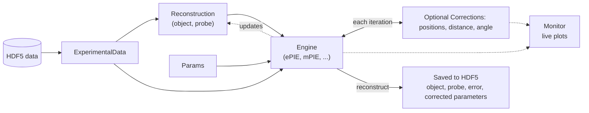

# PtyLab.py: Unified Ptychography Toolbox

[](https://pypi.org/project/ptylab/)

[](https://ptylab.github.io/PtyLab.py/)

[**Key Features**](#key-features) | [**Getting Started**](#getting-started) | [**Installation**](https://ptylab.github.io/PtyLab.py/getting-started/installation/) | [**Documentation**](https://ptylab.github.io/PtyLab.py/)

PtyLab is an inverse modeling toolbox for Conventional (CPM) and Fourier (FPM) ptychography in a unified framework. See the [paper](https://opg.optica.org/oe/fulltext.cfm?uri=oe-31-9-13763&id=529026) for details.

## Key Features

- **Classic engines**: ePIE, mPIE, mqNewton, qNewton
- **Advanced corrections**: position correction, defocus correction (zPIE), angle correction (aPIE), orthogonal probe relaxation (OPR)
- **Multi-modal**: multi-slice, multi-wavelength, mixed-state object and probe
- **Multiple propagators**: Fraunhofer, Fresnel, Angular Spectrum (ASP), scaled ASP, polychromatic variants
- **GPU acceleration**: same code runs on CPU and GPU (NumPy/CuPy)
- **Live monitor**: follow the object, probe, error metric and any corrected parameters (scan positions, sample-detector distance, wavelength, angle) as the iterations run
- **Differentiable ptychography** *(work in progress)*: Optional Gradient-based reconstruction module with custom models, losses and constraints leveraging automatic differentiation of PyTorch.


### How it works

PtyLab.py is built around a 6D array `(nlambda, nosm, npsm, nslice, N, N)`, i.e. wavelengths, object and probe state mixtures, depth slices, then the frame. 

As shown below, the data flow to a reconstruction involves five core classes: `ExperimentalData`, `Reconstruction`, `Params`, `Engine` and `Monitor`.




## Getting started

Try the demo in Google Colab:

[](https://colab.research.google.com/github/PtyLab/PtyLab.py/blob/main/demo.ipynb)


To explore more features, we have extensive [tutorials](https://ptylab.github.io/PtyLab.py/tutorials/) in our documentation.

## Installation

Install from PyPI within your virtual environment (assuming you have installed [uv](https://docs.astral.sh/uv/getting-started/installation/)):

```bash
uv pip install -U ptylab
```

For GPU support (Linux or Windows):

```bash
uv pip install -U "ptylab[gpu]"
```

Check whether the GPU is correctly configured with `ptylab check gpu`. For other extras such as `torch` and `gui`, see the [installation guide](https://ptylab.github.io/PtyLab.py/getting-started/installation/).

## Contributing

Contributions are welcome! See the [contributing guide](https://ptylab.github.io/PtyLab.py/contributing/) for the development setup, tests and how to open a pull request.

## Citation

If you use this package, please cite:

```tex
@article{Loetgering:23,
        author = {Lars Loetgering and Mengqi Du and Dirk Boonzajer Flaes and Tomas Aidukas and Felix Wechsler and Daniel S. Penagos Molina and Max Rose and Antonios Pelekanidis and Wilhelm Eschen and J\"{u}rgen Hess and Thomas Wilhein and Rainer Heintzmann and Jan Rothhardt and Stefan Witte},
        journal = {Opt. Express},
        number = {9},
        pages = {13763--13797},
        publisher = {Optica Publishing Group},
        title = {PtyLab.m/py/jl: a cross-platform, open-source inverse modeling toolbox for conventional and Fourier ptychography},
        volume = {31},
        month = {Apr},
        year = {2023},
        doi = {10.1364/OE.485370},
}
```

