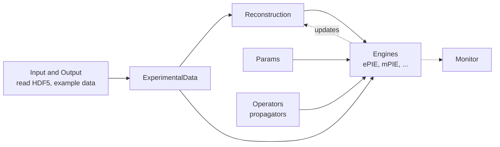

# API Reference

These pages are generated from PtyLab's docstrings. Each class is listed with its methods, equations and source code. For how the pieces fit together, start with the [User Guide](../cpm/overview.md) or the [Tutorials](../tutorials/index.md).

## How the main classes connect

## Pages

| Page | What it documents |
|---|---|
| [Core](core.md) | `easyInitialize()` and the top-level `PtyLab` package |
| [Experimental Data](experimental-data.md) | `ExperimentalData`: the measured ptychogram, scan positions and geometry |
| [Reconstruction](reconstruction.md) | `Reconstruction`: object, probe and positions, initialization and saving; FPM `IlluminationCalibration` |
| [Parameters](parameters.md) | `Params`: the switches shared by all engines |
| [Engines](engines.md) | `BaseEngine` and every engine: ePIE, mPIE, purityPIE, zPIE, aPIE, e3PIE, OPR, qNewton, mqNewton |
| [Operators](operators.md) | Propagation between the sample and the detector (Fraunhofer, Fresnel, ASP, scaled ASP) |
| [Probe Engines](probe-engines.md) | Probe representations (standard, OPR) |
| [Regularizers](regularizers.md) | Focus metrics and total variation (TV) helpers |
| [Monitoring](monitoring.md) | `Monitor` and `DummyMonitor`: live plots during the reconstruction |
| [Grid Generation](grid-generation.md) | Fermat spiral scan grids and scan path ordering |
| [Input and Output](io.md) | Reading HDF5 data, example datasets and the simulated dataset |
| [Utilities](utilities.md) | GPU helpers, scan grids, initial guesses, visualization and the `ptylab` command line |
