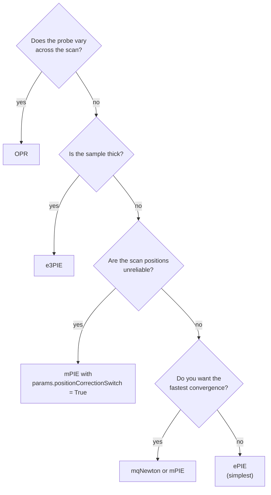

# Engines

An engine runs one iterative reconstruction algorithm. All engines inherit from `BaseEngine` and share the same interface.

## Available engines

| Engine | Full name | Best for |
|--------|-----------|----------|
| `ePIE` | Extended PIE | Simple, general-purpose starting point |
| `mPIE` | Momentum PIE | Faster convergence than ePIE; recommended default |
| `mqNewton` | Momentum quasi-Newton | High-quality results with faster convergence |
| `qNewton` | Quasi-Newton | Newton-step updates without momentum |
| `zPIE` | Defocus-correcting PIE | Unknown or uncertain sample-detector distance |
| `aPIE` | Angle-correcting PIE | Reflection geometry with uncertain tilt angle |
| `purityPIE` | Purity-based calibration | Calibrating the sample-detector distance or the wavelength from the probe purity |
| `e3PIE` | Multislice ePIE | Thick samples, reconstructed as several slices |
| `OPR` | Orthogonal Probe Relaxation | Probe that varies across the scan (e.g. drift) |

!!! note
    `pcPIE` and `multiPIE` are deprecated and kept only for old scripts. Use `mPIE` instead: position correction is turned on with `params.positionCorrectionSwitch`, and mixed states with `reconstruction.npsm`, `nosm` and `nlambda`.

## Common interface

All engines take the same arguments and run with `reconstruct()`:

```python
from PtyLab import Engines

engine = Engines.mPIE(reconstruction, experimentalData, params, monitor)
engine.numIterations = 50
engine.reconstruct()
```

`ePIE` also has `reconstruct_stepwise()`, a generator that yields `(loop, positionLoop)` after every scan-position update, so you can run your own code in between:

```python
engine = Engines.ePIE(reconstruction, experimentalData, params, monitor)
for loop, positionLoop in engine.reconstruct_stepwise():
    pass
```

## Engine-specific parameters

### ePIE / mPIE

```python
engine.betaObject = 0.25   # object update step size (0 < beta ≤ 1)
engine.betaProbe = 0.25    # probe update step size (0 < beta ≤ 1)
```

### mqNewton / qNewton

These use quasi-Newton updates and usually need fewer iterations than the PIE engines.

### Position correction (mPIE, mqNewton)

`pcPIE` is deprecated; turn on position correction in `mPIE` or `mqNewton` instead:

```python
params.positionCorrectionSwitch = True
params.positionCorrectionSwitch_radius = 1  # search radius in pixels
```

Start with a small radius (1–2 pixels): large radii are slower and can be unstable early on. After the reconstruction:

```python
reconstruction.make_alignment_plot()      # original vs corrected positions
reconstruction.encoder_corrected          # corrected positions (meters)
reconstruction.positions                  # corrected positions (pixels)
reconstruction.positions0                 # original positions (pixels)
reconstruction.reset_positioncorrection() # go back to the encoder positions
```

[Tutorial 07](../tutorials/tutorial_LateralPositionCorrection.md) explains the method and its equations.

### e3PIE (multislice)

```python
reconstruction.nslice = 3  # number of depth slices
engine = Engines.e3PIE(reconstruction, experimentalData, params, monitor)
```

Set `reconstruction.dz` and `reconstruction.refrIndex` before creating the engine, which computes the propagator between slices from them. [Tutorial 05](../tutorials/tutorial_multiSlice.md) shows the full setup.

### OPR (Orthogonal Probe Relaxation)

```python
params.OPR_modes = [0]        # which probe modes to relax
params.OPR_subspace = 4       # subspace dimension
params.OPR_alpha = 0.05       # feedback strength
params.OPR_orthogonalize_modes = True
```

## Which engine to choose



## Chaining engines

Several engines can run one after another on the same `Reconstruction`, because each continues from the current object and probe. For example, start with `ePIE` and refine with `mqNewton`:

```python
# Phase 1: rough convergence
engine1 = Engines.ePIE(reconstruction, experimentalData, params, monitor)
engine1.numIterations = 30
engine1.reconstruct()

# Phase 2: fine convergence
engine2 = Engines.mqNewton(reconstruction, experimentalData, params, monitor)
engine2.numIterations = 30
engine2.reconstruct()

reconstruction.saveResults("result.hdf5")
```
