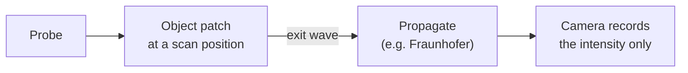
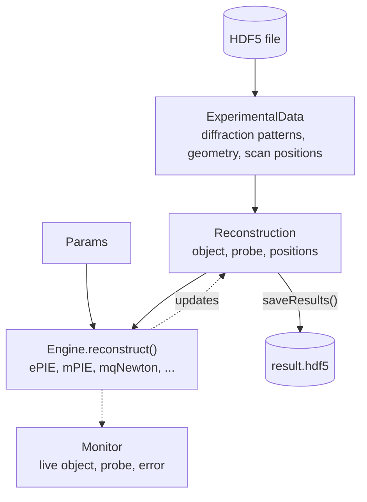
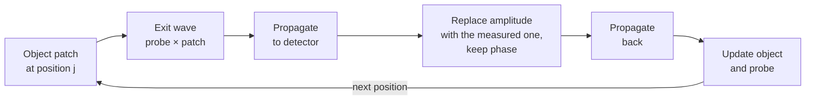

# CPM Overview

## What is conventional ptychography?

In conventional ptychography (CPM), a coherent probe beam is scanned across a sample so that neighbouring illuminated areas overlap. At each scan position a camera records the diffraction pattern, which holds only the intensity. From these intensities, an iterative algorithm recovers both the complex object (amplitude and phase) and the probe.



$$
\psi_j = P\,O_j, \qquad I_j = \left|\mathcal{F}\{\psi_j\}\right|^2
$$

where $P$ is the probe, $O_j$ the object patch at scan position $j$, $\psi_j$ the exit wave, $\mathcal{F}$ the propagation to the detector (a Fourier transform for Fraunhofer) and $I_j$ the measured intensity.

## Data flow



## Step-by-step reconstruction workflow

### 1. Load experimental data

`ExperimentalData` loads the diffraction patterns and the geometry from an HDF5 file. The required fields are `ptychogram` (diffraction intensities), `wavelength`, `encoder` (scan positions), `dxd` (detector pixel size) and `zo` (sample-to-detector distance).

See [Data Format](data-format.md) for the full HDF5 specification.

### 2. Initialize reconstruction state

A `Reconstruction` is created from the experimental data. It computes the coordinate grids, and `initializeObjectProbe()` creates the initial guesses:

- **Object**: the complex transmission function of the sample
- **Probe**: the complex illumination at the sample plane

The initial guess is set by `reconstruction.initialObject` and `reconstruction.initialProbe`:

| Type | Description |
|------|-------------|
| `"circ"` | Circular aperture with random noise |
| `"circ_smooth"` | Smoothed circular aperture |
| `"ones"` | All-ones array with random noise |
| `"rand"` | Fully random |
| `"gaussian"` | Gaussian |
| `"upsampled"` | Upsampled from the diffraction patterns (FPM object) |

CPM uses `"circ"` for the probe and `"ones"` for the object by default.

### 3. Configure parameters

`Params` holds the settings shared by all engines: propagator type, constraint switches, regularization, position order and more. See the [Configuration Reference](configuration.md) for all options.

### 4. Choose and configure an engine

An engine implements one reconstruction algorithm. All engines share the same interface:

```python
engine = Engines.mPIE(reconstruction, experimentalData, params, monitor)
engine.numIterations = 50
engine.reconstruct()
```

See [Engines](engines.md) for the full list and which one to pick.

### 5. Iterate

`engine.reconstruct()` loops over the iterations, and in each iteration over the scan positions:



The measured amplitude is $\sqrt{I_j}$; the phase of the propagated exit wave is kept.

After each iteration, `applyConstraints` applies the `Params` switches (regularization, orthogonalization, corrections), and the `Monitor` updates its plots.

### 6. Save results

```python
reconstruction.saveResults("result.hdf5")
```

## Array layout

The object and probe are 6D arrays of shape `(nlambda, nosm, npsm, nslice, N, N)`, with `N = No` for the object and `N = Np` for the probe. Singleton axes are kept:

| Axis | Default | Meaning |
|------|---------|---------|
| `nlambda` | 1 | Number of wavelengths (polychromatic reconstruction) |
| `nosm` | 1 | Object state mixture (incoherent object modes) |
| `npsm` | 1 | Probe state mixture (incoherent probe modes, partial coherence) |
| `nslice` | 1 | Depth slices (multislice, for thick samples) |
| `No`, `Np` | from the data | Frame size in pixels |

Set the first four on the `Reconstruction` before `initializeObjectProbe()` to reconstruct several wavelengths, modes or slices.

!!! note
    Polychromatic reconstruction needs `spectralDensity` in the experimental data. Multislice reconstruction needs `nslice > 1` and the `e3PIE` engine; see [tutorial 05](../tutorials/tutorial_multiSlice.md).

## Key concepts

| Term | Description |
|------|-------------|
| **Object** | Complex transmission function of the sample |
| **Probe** | Complex illumination at the sample plane |
| **Ptychogram** | Stack of 2D diffraction intensities, one per scan position |
| **Encoder / scan positions** | Physical (x, y) positions where the probe illuminates the sample |
| **Exit surface wave (ESW)** | Product of probe and object patch: the field right behind the sample |
| **Propagator** | How the wave is propagated between the sample and the detector |
| **Intensity constraint** | Replace the computed amplitude with the measured one and keep the phase |
