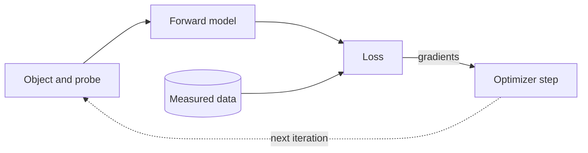

# Differentiable Ptychography


`PtyLab.Engines.GradientEngine` reconstructs with gradients from PyTorch's automatic differentiation. A forward model predicts the detector intensity of every scan frame, a loss compares it with the measurements, and an optimizer updates the parameters you select.




## Scope

- Conventional ptychography (CPM) only.
- Mixed states: any number of object states (`nosm`) and probe states (`npsm`), see [Mixed states](#mixed-states).
- Orthogonal probe relaxation: one probe per scan frame, kept low rank, see [Orthogonal probe relaxation](#orthogonal-probe-relaxation).
- Currently, multi-wavelength and multislice are not supported yet. However, the object and probe keep the six-axis layout of `Reconstruction`, as in the other engines.
- Propagators: `Fraunhofer`, `Fresnel`, `ASP` and `scaledASP`.
- Centered data (`params.fftshiftSwitch = False`) and the standard intensity constraint.
- `Params` switches that have no gradient-based counterpart yet (position correction, momentum and others) are rejected at the start of a run. The full list is `GradientEngine.unsupportedSettings`. Regularization such as TV is added through [`engine.regularizers`](#regularizers) instead of the `Params` switches.

!!! warning
    The module is a work in progress. The API should stay fixed as well, but in case it doesn't, a deprecation warning would be raised.

## Installation

Install PtyLab with the `torch` extra. On Linux and Windows, `--torch-backend=cu126` picks the CUDA 12 build that matches CuPy; drop it on macOS (see [Installation](../getting-started/installation.md#differentiable-ptychography)):

```bash
uv pip install -U "ptylab[gpu,torch]" --torch-backend=cu126
```

## Quick start

```python
import PtyLab
from PtyLab.Engines.GradientEngine import GradientEngine

experimentalData, reconstruction, params, monitor, _ = PtyLab.easyInitialize(
    "example:simulation_cpm", operationMode="CPM"
)
params.gpuSwitch = False  # Torch selects its own device, see engine.device

engine = GradientEngine(reconstruction, experimentalData, params, monitor)
engine.numIterations = 200
engine.reconstruct()

reconstruction.saveResults("result.hdf5")
```

The constructor and `reconstruct()` are the same as for the other engines, and the results are written back to `reconstruction.object`, `reconstruction.probe` and `reconstruction.error` as NumPy arrays. Unlike the classic engines, `reconstruct()` runs to completion and does not yield.

The engine runs on `"cuda"` when it is available and on `"cpu"` otherwise. Set `engine.device` to override this. Leave `params.gpuSwitch` off: it controls CuPy, not PyTorch.

## Selecting parameters

`engine.parameters` maps model parameter names to optimizer options. Parameters that are not listed stay fixed.

```python
engine.parameters = {
    "object": {"lr": 0.03},
    "probe.field": {"lr": 0.1},
}
```

| Name | Quantity |
|---|---|
| `"object"` | Complex object |
| `"probe.field"` | Complex probe, scale-free (see below) |
| `"background"` | Detector background, if `engine.background` is set |

`parameters = None` (the default) estimates object and probe with `learningRateObject` (0.03) and `learningRateProbe` (0.1).

The probe is optimized scale-free. `probe.field` stores the probe divided by a fixed power of two that is set from the measured photons per frame, so one probe learning rate works across photon counts. `reconstruction.probe`, `engine.snapshot()` and `model.probe(indices)` stay in physical units. A learning rate `lr` that was tuned for the physical probe corresponds to `lr / engine.model.probe.scale.item()`.

Every call to `reconstruct()` starts a fresh optimizer from the current estimates. If you edit `reconstruction.object` or `reconstruction.probe` between runs, call `engine.reset()` so that the model imports them.

## Mixed states

Set `reconstruction.nosm` and `reconstruction.npsm` before `initializeObjectProbe()`. Every object state $O_a$ meets every probe state $P_m$, and the intensities of all pairs add:

$$
I_j = \sum_{a}\sum_{m} \left|\mathcal{D}\{O_a(\mathbf{r} + \mathbf{x}_j)\,P_m(\mathbf{r})\}\right|^2 + b .
$$

```python
reconstruction.npsm = 4
reconstruction.initializeObjectProbe()
engine = GradientEngine(reconstruction, data, params, monitor)
engine.reconstruct()
engine.model.probe.mode_powers()  # (nlambda, npsm): sum of |P_m|^2 per mode
```

All probe states share one learning rate and one probe scale. Start the states different from each other: exactly identical states receive identical gradients and stay identical. `initializeObjectProbe()` already adds a little noise to each state, which is enough. A unitary rotation of the states leaves every intensity unchanged, so the stored modes are one basis among many. Add `ProbeModeOrthogonalization` (see [Constraints](#constraints)) to keep them orthogonal and sorted by power, so that `mode_powers()` can be compared between runs:

```python
from PtyLab.Engines.GradientEngine import ProbeCentering, ProbeModeOrthogonalization

engine.constraints = [ProbeCentering(), ProbeModeOrthogonalization(step=10)]
```

Object states (`nosm > 1`) have the same freedom. `ObjectStateOrthogonalization` rotates them into orthogonal states, strongest first. Unlike the classic engines (`BaseEngine.orthogonalization`), which orthogonalize the object only when there is a single probe mode, both constraints can be used together, because each rotation leaves the intensities unchanged on its own:

```python
from PtyLab.Engines.GradientEngine import ObjectStateOrthogonalization

engine.constraints = [
    ProbeCentering(),
    ProbeModeOrthogonalization(step=10),
    ObjectStateOrthogonalization(step=10),
]
```

`params.orthogonalizationSwitch` is not used by this engine; the constraints replace it.

## Orthogonal probe relaxation

When the illumination changes from frame to frame, as with the pulse-to-pulse flux, pointing and wavefront changes of a high-harmonic source, one shared probe cannot fit every frame. Orthogonal probe relaxation (OPR) gives frame $j$ its own probe $P_j$ and keeps the stack of all frame probes low rank,

$$
P_j(\mathbf r) \approx \sum_{k=1}^{K} c_{jk}\,B_k(\mathbf r),
$$

with $K$ shared patterns $B_k$ and frame coefficients $c_{jk}$, as the classic `OPR` engine does. Every probe mode varies between frames; the modes still add incoherently within a frame.

First fit a shared probe, then relax it:

```python
from PtyLab.Engines.GradientEngine import (
    OPRProjection,
    ProbeModeOrthogonalization,
    blind_recipe,
)

engine.run(blind_recipe(1000))  # shared probe
engine.relaxProbe()  # every frame starts from the shared probe
engine.constraints = [
    OPRProjection(rank=4, relax=0.05),
    ProbeModeOrthogonalization(step=10),
]
engine.numIterations = 300
engine.reconstruct()
```

- `relaxProbe()` replaces the shared probe by an `OPRProbe` of shape `(frames, nlambda, 1, npsm, 1, Np, Np)`. The parameter keeps the name `"probe.field"`, so `parameters`, learning rates and phases are unchanged.
- `OPRProjection(rank=K)` replaces the stack by its closest rank-$K$ stack after every step, for each wavelength and mode. `relax` blends it with the unprojected stack, like `params.OPR_alpha`, and `rank` plays the role of `params.OPR_subspace`. The `params.OPR_*` switches are not used by this engine.
- With an `OPRProbe`, `ProbeModeOrthogonalization` orthogonalizes the modes of each frame, like `params.OPR_orthogonalize_modes`.
- `ProbeCentering`, `PhaseRampRemoval` and `AbsorbingProbeBoundary` act on the whole stack.
- At the end of a run, `reconstruction.probe_stack` holds the frame probes in the layout of the classic `OPR` engine, `(nlambda, 1, npsm, 1, Np, Np, frames)`. `reconstruction.probe` holds the dominant component of the stack (`OPRProbe.shared_estimate`), the single probe that best represents all frames.
- To start from a stack, for example one from the classic `OPR` engine, call `relaxProbe()`, set `reconstruction.probe_stack` and call `reset()`.
- `engine.model.probe.frame_powers()` gives the power of every frame and mode; `mode_powers()` is their mean over the frames.

The stack and Adam's two moments take three times `frames × npsm × Np² × 8` bytes: about 40 GB for 101 frames, 4 modes and 2048² pixels.

## Optimizers

`engine.optimizerType` is `"adam"` (default) or `"preconditioned"`. The preconditioned optimizer is a PIE-style gradient descent: each gradient is divided by a regularized curvature map (`preconditionerAlpha`, default 0.1) before a plain step. Its learning rates are dimensionless; about 0.3 suits the amplitude loss.

## Losses

Set `engine.lossFunction` to one of the functions in `losses`. Options are passed with `functools.partial`.

```python
from functools import partial
from PtyLab.Engines.GradientEngine.losses import poisson_loss

engine.lossFunction = partial(poisson_loss, read_out_sigma=2.0)
```

| Loss | Noise model | Options |
|---|---|---|
| `amplitude_loss` (default) | Conventional amplitude objective; with `anscombe_offset_switch=True`, the generalized Anscombe transform | `anscombe_offset_switch`, `read_out_sigma` |
| `intensity_loss` | Gaussian with constant variance | |
| `poisson_loss` | Poisson, optionally with Gaussian readout noise | `gain`, `read_out_sigma` |
| `mixed_poisson_gaussian_loss` | Gaussian approximation of Poisson plus readout noise | `gain`, `read_out_sigma` |

All losses expect intensities in detector units, sum over pixels and frames, and are normalized by the total measured power. Measured frames may contain negative values (offset-subtracted raw data).

## Detector background

A raw camera frame holds more than the sample's photons. Each part goes where the loss models its noise correctly:

| Part of a raw frame | Noise | Where it goes |
|---|---|---|
| Electronic offset (bias) | none | subtracted from the frames |
| Dark current | Poisson | its mean subtracted from the frames, its scatter in `readoutSigma` |
| Stray light | Poisson | `engine.background` |
| Readout noise | Gaussian | `readoutSigma` |

With dark frames taken at the scan's exposure, subtract their mean from the frames, without clipping, before `reconstruct()`. This removes the offset and the mean dark current in one step:

```python
dark = ...  # (n_dark, N, N) dark frames, centered order
data.ptychogram = data.ptychogram - dark.mean(axis=0)  # negative values stay
```

Set `engine.background` to a scalar or a frame-shaped image in centered order (zero frequency at the centre, as `fft2c`) for a background that carries shot noise, such as stray light. It is fixed by default and estimated (kept nonnegative) when `"background"` is selected in `parameters`. Every loss counts $b$ as photons, with variance $g(I + b) + \sigma^2$. Do not put the dark mean into `engine.background`: its offset has no shot noise, so the loss would overestimate the variance of every dark pixel and give the weak high-angle signal too little weight. The offset would also inflate the total power and the probe scale.

### Readout noise per pixel

`read_out_sigma` can be bound in the loss as one number. When the noise differs between pixels (hot pixels, amp glow), give it to the engine as `engine.readoutSigma` instead, in the same units: a scalar for every pixel, or one frame-shaped map $\sigma(\mathbf q)$ in centered order (as `fft2c`). The map is usually the standard deviation over the dark frames whose mean was subtracted from the data (see [Detector background](#detector-background)). It holds the readout noise and the dark-current shot noise, which is the noise left after the subtraction.

```python
engine.lossFunction = partial(poisson_loss, gain=g)
engine.readoutSigma = dark.std(axis=0)  # one sigma per detector pixel
```

The engine passes the map to the loss as `read_out_sigma`. The loss must have a `read_out_sigma` argument, and must not bind its own: setting it in both places raises an error. `amplitude_loss` takes a map only with `anscombe_offset_switch=True`. A per-pixel standard deviation from $n$ dark frames has a relative error of about $1/\sqrt{2(n-1)}$, so use tens of frames.

`poisson_loss` can be negative. The default `Monitor` currently fails to plot a negative error; use `easyInitialize(..., dummyMonitor=True)` or `DummyMonitor()` with this loss.

## Regularizers

`engine.regularizers` is a list of functions that take the model and return a scalar penalty. They are added once per iteration.

```python
from functools import partial
from PtyLab.Engines.GradientEngine.regularizers import object_smoothness

engine.regularizers = [partial(object_smoothness, weight=1e-4)]
```

| Regularizer | Penalty | Effect |
|---|---|---|
| `object_smoothness` | $w\,\langle\lvert\Delta_y O\rvert^2\rangle + w\,\langle\lvert\Delta_x O\rvert^2\rangle$ | Squared differences between neighbouring pixels (L2 on the gradient). Smooths noise and edges alike. |
| `object_tv` | $w\,\langle\sqrt{\lvert\Delta_y O\rvert^2 + \lvert\Delta_x O\rvert^2 + \epsilon}\rangle$ | Total variation (L1 on the gradient). Removes small noisy variations and keeps sharp edges. Replaces `params.objectTVregSwitch`. |

$\Delta_y O$ and $\Delta_x O$ are the differences between neighbouring object pixels, $\langle\cdot\rangle$ the mean over pixels and modes, $w$ is `weight` (default 1e-4) and $\epsilon$ is `epsilon` (default 1e-6), which keeps the gradient finite where the object is flat. The losses are normalized by the total measured power, so a useful `weight` is usually between 1e-4 and 1e-2.

## Constraints

`engine.constraints` is a list of operations applied in place after every optimizer step, outside the gradient computation.

```python
from PtyLab.Engines.GradientEngine import (
    ObjectAmplitudeClamp,
    PhaseRampRemoval,
    ProbeCentering,
)

engine.constraints = [
    ProbeCentering(threshold=2),
    ObjectAmplitudeClamp(maximum=1.0),
    PhaseRampRemoval(),
]
```

| Constraint | Effect |
|---|---|
| `ProbeCentering` | Rolls probe and object so that the probe's centre of mass stays at the window centre. Leaves Fraunhofer intensities unchanged. |
| `ObjectAmplitudeClamp` | Limits the object amplitude to `[minimum, maximum]`, keeping the phase. |
| `AbsorbingObject` | Pulls the object towards its modulus, $O \leftarrow (1 - \beta)O + \beta|O|$ with `beta` $= \beta$ (default 0.01), like `params.absObjectSwitch` with `params.absObjectBeta`. Shrinks the object phase towards 0; for samples whose phase carries little information. |
| `PhaseRampRemoval` | Moves a linear phase ramp and a global phase from the object to the probe. Leaves all predicted intensities unchanged. |
| `ProbeModeOrthogonalization` | Rotates the probe modes into orthogonal modes, strongest first, by the same snapshot method as `PtyLab.utils.utils.orthogonalizeModes`, used by the classic engines. Leaves all predicted intensities unchanged. |
| `ObjectStateOrthogonalization` | The same for the object states (`nosm > 1`), over the whole object grid. Leaves all predicted intensities unchanged, also together with `ProbeModeOrthogonalization`. |
| `OPRProjection` | Replaces a per-frame probe stack (after `relaxProbe()`) by its closest rank-`rank` stack, for each wavelength and mode. See [Orthogonal probe relaxation](#orthogonal-probe-relaxation). |
| `AbsorbingProbeBoundary` | Damps the probe near the edges of its window by the same super-Gaussian window as the classic engines' `params.absorbingProbeBoundary`: $P \leftarrow [(1 - a) + aW]P$ with `aleph` $= a$ (default 0.05). Keeps weak modes from drifting into the window corners, where they light object regions nothing else constrains. |

Each constraint takes the schedule arguments `start`, `step`, `end` (iterations) and `relax` (fraction of the correction that is not applied). Constraints that move or scale a parameter also move or scale its optimizer state. The `params.absorbingProbeBoundary` and `params.absObjectSwitch` switches stay in `unsupportedSettings`; add `AbsorbingProbeBoundary()` or `AbsorbingObject()` to the list instead. Any callable `constraint(engine, iteration)` is accepted, and subclasses of `Constraint` get the schedule for free. Subclasses of `GradientEngine` can still override `afterStep(iteration)`, which runs after the constraints.

## Reconstruction Phases

A reconstruction often needs different settings at different times. `engine.run(phases)` runs a list of `Phase` records in order. Each phase starts a fresh optimizer from the estimates of the previous one, and fields left at None keep the engine's settings.

```python
from PtyLab.Engines.GradientEngine import Phase

engine.run(
    [
        Phase(200, {"object": {"lr": 0.03}}, name="object only"),
        Phase(800, {"object": {"lr": 0.03}, "probe.field": {"lr": 0.1}}),
    ]
)
```

`Phase` sets `parameters`, `optimizerType`, `loss`, `constraints` and `readoutSigma`. A field left at None takes the engine's own setting, not that of an earlier phase. `run` restores the engine's settings afterwards, writes the errors of all phases to `reconstruction.error`, and returns one history per phase.

`blind_recipe(iterations)` builds two phases for recovering object and probe from a flat start: 20 % of the iterations with the preconditioned optimizer on the amplitude loss, then Adam on the engine's loss.

```python
from PtyLab.Engines.GradientEngine import ProbeCentering, blind_recipe

engine.run(blind_recipe(iterations=1000, constraints=[ProbeCentering()]))
```

For raw frames, subtract the dark mean from the data (see [Detector background](#detector-background)) and pass the readout noise to the recipe as a scalar or a per-pixel map. It is used by the Adam phase; the start always runs the plain amplitude loss without readout noise:

```python
data.ptychogram = data.ptychogram - dark.mean(axis=0)
engine.background = stray  # optional: a Poisson background such as stray light
engine.run(
    blind_recipe(
        iterations=1000,
        loss=poisson_loss,
        read_out_sigma=dark.std(axis=0),
        constraints=[ProbeCentering()],
    )
)
```

## Batching and memory

By default the whole scan is forwarded as one tensor and the optimizer takes one step per iteration.

- `batchSize` limits how many frames are forwarded at once. Gradients are accumulated over batches, so the result does not depend on it; it only bounds memory.
- `memoryBudget` (CUDA only) is a number of bytes. The engine measures and picks the largest batch whose iteration fits within it. `engine.suggestBatchSize(budget)` runs the same search on its own.
- `dataDevice` sets where the measurements are kept. None keeps them on `device` unless they would take more than half of the free GPU memory; `"cpu"` keeps them in pinned host memory and copies each batch while the previous one is computed.
- `updatePerBatch = True` takes one step per batch instead. Combine it with `params.positionOrder = "random"` so that each batch samples the whole scan.
- `compile = True` runs the loss through `torch.compile`. Only the real-valued loss is compiled and the gain is small, so it is off by default.

## Custom models

The default model is a `PtychographyModel` that owns the object and a `SharedProbe`. To change the physics, subclass `GradientEngine` and override `createModel()`:

```python
from PtyLab.Engines.GradientEngine import GradientEngine, PtychographyModel, SharedProbe


class MyEngine(GradientEngine):
    def createModel(self):
        r = self.reconstruction
        return MyModel(r.object, SharedProbe(r.probe), r.positions)
```

A custom model is a `torch.nn.Module`. Its `forward(indices)` returns the predicted intensity of the selected frames, and its parameters are selected by their `named_parameters()` names. To support `engine.reset()`, it must implement `reset_from_reconstruction(reconstruction)`. Subclassing `PtychographyModel` and overriding `detector_fields` or `forward` is the simplest way to keep positions, propagation and background handling.

Model tensors have these shapes:

| Quantity | Shape |
|---|---|
| Object | `(nlambda, nosm, 1, nslice, No, No)` |
| Probe | `(nlambda, 1, npsm, 1, Np, Np)` |
| Probe stack (`OPRProbe`) | `(frames, nlambda, 1, npsm, 1, Np, Np)` |
| Predicted intensity | `(batch, Np, Np)` |

Every detector-plane array uses the centered pixel order of `fft2c`, as in the classic engines: predicted intensities, `engine.measuredIntensities`, `engine.background`, `engine.readoutSigma` and any per-pixel weights or masks in a custom loss. `engine.centeredIntensity(intensity)` returns a NumPy copy, for plotting.

## Modules

| Module | Contents |
|---|---|
| `engine` | `GradientEngine` |
| `models` | `PtychographyModel`, `SharedProbe`, `OPRProbe`, `probe_scale` |
| `propagation` | `KernelPropagator`: fixed Fraunhofer, Fresnel, ASP and scaled-ASP kernels |
| `losses` | Data objectives |
| `regularizers` | `object_smoothness`, `object_tv` |
| `constraints` | `Constraint`, `ProbeCentering`, `ObjectAmplitudeClamp`, `AbsorbingObject`, `PhaseRampRemoval`, `ProbeModeOrthogonalization`, `ObjectStateOrthogonalization`, `AbsorbingProbeBoundary`, `OPRProjection` |
| `phases` | `Phase`, `blind_recipe` |

The docstrings of each module give the equations and all options; they are rendered in the [Gradient Engine API reference](../api/gradient-engine.md).
