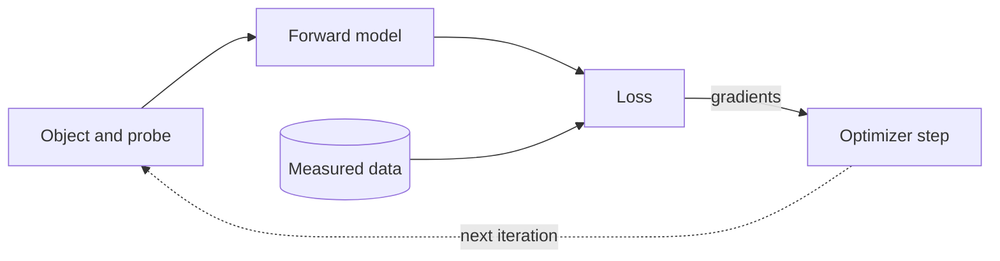

# Differentiable Ptychography

`PtyLab.Engines.GradientEngine` reconstructs with gradients from PyTorch's automatic differentiation. A forward model predicts the detector intensity of every scan frame, a loss compares it with the measurements, and an optimizer updates the parameters you select.



## Scope

The forward model is conventional ptychography (CPM) with the `Fraunhofer`, `Fresnel`, `ASP` or `scaledASP` propagator. Besides a single probe, it supports [mixed states](#mixed-states) and [orthogonal probe relaxation](#orthogonal-probe-relaxation), and it can include a [detector background](#detector-background). Noise models enter as [losses](#losses), and [regularizers](#regularizers) and [constraints](#constraints) guide the joint optimization of the parameters of interest. As in the classic engines, object and probe keep the 6D array layout of `Reconstruction`, and the `Monitor` shows the live reconstruction.

!!! note "TBA"
    The module is a work in progress; more features will come in later releases. For CPM multi-wavelength, multislice, the polychrome and two-step propagators or correction methods are not supported yet. Most classic `Params` switches are rejected at the start of a run (the list is `GradientEngine.unsupportedSettings`); a few have a gradient counterpart here, such as TV through [`engine.regularizers`](#regularizers). Differentiable counterpart for FPM is not planned at the moment.

## Installation

Install PtyLab with the `torch` extra. On Linux and Windows, `--torch-backend=cu126` picks the CUDA 12 build that matches CuPy; drop it on macOS (see [Installation](../getting-started/installation.md#differentiable-ptychography)):

```bash
uv pip install -U "ptylab[gpu,torch]" --torch-backend=cu126
```

## Quick start

```python
import PtyLab
from PtyLab.Engines.GradientEngine import GradientEngine

experimentalData, reconstruction, params, monitor, _ = PtyLab.easyInitialize(
    "example:simulation_cpm", operationMode="CPM"
)

engine = GradientEngine(reconstruction, experimentalData, params, monitor)
engine.numIterations = 200
engine.reconstruct()

reconstruction.saveResults("result.hdf5", snapshot=monitor)  # plus a PNG of the monitor figure
```

The constructor, `reconstruct()` and the results (`reconstruction.object`, `.probe`, `.error` as NumPy arrays) work as in the other engines. 

The engine runs on `"cuda"` if available, else on `"cpu"`; set `engine.device` to override. `params.gpuSwitch` is ignored: it only controls CuPy for the classic engines.

## Selecting parameters

`engine.parameters` maps model parameter names to optimizer options. Parameters that are not listed stay fixed. Besides `"object"` and `"probe"`, `"background"` can be estimated when `engine.background` is set.

```python
engine.parameters = {
    "object": {"lr": 0.03},
    "probe": {"lr": 0.1},
}
```

`parameters = None` (the default) estimates object and probe with `learningRateObject` (0.03) and `learningRateProbe` (0.1).

**Scale-free probe.** For `"probe"`, the optimizer updates $F = P / s$ instead of the probe $P$. Here $s = \sqrt{N_{\mathrm{frame}} / N_{\mathrm{pix}}}$ is the typical probe amplitude: the mean measured photons per frame $N_{\mathrm{frame}}$ spread evenly over the $N_{\mathrm{pix}}$ pixels of the probe window, rounded to a power of two so that $P = sF$ is exact in floating point. $F$ is then of order 1 for any dataset, so one learning rate works across photon counts. `reconstruction.probe`, `engine.snapshot()` and `model.probe(indices)` stay physical. A rate `lr` tuned for the physical probe becomes `lr / engine.model.probe.scale.item()`.

Each `reconstruct()` starts a fresh optimizer from the current estimates. After editing `reconstruction.object` or `reconstruction.probe`, call `engine.reset()` so the model imports them.

## Mixed states

Set `reconstruction.nosm` and `reconstruction.npsm` before `initializeObjectProbe()`. Every object state $O_a$ meets every probe state $P_m$, and the intensities of all pairs add:

$$
I_j = \sum_{a}\sum_{m} \left|\mathcal{D}\{O_a(\mathbf{r} + \mathbf{x}_j)\,P_m(\mathbf{r})\}\right|^2 + b .
$$

```python
reconstruction.npsm = 4
reconstruction.initializeObjectProbe()
engine = GradientEngine(reconstruction, data, params, monitor)
engine.reconstruct()
engine.model.probe.mode_powers()  # (nlambda, npsm): sum of |P_m|^2 per mode
```

- All probe states share one learning rate and one probe scale.
- States must start different: identical states get identical gradients and stay identical. The small noise from `initializeObjectProbe()` is enough.
- Any unitary rotation of the states gives the same intensities. Add `ProbeModeOrthogonalization` to keep them orthogonal and sorted by power, so `mode_powers()` can be compared between runs.

```python
from PtyLab.Engines.GradientEngine import ProbeCentering, ProbeModeOrthogonalization

engine.constraints = [ProbeCentering(), ProbeModeOrthogonalization(step=10)]
```

`ObjectStateOrthogonalization` does the same for object states (`nosm > 1`). Both can be used together, unlike the classic `BaseEngine.orthogonalization`, which orthogonalizes the object only for a single probe mode. These constraints replace `params.orthogonalizationSwitch`.

```python
from PtyLab.Engines.GradientEngine import ObjectStateOrthogonalization

engine.constraints = [
    ProbeCentering(),
    ProbeModeOrthogonalization(step=10),
    ObjectStateOrthogonalization(step=10),
]
```

## Orthogonal probe relaxation

When the illumination changes from frame to frame (flux, pointing, wavefront), one shared probe cannot fit every frame. Orthogonal probe relaxation (OPR) gives each frame $j$ its own probe and keeps the stack low rank, as the classic `OPR` engine does:

$$
P_j(\mathbf r) \approx \sum_{k=1}^{K} c_{jk}\,B_k(\mathbf r),
$$

with $K$ shared patterns $B_k$ and frame coefficients $c_{jk}$. Each probe mode varies this way; modes still add incoherently within a frame.

First fit a shared probe, then relax it:

```python
from PtyLab.Engines.GradientEngine import (
    OPRProjection,
    ProbeModeOrthogonalization,
    blind_recipe,
)

engine.reconstruct(phases=blind_recipe(1000))  # shared probe
engine.relaxProbe()  # every frame starts from the shared probe
engine.constraints = [
    OPRProjection(rank=4, relax=0.05),
    ProbeModeOrthogonalization(step=10),
]
engine.numIterations = 300
engine.reconstruct()
```

| Item | What it does |
|---|---|
| `relaxProbe()` | Replaces the shared probe by an `OPRProbe` of shape `(frames, nlambda, 1, npsm, 1, Np, Np)`. The parameter is still `"probe"`, so `parameters` and phases are unchanged. |
| `OPRProjection(rank, relax)` | Projects the stack onto its closest rank-`rank` stack after every step, per wavelength and mode. `rank` and `relax` play the roles of `params.OPR_subspace` and `params.OPR_alpha`; the `params.OPR_*` switches are not used. |
| Other constraints | `ProbeModeOrthogonalization` works per frame (like `params.OPR_orthogonalize_modes`). `ProbeCentering`, `PhaseRampRemoval` and `AbsorbingProbeBoundary` act on the whole stack. |
| `reconstruction.probe_stack` | The frame probes, in the classic `OPR` layout `(nlambda, 1, npsm, 1, Np, Np, frames)`. |
| `reconstruction.probe` | The single probe that best represents all frames (`OPRProbe.shared_estimate`). It needs an eigendecomposition, so during a run it is refreshed only when the monitor draws. |
| `frame_powers()`, `mode_powers()` | On `engine.model.probe`: power per frame and mode, and its mean over frames. |

Restarting:

- To start from a stack (for example from the classic `OPR` engine): call `relaxProbe()`, set `reconstruction.probe_stack`, call `reset()`.
- `reset()` after a run re-imports `probe_stack`. If you changed `reconstruction.probe` since, that probe is copied to every frame instead.
- The stack belongs to one scan: data with another number of frames are rejected. Use a new engine for them.

Memory: the stack and Adam's two moments take `3 × frames × npsm × Np² × 8` bytes, about 40 GB for 101 frames, 4 modes and 2048² pixels.

## Optimizers

`engine.optimizerType` is `"adam"` (default) or `"preconditioned"`. The preconditioned optimizer is a PIE-style gradient descent: each gradient is divided by a regularized curvature map (`preconditionerAlpha`, default 0.1) before a plain step. Its learning rates are dimensionless; about 0.3 suits the amplitude loss.

## Losses

Set `engine.lossFunction` to one of the functions in `losses`. Options are passed with `functools.partial`.

```python
from functools import partial
from PtyLab.Engines.GradientEngine import poisson_loss

engine.lossFunction = partial(poisson_loss, read_out_sigma=2.0)
```

| Loss | Noise model | Options |
|---|---|---|
| `amplitude_loss` (default) | Conventional amplitude objective; with `anscombe_offset_switch=True`, the generalized Anscombe transform | `anscombe_offset_switch`, `read_out_sigma` |
| `intensity_loss` | Gaussian with constant variance | |
| `poisson_loss` | Poisson, optionally with Gaussian readout noise | `gain`, `read_out_sigma` |
| `mixed_poisson_gaussian_loss` | Gaussian approximation of Poisson plus readout noise | `gain`, `read_out_sigma` |

`poisson_loss` and `mixed_poisson_gaussian_loss` take intensities in detector units, with the detector `gain`. `amplitude_loss` with `anscombe_offset_switch=True` takes photon counts (unit gain). All losses sum over pixels and frames and are normalized by the total measured power. Measured frames may contain negative values (offset-subtracted raw data).

## Detector background

A raw camera frame holds more than the sample's photons. Each part goes where the loss models its noise correctly:

| Part of a raw frame | Noise | Where it goes |
|---|---|---|
| Electronic offset (bias) | none | subtracted from the frames |
| Dark current | Poisson | its mean subtracted from the frames, its scatter in `readoutSigma` |
| Stray light | Poisson | `engine.background` |
| Readout noise | Gaussian | `readoutSigma` |

With dark frames taken at the scan's exposure, subtract their mean from the frames, without clipping, before `reconstruct()`. This removes the offset and the mean dark current in one step:

```python
dark = ...  # (n_dark, N, N) dark frames, centered order
data.ptychogram = data.ptychogram - dark.mean(axis=0)  # negative values stay
```

`engine.background` is a background with shot noise, such as stray light: a scalar or a frame-shaped image in centered order (as `fft2c`). It is fixed, unless `"background"` is in `parameters`; then it is estimated and kept nonnegative. The noise-model losses (`poisson_loss`, `mixed_poisson_gaussian_loss`, `amplitude_loss`) count $b$ as photons, with variance $g(I + b) + \sigma^2$; `intensity_loss` assumes a constant variance.

!!! note
    Do not put the dark mean into `engine.background`. It has no shot noise, so the loss would overestimate every pixel's variance and underweight the weak high-angle signal. It would also inflate the total power and the probe scale.

### Readout noise per pixel

`read_out_sigma` bound in the loss is one value for all pixels. When the noise differs between pixels (hot pixels, amp glow), set `engine.readoutSigma` instead, in the same units: a scalar, or a frame-shaped map $\sigma(\mathbf q)$ in centered order. It is usually the standard deviation over the same dark frames, which holds the readout noise and the dark-current shot noise.

```python
engine.lossFunction = partial(poisson_loss, gain=g)
engine.readoutSigma = dark.std(axis=0)  # one sigma per detector pixel
```

- The engine passes the map to the loss as `read_out_sigma`. The loss must accept that argument and not bind it too; setting both raises an error.
- `amplitude_loss` takes a map only with `anscombe_offset_switch=True`.
- Use tens of dark frames: a per-pixel standard deviation from $n$ frames has a relative error of about $1/\sqrt{2(n-1)}$.

`poisson_loss` and `mixed_poisson_gaussian_loss` can be negative, which the default `Monitor` currently fails to plot. Use `easyInitialize(..., dummyMonitor=True)` or `DummyMonitor()` with it.

## Regularizers

`engine.regularizers` is a list of functions that take the model and return a scalar penalty. They are added once per iteration.

```python
from functools import partial
from PtyLab.Engines.GradientEngine import object_smoothness

engine.regularizers = [partial(object_smoothness, weight=1e-4)]
```

| Regularizer | Penalty | Effect |
|---|---|---|
| `object_smoothness` | $w\,\langle\lvert\Delta_y O\rvert^2\rangle + w\,\langle\lvert\Delta_x O\rvert^2\rangle$ | L2 on the gradient. Smooths noise and edges alike. |
| `object_tv` | $w\,\langle\sqrt{\lvert\Delta_y O\rvert^2 + \lvert\Delta_x O\rvert^2 + \epsilon}\rangle$ | Total variation (L1 on the gradient). Removes small noisy variations, keeps sharp edges. Replaces `params.objectTVregSwitch`. |

$\Delta_y O$, $\Delta_x O$: differences between neighbouring pixels. $\langle\cdot\rangle$: mean over pixels and modes. $w$: `weight` (default 1e-4). $\epsilon$: `epsilon` (default 1e-6), keeps the gradient finite where the object is flat. Losses are normalized by the total measured power, so a useful `weight` is usually 1e-4 to 1e-2.

## Constraints

`engine.constraints` is a list of operations applied in place after every optimizer step, outside the gradient computation.

```python
from PtyLab.Engines.GradientEngine import (
    ObjectAmplitudeClamp,
    PhaseRampRemoval,
    ProbeCentering,
)

engine.constraints = [
    ProbeCentering(threshold=2),
    ObjectAmplitudeClamp(maximum=1.0),
    PhaseRampRemoval(),
]
```

| Constraint | Effect |
|---|---|
| `ProbeCentering` | Rolls probe and object so the probe's centre of mass stays at the window centre. Fraunhofer intensities unchanged. |
| `ObjectAmplitudeClamp` | Limits the object amplitude to `[minimum, maximum]`, keeping the phase. |
| `AbsorbingObject` | Pulls the object towards its modulus, $O \leftarrow (1 - \beta)O + \beta\lvert O\rvert$ (`beta`, default 0.01), like `params.absObjectSwitch`. For samples whose phase carries little information. |
| `PhaseRampRemoval` | Moves a linear phase ramp and a global phase from the object to the probe. Intensities unchanged. |
| `ProbeModeOrthogonalization` | Rotates the probe modes into orthogonal modes, strongest first (snapshot method of `PtyLab.utils.utils.orthogonalizeModes`). Intensities unchanged. |
| `ObjectStateOrthogonalization` | The same for object states (`nosm > 1`). Intensities unchanged, also together with `ProbeModeOrthogonalization`. |
| `OPRProjection` | Projects a per-frame probe stack onto its closest rank-`rank` stack. See [Orthogonal probe relaxation](#orthogonal-probe-relaxation). |
| `AbsorbingProbeBoundary` | Damps the probe near its window edges, $P \leftarrow [(1 - a) + aW]P$, with the super-Gaussian window $W$ of `params.absorbingProbeBoundary` (`aleph`, default 0.05). Keeps weak modes out of the window corners. |

- Each constraint takes `start`, `step`, `end` (iterations) and `relax` (fraction of the correction not applied).
- Constraints that move or scale a parameter also move or scale its optimizer state.
- `params.absorbingProbeBoundary` and `params.absObjectSwitch` are rejected; use `AbsorbingProbeBoundary()` and `AbsorbingObject()` instead.
- Any callable `constraint(engine, iteration)` works; subclass `Constraint` to get the schedule. `GradientEngine` subclasses can also override `afterStep(iteration)`, which runs after the constraints.

## Reconstruction Phases

`engine.reconstruct(phases=...)` runs a list of `Phase` records in order, for settings that change during a reconstruction. Each phase starts a fresh optimizer from the estimates of the previous one.

```python
from PtyLab.Engines.GradientEngine import Phase

engine.reconstruct(
    phases=[
        Phase(200, {"object": {"lr": 0.03}}, name="object only"),
        Phase(800, {"object": {"lr": 0.03}, "probe": {"lr": 0.1}}),
    ]
)
```

A `Phase` sets `parameters`, `optimizerType`, `lossFunction`, `constraints` and `readoutSigma`, with the names of the engine attributes. A field left at None uses the engine's own setting, not that of the previous phase. Afterwards `reconstruct` restores the engine's settings and returns one history per phase. As in the classic engines, every `reconstruct()` call appends its errors to `reconstruction.error`, so the monitor's iteration count keeps going over phases and calls.

`blind_recipe(iterations)` builds two phases for recovering object and probe from a flat start: 20 % of the iterations with the preconditioned optimizer on the amplitude loss, then Adam on the engine's loss.

```python
from PtyLab.Engines.GradientEngine import ProbeCentering, blind_recipe

engine.reconstruct(phases=blind_recipe(iterations=1000, constraints=[ProbeCentering()]))
```

For raw frames, subtract the dark mean (see [Detector background](#detector-background)) and pass the readout noise to the recipe as a scalar or a per-pixel map. Only the Adam phase uses it; the start always runs the plain amplitude loss:

```python
data.ptychogram = data.ptychogram - dark.mean(axis=0)
engine.background = stray  # optional: a Poisson background such as stray light
engine.reconstruct(
    phases=blind_recipe(
        iterations=1000,
        lossFunction=poisson_loss,
        readoutSigma=dark.std(axis=0),
        constraints=[ProbeCentering()],
    )
)
```

## Batching and memory

`engine.batchSize` (or `engine.memoryBudget` on CUDA) splits the scan into batches to bound memory. Gradients are summed over the batches, so the result does not change; see [`GradientEngine`](../api/gradient-engine.md) for the other memory settings.

## Custom models

The default model is a `PtychographyModel` that owns the object and a `SharedProbe`. To change the physics, subclass `GradientEngine` and override `createModel()`:

```python
from PtyLab.Engines.GradientEngine import GradientEngine, PtychographyModel, SharedProbe


class MyModel(PtychographyModel):
    def forward(self, indices):
        return 0.9 * super().forward(indices)  # detector efficiency


class MyEngine(GradientEngine):
    def createModel(self):
        r = self.reconstruction
        return MyModel(r.object, SharedProbe(r.probe), r.positions)
```

- A custom model is a `torch.nn.Module`. `forward(indices)` returns the predicted intensity of the selected frames, and `engine.parameters` selects by `named_parameters()` names (`"probe"` stands for the scale-free `probe.field` of a `SharedProbe`).
- Implement `reset_from_reconstruction(reconstruction)` to support `engine.reset()`.
- Easiest route: subclass `PtychographyModel` and override `detector_fields` or `forward`. This keeps positions, propagation and background handling.

| Quantity | Shape |
|---|---|
| Object | `(nlambda, nosm, 1, nslice, No, No)` |
| Probe | `(nlambda, 1, npsm, 1, Np, Np)` |
| Probe stack (`OPRProbe`) | `(frames, nlambda, 1, npsm, 1, Np, Np)` |
| Predicted intensity | `(batch, Np, Np)` |

Every detector-plane array uses the centered order of `fft2c`, as in the classic engines: predicted intensities, `engine.measuredIntensities`, `engine.background`, `engine.readoutSigma` and any per-pixel weights or masks in a custom loss.

## Modules

- **engine**: `GradientEngine`
- **models**: `PtychographyModel`, `SharedProbe`, `OPRProbe`, `probe_scale`
- **propagation**: `KernelPropagator`: fixed Fraunhofer, Fresnel, ASP and scaled-ASP kernels
- **losses**: `amplitude_loss`, `intensity_loss`, `poisson_loss`, `mixed_poisson_gaussian_loss`
- **regularizers**: `object_smoothness`, `object_tv`
- **constraints**: `Constraint`, `ProbeCentering`, `ObjectAmplitudeClamp`, `AbsorbingObject`, `PhaseRampRemoval`, `ProbeModeOrthogonalization`, `ObjectStateOrthogonalization`, `AbsorbingProbeBoundary`, `OPRProjection`
- **phases**: `Phase`, `blind_recipe`

Every name above can be imported from `PtyLab.Engines.GradientEngine`. The docstrings of each module give the equations and all options; they are rendered in the [Gradient Engine API reference](../api/gradient-engine.md).
