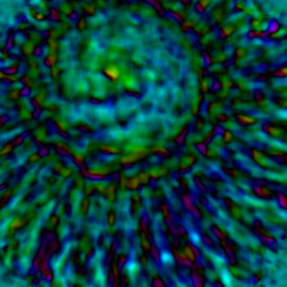
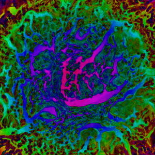
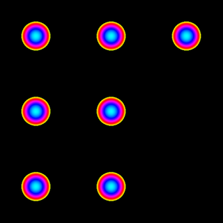
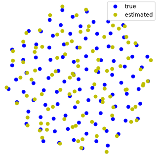
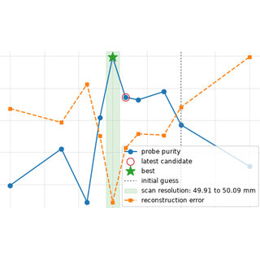
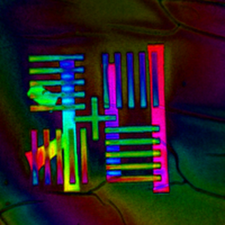
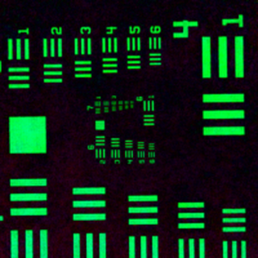
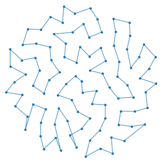
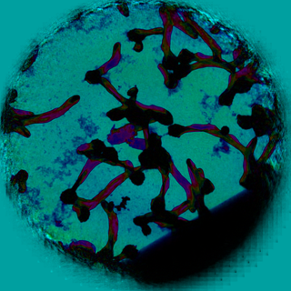
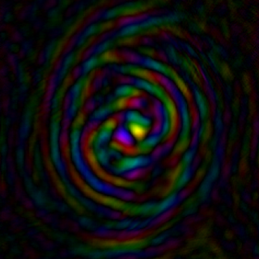

# Examples

Worked CPM and FPM reconstructions on simulated and real data.

[{ loading=lazy } CPM Simulation](example_CPM_sim.md)

[{ loading=lazy } CPM Example Data](example_CPM.md)

[{ loading=lazy } FPM Example Data](example_FPM.md)

[{ loading=lazy } CPM Mixed States](example_mixedStates.md)

[{ loading=lazy } CPM Multi-Slice](example_multiSlice.md)

[{ loading=lazy } CPM Multi-Wavelength](example_CPM_multiWavelength.md)

[{ loading=lazy } CPM Position Correction](example_LateralPositionCorrection.md)

[{ loading=lazy } CPM Purity-Based Calibration](example_purityCalibration.md)

[{ loading=lazy } CPM Reflection](example_reflectionPtychography.md)

[{ loading=lazy } CPM Interferometric Intensity](example_interferometricIntensityConstraint.md)

[{ loading=lazy } Scan Grids](example_scanGrids.md)

[{ loading=lazy } CPM Orthogonal Probe Relaxation](example_OPR.md)

[{ loading=lazy } CPM Differentiable Ptychography](example_differentiablePtychography.md)

!!! tip "Stuck?"
    The [User Guide](../user-guide/index.md) explains the [data format](../cpm/data-format.md), the [engines](../cpm/engines.md) and every [`Params` setting](../cpm/configuration.md). The [API Reference](../api/index.md) documents each class and function.