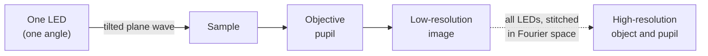
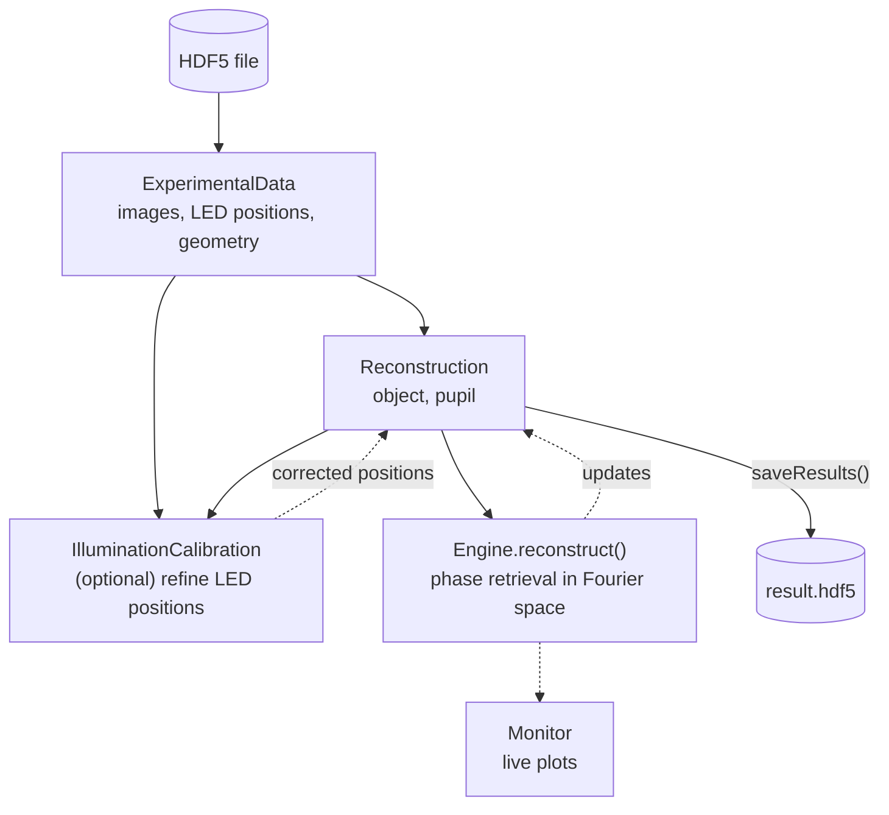

# FPM Overview

## What is Fourier ptychography?

In Fourier ptychography (FPM), an LED array lights the sample from many angles, one LED at a time. Each LED gives a plane wave at its own angle, and the microscope records a low-resolution image. A tilted plane wave shifts the sample's spectrum, so each image holds a different patch of it, cut out by the objective pupil. Stitching these patches together in Fourier space gives a high-resolution, wide-field image of amplitude and phase, without moving the sample.



$$
I_k = \left|\mathcal{F}^{-1}\{\tilde{O}(\mathbf{q} - \mathbf{q}_k)\,P(\mathbf{q})\}\right|^2
$$

where $\tilde{O}$ is the object spectrum, $\mathbf{q}$ the spatial frequency, $\mathbf{q}_k$ the shift set by the illumination angle of LED $k$, $P$ the pupil of the objective and $I_k$ the image recorded with LED $k$.

## Data flow



## FPM vs CPM

| | CPM | FPM |
|---|---|---|
| Illumination | Coherent focused probe scanned across the sample | LED array, one illumination angle per image |
| Scanning | Sample plane (real space) | Fourier plane (shifts of the pupil) |
| Output | Complex object and probe in real space | Complex object and pupil function |
| Resolution | Set by the largest scattering angle the detector records | Set by the objective NA plus the largest LED illumination NA |

## Step-by-step FPM workflow

### 1. Initialize with `easyInitialize`

```python
import PtyLab
from PtyLab import Engines

data, recon, params, monitor, engine, calib = PtyLab.easyInitialize(
    "fpm_data.hdf5",
    engine=Engines.mqNewton,
    operationMode="FPM",
)
```

For FPM, `easyInitialize` returns six objects, the sixth being an `IlluminationCalibration`:

| Object | Description |
|--------|-------------|
| `experimentalData` | FPM images and geometry |
| `reconstruction` | Reconstruction state: object and pupil |
| `params` | Settings shared by all engines |
| `monitor` | Live plots |
| `engine` | Reconstruction algorithm |
| `calib` | LED calibration helper (`IlluminationCalibration`) |

### 2. Calibrate LED positions (optional, recommended)

The LEDs of a real array sit tens of microns away from their nominal positions, and the array as a whole can be shifted or rotated. Wrong LED positions mean wrong illumination angles, which blur the reconstruction. `IlluminationCalibration` finds the bright-field LED positions from the data and fits a transform that corrects all of them:

```python
calib.fit_mode = "SimilarityTransform"
calib.calibrateRadius = True   # also calibrate the pupil radius (NA)
calib.plot = True              # show the fitted positions
calib.runCalibration()
```

`runCalibration()` overwrites `experimentalData.encoder` and `reconstruction.positions` with the corrected positions, and with `calibrateRadius = True` also updates `reconstruction.NA`. Keep `data.encoder.copy()` beforehand if you want to compare. `fit_mode` sets the fitted transform:

| `fit_mode` | Fits |
|------|------|
| `"Translation"` or `"EuclideanTransform"` | Shift and rotation of the whole array |
| `"SimilarityTransform"` (default) | Shift, rotation and uniform scale |
| `"AffineTransform"` | Shift, rotation, scale and shear |

Skip this step for simulated data, or when you have already checked the LED positions.

### 3. Reconstruct

```python
recon.initializeObjectProbe()
engine.numIterations = 50
engine.reconstruct()

recon.saveResults("fpm_result.hdf5")
```

The FPM data fields are listed in [Data Format](../cpm/data-format.md#fpm-fields).

## Recommended engines for FPM

| Engine | Notes |
|--------|-------|
| `mqNewton` | Recommended: fast quasi-Newton updates |
| `mPIE` | Good all-purpose choice with momentum |
| `ePIE` | Simplest; useful for debugging |
