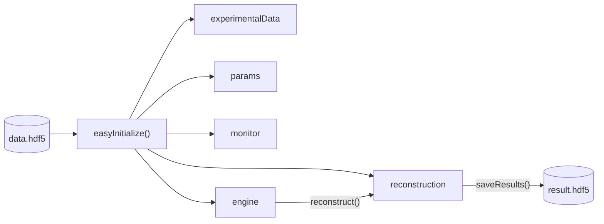

# Quick Start

PtyLab supports both **conventional ptychography (CPM)** and **Fourier ptychography (FPM)**. This page uses CPM; see the [FPM Overview](../fpm/overview.md) for the differences.

The script `example_scripts/exampleReconstructionCPM.py` runs a complete CPM reconstruction. Keep it open as a reference while reading this page.

Without your own dataset, use the simulated dataset `simu.hdf5`. If it does not exist yet, generate it with:

```python
from PtyLab.io import getExampleDataFolder, generate_simu_hdf5

generate_simu_hdf5(getExampleDataFolder() / "simu.hdf5")
```

The tutorials download their other datasets into `example_data/` on first run.

## Using `easyInitialize`

`easyInitialize()` builds all components from one HDF5 data file, so a reconstruction takes a few lines:

```python
import PtyLab
from PtyLab import Engines

experimentalData, reconstruction, params, monitor, engine = PtyLab.easyInitialize(
    "path/to/data.hdf5",
    engine=Engines.mPIE,
    operationMode="CPM",
)

engine.numIterations = 50
engine.reconstruct()

reconstruction.saveResults("result.hdf5")
```



Instead of a file path, you can pass the name of an example dataset:

| Name | Description |
|------|-------------|
| `"example:simulation_cpm"` | Synthetic CPM dataset (`simu.hdf5`) |
| `"example:simulation_fpm"` | Measured FPM dataset of a lung carcinoma sample (`LungCarcinomaSmallFPM.hdf5`) |

For CPM, `easyInitialize` returns five objects:

| Object | Type | Description |
|--------|------|-------------|
| `experimentalData` | `ExperimentalData` | Diffraction data and experimental geometry from the HDF5 file |
| `reconstruction` | `Reconstruction` | Reconstruction state: object, probe and scan positions |
| `params` | `Params` | Settings shared by all engines (propagator type, constraints, switches) |
| `monitor` | `Monitor` | Live plots during the reconstruction |
| `engine` | `BaseEngine` | The reconstruction algorithm (e.g. `mPIE`) |

## Headless mode

On a server or in a batch job without a display, turn off the live plots:

```python
experimentalData, reconstruction, params, monitor, engine = PtyLab.easyInitialize(
    "data.hdf5",
    engine=Engines.mPIE,
    dummyMonitor=True,
)
```

## Manual initialization

For more control (e.g. a custom initial probe or several probe modes), skip `easyInitialize` and set up each component yourself:

```python
from PtyLab import ExperimentalData, Reconstruction, Params, Monitor, Engines

# Load data
experimentalData = ExperimentalData("data.hdf5", operationMode="CPM")

# Configure parameters
params = Params()
params.propagatorType = "ASP"
params.positionOrder = "random"

# Set up visualization
monitor = Monitor()
monitor.figureUpdateFrequency = 5
monitor.objectPlot = "complex"

# Set up reconstruction state
reconstruction = Reconstruction(experimentalData, params)
reconstruction.npsm = 2   # two incoherent probe modes
reconstruction.nosm = 1
reconstruction.nlambda = 1
reconstruction.nslice = 1
reconstruction.initializeObjectProbe()

# Create and configure engine
engine = Engines.mPIE(reconstruction, experimentalData, params, monitor)
engine.numIterations = 50
engine.betaObject = 0.25
engine.betaProbe = 0.25
engine.reconstruct()

reconstruction.saveResults("result.hdf5")
```

## Saving and loading

```python
# Save the full reconstruction state
reconstruction.saveResults("result.hdf5")

# Reload probe or object from a previous run
reconstruction.load_probe("previous_result.hdf5")
reconstruction.load_object("previous_result.hdf5")
```

## Next steps

- [Tutorials](../tutorials/index.md): worked examples, end to end
- [User Guide](../cpm/overview.md): the pipeline, data format, engines and all `Params` options, for when you need details
