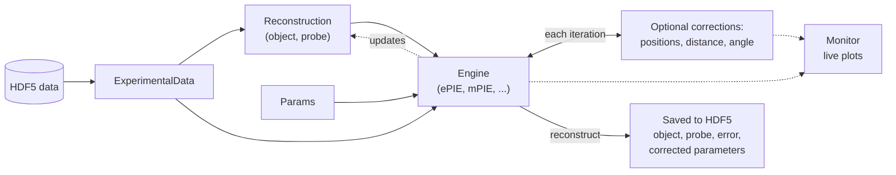

# PtyLab.py

!!! warning "Work in progress"
    This documentation is still being written, so some details may either be incomplete or might not match the current codebase. Please open an [issue](https://github.com/PtyLab/PtyLab.py/issues) if you find any inconsistencies.

PtyLab is an inverse modeling toolbox for **conventional (CPM)** and **Fourier (FPM)** ptychography in a unified framework. See the [paper](https://opg.optica.org/oe/fulltext.cfm?uri=oe-31-9-13763&id=529026) for details.

[Get started](getting-started/quickstart.md){ .md-button .md-button--primary } [Install](getting-started/installation.md){ .md-button } [Tutorials](tutorials/index.md){ .md-button }

## Key features

- **Classic engines**: ePIE, mPIE, mqNewton, qNewton
- **Advanced corrections**: position correction, defocus correction (zPIE), angle correction (aPIE), orthogonal probe relaxation (OPR)
- **Multi-modal**: multi-slice, multi-wavelength, mixed-state object and probe
- **Multiple propagators**: Fraunhofer, Fresnel, Angular Spectrum (ASP), scaled ASP, polychromatic variants
- **GPU acceleration**: same code runs on CPU and GPU (NumPy/CuPy)
- **Live monitor**: follow the object, probe, error metric and any corrected parameters (scan positions, sample-detector distance, wavelength, angle) as the iterations run

## How it works

PtyLab.py is built around a 6D array `(nlambda, nosm, npsm, nslice, N, N)`, i.e. wavelengths, object and probe state mixtures, depth slices, then the frame.

As shown below, the data flow to a reconstruction involves five core classes: `ExperimentalData`, `Reconstruction`, `Params`, `Engine` and `Monitor`.



`PtyLab.easyInitialize()` creates all five from one HDF5 file, see the [Quick Start](getting-started/quickstart.md).

## Demo

Try the demo in Google Colab:

[](https://colab.research.google.com/github/PtyLab/PtyLab.py/blob/main/demo.ipynb)


## Where to start

| I want to | Go to |
|---|---|
| install PtyLab, with or without a GPU | [Installation](getting-started/installation.md) |
| run a first reconstruction in a few lines | [Quick Start](getting-started/quickstart.md) |
| follow worked examples on simulated and real data | [Tutorials](tutorials/index.md) |
| look up the data format, engines or settings | [User Guide](cpm/overview.md) |
| contribute code, tests or tutorials | [Contributing](contributing.md) |

## Citation

If you use this package, please cite:

```bibtex
@article{Loetgering:23,
    author = {Lars Loetgering and Mengqi Du and Dirk Boonzajer Flaes and Tomas Aidukas and Felix Wechsler and Daniel S. Penagos Molina and Max Rose and Antonios Pelekanidis and Wilhelm Eschen and J\"{u}rgen Hess and Thomas Wilhein and Rainer Heintzmann and Jan Rothhardt and Stefan Witte},
    journal = {Opt. Express},
    number = {9},
    pages = {13763--13797},
    publisher = {Optica Publishing Group},
    title = {PtyLab.m/py/jl: a cross-platform, open-source inverse modeling toolbox for conventional and Fourier ptychography},
    volume = {31},
    month = {Apr},
    year = {2023},
    doi = {10.1364/OE.485370},
}
```
