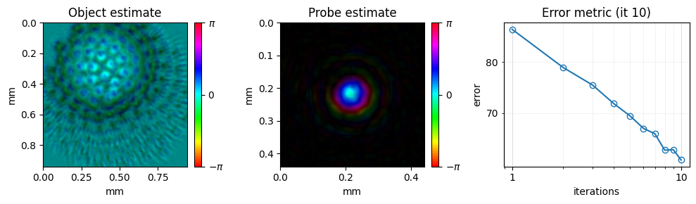
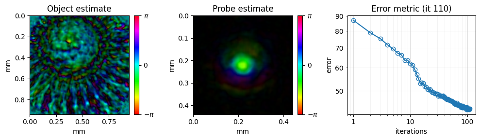

<!-- source-sha256: 81cb88515a880c3a5db9ea0c832e4a258d59a7ef38cc46f440cef3512786f9ed (generated by `ptylab docs render` from scripts/tutorial_CPM.py, do not edit) -->

# CPM Example Data

This tutorial walks through a complete CPM reconstruction, step by step. It uses `simu.hdf5`, a simulated measurement stored in the same HDF5 format as real data. It covers loading the data, setting up the reconstruction and its parameters, and running an engine.

**What you'll learn:**

- How to load CPM data from an HDF5 file
- How to configure `Params` and choose a reconstruction engine
- How to follow the reconstruction live with the monitor

!!! quote "References"
    - PtyLab: L. Loetgering et al., "PtyLab.m/py/jl: a cross-platform, open-source inverse modeling toolbox for conventional and Fourier ptychography," Opt. Express 31, 13763 (2023). [doi:10.1364/OE.485370](https://doi.org/10.1364/OE.485370)
    - ePIE: A. M. Maiden and J. M. Rodenburg, "An improved ptychographical phase retrieval algorithm for diffractive imaging," Ultramicroscopy 109, 1256–1262 (2009). [doi:10.1016/j.ultramic.2009.05.012](https://doi.org/10.1016/j.ultramic.2009.05.012)
    - mPIE: A. M. Maiden, D. Johnson and P. Li, "Further improvements to the ptychographical iterative engine," Optica 4, 736 (2017). [doi:10.1364/OPTICA.4.000736](https://doi.org/10.1364/OPTICA.4.000736)

!!! note "Dataset"
    The dataset (`simu.hdf5`) is generated automatically into the `example_data/` folder at the project root the first time you run the tutorial. If the file already exists it is not re-generated.

!!! tip "Prerequisites"
    Complete [CPM Simulation](tutorial_CPM_sim.md) before this tutorial.

!!! tip "Run it yourself"
    Run this tutorial as a Jupyter notebook, or as a Python script with `python tutorial_CPM.py`.

    [Download Jupyter notebook](tutorial_CPM.ipynb){ .md-button download="tutorial_CPM.ipynb" } [Download Python source](scripts/tutorial_CPM.py){ .md-button download="tutorial_CPM.py" }

```python
import matplotlib
import matplotlib.pyplot as plt
import numpy as np

# import the PtyLab module
import PtyLab
```

```python
from PtyLab.io import getExampleDataFolder, generate_simu_hdf5

fileName = "simu.hdf5"
filePath = getExampleDataFolder() / fileName

if not filePath.exists():
    print("Generating simu.hdf5...")
    generate_simu_hdf5(filePath)
    print("Done.")
else:
    print(f"{fileName} found, skipping generation.")
```

```text
simu.hdf5 found, skipping generation.
```

`PtyLab.easyInitialize` creates all five objects in one call, with default settings. The next cell shows it for reference.

The rest of this tutorial creates each object step by step instead, so you can see and change every setting.

```python
## optional
exampleData, reconstruction, params, monitor, ePIE_engine = PtyLab.easyInitialize(
    filePath
)
```

```text
Found encoder with shape (100, 2)
```

## ExperimentalData class
`ExperimentalData` loads a measurement from an HDF5 file (`.hdf5`). One file holds the diffraction images together with everything needed to interpret them: wavelength, scan positions and detector geometry.

A CPM file must contain these fields:

| Field | Shape | Unit | Meaning |
|-------|-------|------|---------|
| `ptychogram` | `(numFrames, Nd, Nd)` | counts | one diffraction image per scan position |
| `encoder` | `(numFrames, 2)` | m | scan position of each image |
| `wavelength` | scalar | m | illumination wavelength |
| `dxd` | scalar | m | detector pixel size |
| `zo` | scalar | m | sample-to-detector distance |

These fields are optional. When a field is missing it is set to `None`, and PtyLab either computes a value or does not use the field:

| Field | Unit | Meaning |
|-------|------|---------|
| `entrancePupilDiameter` | m | estimated beam diameter, used for the initial probe |
| `spectralDensity` | m | list of wavelengths, for multi-wavelength reconstruction |
| `theta` | rad | sample tilt, for reflection-mode ptychography |
| `emptyBeam` | counts | image of the beam without a sample |

FPM files use a different set of fields; see the [FPM tutorial](tutorial_FPM.md). [Data Format](../cpm/data-format.md) describes the file layout in full.

Load the file into `exampleData`:

```python
exampleData = PtyLab.ExperimentalData(filePath)
```

```text
Found encoder with shape (100, 2)
```

```python
# Look at one diffraction pattern; log10 makes the weak outer signal visible.
# exampleData.showPtychogram() opens an interactive viewer of all frames instead.
plt.imshow(np.log10(exampleData.ptychogram[0] + 1), cmap="gray")
plt.title("First diffraction pattern, log10(I + 1)")
plt.colorbar()
plt.show()
```


## Reconstruction class
`Reconstruction` holds everything that changes while the algorithm runs: the object and probe estimates, the sampling grids and the error history. It copies the geometry it needs from `exampleData`.

```python
## initialize the Reconstruction class
reconstruction = PtyLab.Reconstruction(exampleData, params)
```

Next, set the number of modes and slices and choose the initial guesses. The object and probe are 6-D arrays with axes `(nlambda, nosm, npsm, nslice, Ny, Nx)`: wavelengths, object modes, probe modes, depth slices, then the image. The first four axes have length 1 by default.

```python
reconstruction.npsm = 1  # Number of probe modes to reconstruct
reconstruction.nosm = 1  # Number of object modes to reconstruct
reconstruction.nlambda = 1  # len(exampleData.spectralDensity) # Number of wavelength
reconstruction.nslice = 1  # Number of object slice

# set initial guesses
reconstruction.initialProbe = "circ"
reconstruction.initialObject = "ones"
# initialize probe and object and related params
reconstruction.initializeObjectProbe()

# optional: give the initial probe a quadratic (diverging) phase
reconstruction.probe = reconstruction.probe * np.exp(
    1.0j
    * 2
    * np.pi
    / reconstruction.wavelength
    * (reconstruction.Xp**2 + reconstruction.Yp**2)
    / (2 * 6e-3)
)
```

## Monitor class
`Monitor` plots the object, the probe and the error while the reconstruction runs.

```python
## Initialise the monitor class
monitor = PtyLab.Monitor()
```

```python
## Set monitor properties
monitor.verboseLevel = "low"  # low (default): plot only one figure (object/probe/error), high: add a second figure showing measured and estimated diffraction patterns
monitor.figureUpdateFrequency = 1  # the frequency of the plots
monitor.objectPlot = "complex"  # options: complex, abs, angle
monitor.objectZoom = 1.5  # control object plot FoV
monitor.probeZoom = 0.5  # control probe plot FoV
monitor.objectPlotContrast = 0.9  # control the contrast of object plot, normalized intensity is from [0,1], objectPlotContrast sets the maximum value for color axis
monitor.probePlotContrast = 0.9  # control the contrast of probe plot
```

```text
/tmp/ipykernel_1015785/3958284327.py:3: UserWarning: For faster update of the reconstruction plot, set `monitor.figureUpdateFrequency = 5` or higher.
  monitor.figureUpdateFrequency = 1  # the frequency of the plots
```

## Params class
`Params` holds the settings that all engines share: CPU or GPU, the propagator, the order in which scan positions are visited, and the switches for constraints and regularization.

```python
## Initialise Params class
params = PtyLab.Params()
```

```python
## main parameters
params.positionOrder = "random"  # 'sequential' or 'random'
params.propagator = (
    "Fresnel"  # Fraunhofer Fresnel ASP scaledASP polychromeASP scaledPolychromeASP
)

## how do we want to reconstruct?
# params.gpuSwitch is detected automatically: True if CuPy finds a GPU
params.probePowerCorrectionSwitch = (
    True  # fix the power of the probe to the maximum of the ptychogram
)
params.comStabilizationSwitch = (
    True  # fix the center-of-mass of the probe in the center of the probe frame
)
params.orthogonalizationSwitch = (
    False  # turn on when performing mixed states reconstructions
)
params.orthogonalizationFrequency = 10  # the frequency of performing orthogonalization
params.fftshiftSwitch = False
params.intensityConstraint = "standard"  # standard fluctuation exponential poission
params.absorbingProbeBoundary = False
params.objectContrastSwitch = False
params.absObjectSwitch = False
params.backgroundModeSwitch = False
params.couplingSwitch = True
params.couplingAleph = 1
params.positionCorrectionSwitch = False
```

## Engine class
An engine runs the iterative algorithm that improves the object and probe. Create it from the four objects above, set the number of iterations and the step sizes, and call `reconstruct()`.

Engines can be switched on the same `reconstruction`: the next engine starts from the current estimates. Below, 10 iterations of ePIE are followed by 100 iterations of mPIE.

```python
# create the engine from the four objects above
ePIE = PtyLab.Engines.ePIE(reconstruction, exampleData, params, monitor)
```

```python
ePIE.numIterations = 10
ePIE.betaObject = 0.25
ePIE.betaProbe = 0.25
ePIE.reconstruct()
```

```text
Starting ePIE: 10 iterations on the GPU
```



```python
# continue with mPIE from the current estimates
mPIE = PtyLab.Engines.mPIE(reconstruction, exampleData, params, monitor)
mPIE.numIterations = 100
mPIE.betaProbe = 0.25
mPIE.betaObject = 0.25
mPIE.reconstruct()
```

```text
Starting mPIE: 100 iterations on the GPU
```



```python
## now save the data
# saves the result as HDF5, plus a PNG of the final reconstruction
reconstruction.saveResults("reconstruction.hdf5", snapshot=monitor)
```

```text
The reconstruction results (all) have been saved
Saved monitor figure reconstruction_reconstruction.png
```

---

[Download Jupyter notebook](tutorial_CPM.ipynb){ .md-button download="tutorial_CPM.ipynb" } [Download Python source](scripts/tutorial_CPM.py){ .md-button download="tutorial_CPM.py" }
