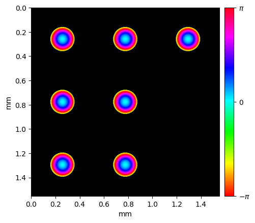
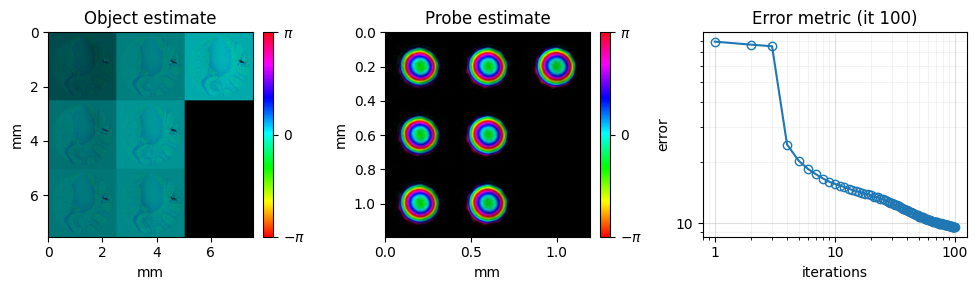
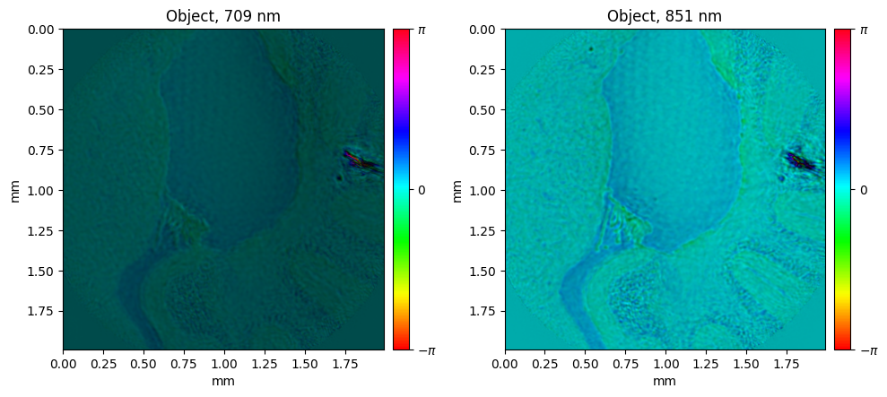

<!-- source-sha256: dc281ee88839937055d5f54a9957f04c310f73decae0e65b15c8e75198461a81 (generated by `ptylab docs render` from scripts/tutorial_CPM_multiWavelength.py, do not edit) -->

# CPM Multi-Wavelength

This tutorial reconstructs a mouse brain sample measured with a broadband beam. The beam contains 7 wavelengths, from 709 to 851 nm. PtyLab reconstructs one object and one probe per wavelength.

**What you'll learn:**

- How the wavelengths are stored in the data (`spectralDensity`)
- How to set up a polychromatic reconstruction (`nlambda > 1`)
- How to run it with `mPIE`

!!! quote "References"
    - Multi-wavelength ptychography (ptychographic information multiplexing): D. J. Batey, D. Claus and J. M. Rodenburg, "Information multiplexing in ptychography," Ultramicroscopy 138, 13–21 (2014). [doi:10.1016/j.ultramic.2013.12.003](https://doi.org/10.1016/j.ultramic.2013.12.003)

!!! note "Dataset"
    The dataset (`Brain_smoothBeam_poly_bin8.hdf5`, ~500 MB) is downloaded automatically into the `example_data/` folder at the project root the first time you run the tutorial. If the file already exists it is not re-downloaded.

!!! tip "Prerequisites"
    Complete [CPM Simulation](tutorial_CPM_sim.md) before this tutorial.

!!! tip "Run it yourself"
    Run this tutorial as a Jupyter notebook, or as a Python script with `python tutorial_CPM_multiWavelength.py`.

    [Download Jupyter notebook](tutorial_CPM_multiWavelength.ipynb){ .md-button download="tutorial_CPM_multiWavelength.ipynb" } [Download Python source](scripts/tutorial_CPM_multiWavelength.py){ .md-button download="tutorial_CPM_multiWavelength.py" }

```python
import matplotlib
import matplotlib.pyplot as plt
import numpy as np
from pathlib import Path
import h5py
```

```python
# import PtyLab
import PtyLab
from PtyLab import ExperimentalData
from PtyLab import Reconstruction
from PtyLab import Monitor
from PtyLab import Params
from PtyLab import Engines
```

```python
from PtyLab.utils.visualisation import hsvplot, hsvmodeplot, absplot, absmodeplot
```

```python
from PtyLab.io import getExampleDataFolder
import urllib.request

fileName = "Brain_smoothBeam_poly_bin8.hdf5"
filePath = getExampleDataFolder() / fileName

if not filePath.exists():
    print(f"Downloading {fileName}...")
    urllib.request.urlretrieve(
        "https://ndownloader.figshare.com/files/33950357",
        filePath,
    )
    print("Download complete.")
else:
    print(f"{fileName} found, skipping download.")
```

```text
Brain_smoothBeam_poly_bin8.hdf5 found, skipping download.
```

## Load and prepare the data
The file stores the wavelengths in `spectralDensity`, one value per wavelength in meters. A constant background of 10 counts is subtracted from every image; `posit` sets negative values to zero.

```python
from PtyLab.utils.utils import posit
experimentalData = ExperimentalData(filePath, operationMode="CPM")
backgroundOffset = 10
experimentalData.entrancePupilDiameter = 0.2e-3

experimentalData.ptychogram = posit(experimentalData.ptychogram - backgroundOffset)
# show measured ptychogram in log scale. Need to close the window to continue
# experimentalData.showPtychogram() opens an interactive viewer of all frames; here we show the first one
plt.imshow(np.log10(experimentalData.ptychogram[0] + 1), cmap="gray")
plt.title("First diffraction pattern, log10(I + 1)")
plt.colorbar()
plt.show()
```

```text
Found encoder with shape (890, 2)
```


## Monitor and parameters
`couplingSwitch` couples the probes of neighbouring wavelengths, which have similar shapes. After each iteration every probe is mixed with its neighbours:

$$P_\lambda \leftarrow (1-\alpha)\,P_\lambda + \alpha\,\frac{P_{\lambda-1}+P_{\lambda+1}}{2},$$

where $P_\lambda$ is the probe at wavelength index $\lambda$ and $\alpha$ is `couplingAleph` (0 = no coupling, 1 = replace by the neighbour mean). The first and last probe use their single neighbour.

```python
# Set monitor properties
monitor = Monitor()
monitor.figureUpdateFrequency = 1
monitor.verboseLevel = "low"  # high: plot two figures, low: plot only one figure
monitor.probeZoom = 1  # control probe plot FoV
monitor.objectZoom = 1  # control object plot FoV
monitor.probePlotContrast = 1
```

```text
/tmp/ipykernel_1039261/3217139662.py:3: UserWarning: For faster update of the reconstruction plot, set `monitor.figureUpdateFrequency = 5` or higher.
  monitor.figureUpdateFrequency = 1
```

```python
params = Params()
# params.gpuSwitch is detected automatically: True if CuPy finds a GPU
params.positionOrder = "random"  # 'sequential' or 'random'
params.propagatorType = (
    "Fraunhofer"  # Fraunhofer Fresnel ASP scaledASP polychromeASP scaledPolychromeASP
)
params.probePowerCorrectionSwitch = False
params.modulusEnforcedProbeSwitch = True
params.comStabilizationSwitch = True
params.orthogonalizationSwitch = True
params.orthogonalizationFrequency = 5
params.intensityConstraint = "standard"  # standard fluctuation exponential poission
params.couplingSwitch = True
params.couplingAleph = 0.5
```

## Reconstruction
`nlambda` is set to the number of wavelengths, so the object and probe arrays get one entry per wavelength. The wavelengths are mutually incoherent, so the model adds their diffraction intensities:

$$I_j(\mathbf{q}) = \sum_{\lambda=1}^{n_\lambda} \left|\mathcal{F}\left\{P_\lambda(\mathbf{r})\,O_\lambda(\mathbf{r}-\mathbf{r}_j)\right\}\right|^2,$$

where $I_j$ is the modeled pattern at scan position $\mathbf{r}_j$, $\mathbf{q}$ the detector coordinate, $P_\lambda$ and $O_\lambda$ the probe and object at wavelength $\lambda$, $\mathcal{F}$ the Fraunhofer propagator and $n_\lambda$ = `nlambda`.

All probes start as the same circle with a diverging (quadratic) phase.

```python
reconstruction = Reconstruction(experimentalData, params)
reconstruction.No = 2**10
reconstruction.nlambda = len(reconstruction.spectralDensity)

# initialize probe and object and related params
reconstruction.initialProbe = "circ"
reconstruction.initialObject = "ones"
reconstruction.initializeObjectProbe()

# # customize initial probe quadratic phase
reconstruction.probe = reconstruction.probe * np.exp(
    1.0j
    * 2
    * np.pi
    / reconstruction.wavelength
    * (reconstruction.Xp**2 + reconstruction.Yp**2)
    / (1 * 2e-2)
)

hsvmodeplot(
    np.squeeze(reconstruction.probe), pixelSize=reconstruction.dxp, axisUnit="mm"
)
```



## Run mPIE
Reconstruct for 100 iterations. The monitor shows the object and probe of each wavelength.

```python
mPIE = Engines.mPIE(reconstruction, experimentalData, params, monitor)
mPIE.numIterations = 100
mPIE.betaProbe = 0.25
mPIE.betaObject = 0.25
mPIE.reconstruct()
```

```text
Starting mPIE: 100 iterations on the GPU
```



## Result
The monitor shows all 7 objects side by side, which makes each one small. Below is the object at the shortest and longest wavelength, cropped to the scanned area (brightness is the amplitude, hue the phase).

```python
c, h = reconstruction.No // 2, 350  # object center and half-width of the scanned area, in pixels
fig, axes = plt.subplots(1, 2, figsize=(10, 4.8))
for ax, l in zip(axes, [0, -1]):
    hsvplot(reconstruction.object[l, 0, 0, 0, c - h : c + h, c - h : c + h], ax=ax, pixelSize=reconstruction.dxo, axisUnit="mm")
    ax.set_title(f"Object, {reconstruction.spectralDensity[l] * 1e9:.0f} nm")
plt.tight_layout()
plt.show()
```



```python
# now save the data
# saves the result as HDF5, plus a PNG of the final reconstruction
reconstruction.saveResults('reconstruction.hdf5', snapshot=monitor)
```

```text
The reconstruction results (all) have been saved
Saved monitor figure reconstruction_reconstruction.png
```

---

[Download Jupyter notebook](tutorial_CPM_multiWavelength.ipynb){ .md-button download="tutorial_CPM_multiWavelength.ipynb" } [Download Python source](scripts/tutorial_CPM_multiWavelength.py){ .md-button download="tutorial_CPM_multiWavelength.py" }
