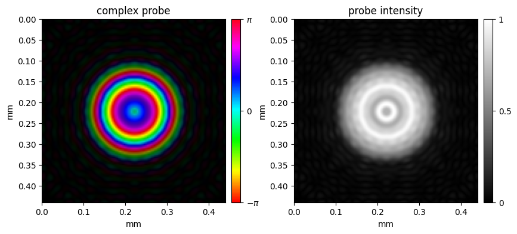
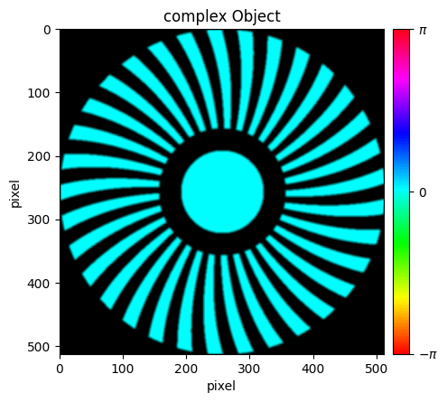
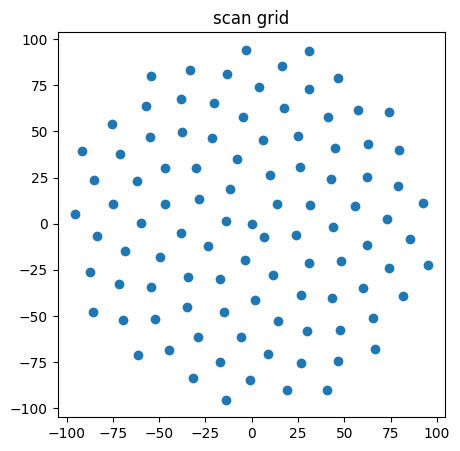
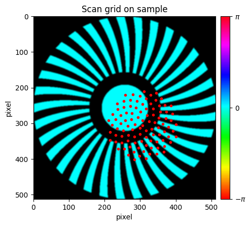
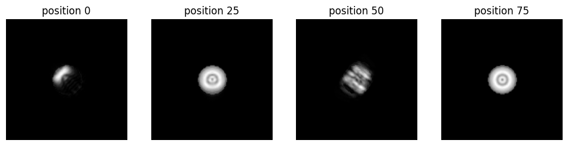
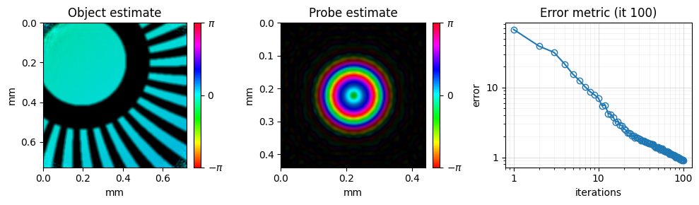

<!-- source-sha256: f2fa2c52b50d4716c09d0c49775d8197cd09cdc2eeb0da77f33d3b219bbe02b4 (generated by docs/render_tutorials.py, do not edit) -->

# 01 – CPM Simulation

This tutorial introduces conventional ptychographic microscopy (CPM) by simulating a complete experiment from scratch. Starting from the geometry (wavelength, detector size, pixel size, sample-to-detector distance), it defines a probe and an object, computes the diffraction patterns, and reconstructs the object with the mPIE engine.

**What you'll learn:**

- How to define CPM experimental geometry
- How to simulate a ptychogram from a known object and probe
- How to fill `ExperimentalData` by hand and run `mPIE`

!!! tip "Run it yourself"
    Run this tutorial as a Jupyter notebook, or as a Python script with `python tutorial_CPM_sim.py`.

    [Download Jupyter notebook](tutorial_CPM_sim.ipynb){ .md-button download="tutorial_CPM_sim.ipynb" } [Download Python source](tutorial_CPM_sim.py){ .md-button download="tutorial_CPM_sim.py" }

## 1. Geometry of the experiment
First, import the packages.

```python
# First all required modules must be imported
import numpy as np
from PtyLab.utils.utils import circ, gaussian2D, cart2pol
from PtyLab.utils.scanGrids import GenerateNonUniformFermat
from PtyLab.Operators.Operators import aspw
from PtyLab.utils.visualisation import hsvplot, absplot, show3Dslider
import matplotlib.pylab as plt
from scipy.signal import convolve2d
```

Next, define the geometry and compute the sampling grids in the sample and detector planes. A conventional ptychography setup is described by three quantities:

1. the wavelength of the beam, here 632.8 nm (`wavelength`),
2. the sample-to-detector distance (`zo`),
3. the number of detector pixels per side (`Nd`) and their size (`dxd`).

The pixel size in the sample plane follows from these:

$$dx_p = \frac{\lambda\, z_o}{N_d\, dx_d}$$

where $\lambda$ is the wavelength and $N_d\, dx_d$ the width of the detector.

```python
# Set the geometry of the Experiment
wavelength = 632.8e-9
zo = 5e-2
Nd = 2**7
dxd = 16 * 4.5e-6

# Calculate the length of the detector
Ld = Nd * dxd

# probe coordinates
dxp = wavelength * zo / Ld
Np = Nd
Lp = dxp * Np
xp = np.arange(-Np // 2, Np // 2) * dxp
Xp, Yp = np.meshgrid(xp, xp)

# object coordinates
No = 2**9
dxo = dxp
Lo = dxo * No
xo = np.arange(-No // 2, No // 2) * dxo
Xo, Yo = np.meshgrid(xo, xo)
```

## 2. Definition of the illuminating beam
The beam (probe) starts as a pinhole whose edge is smoothed with a Gaussian kernel.

```python
# generate illumination
# note: simulate focused beam
# goal: 1:1 image iris through (low-NA) lens with focal length f onto an object
f = 5e-3  # focal length of lens, creating a focused probe
pinhole = circ(Xp, Yp, Lp / 2)
pinhole = convolve2d(pinhole, gaussian2D(5, 1).astype(np.float32), mode="same")
```

The pinhole is then imaged onto the sample: propagate it a distance $2f$ to a lens of focal length $f$, apply the lens phase and aperture, and propagate another $2f$. The plots show the complex probe and its intensity.

```python
# propagate to lens
probe = aspw(pinhole, 2 * f, wavelength, Lp, is_FT=False)[0]

# multiply with quadratic phase and aperture
aperture = circ(Xp, Yp, 3 * Lp / 4)
aperture = convolve2d(aperture, gaussian2D(5, 3).astype(np.float32), mode="same")
probe = (
    probe
    * np.exp(-1.0j * 2 * np.pi / wavelength * (Xp**2 + Yp**2) / (2 * f))
    * aperture
)
probe = aspw(probe, 2 * f, wavelength, Lp, is_FT=False)[0]

plt.figure(figsize=(10, 4), num=1)
ax1 = plt.subplot(121)
hsvplot(probe, ax=ax1, pixelSize=dxp, axisUnit="mm")
ax1.set_title("complex probe")
ax2 = plt.subplot(122)
absplot(abs(probe), ax=ax2, pixelSize=dxp, axisUnit="mm", cmap="gray")
ax2.set_title("probe intensity")
# plt.show(block=False)
```

```text
Text(0.5, 1.0, 'probe intensity')
```



## 3. Definition of an object
The test object is a binary spiral. The object array must be larger than the probe array, because the probe is scanned across it.

```python
# generate object
d = 1e-3  # the smaller this parameter the larger the spatial frequencies in the simulated object
b = 33  # topological charge (feel free to play with this number)
theta, rho = cart2pol(Xo, Yo)
t = (1 + np.sign(np.sin(b * theta + 2 * np.pi * (rho / d) ** 2))) / 2
t = t * circ(Xo, Yo, Lo) * (1 - circ(Xo, Yo, 200 * dxo)) + circ(Xo, Yo, 130 * dxo)
obj = convolve2d(t, gaussian2D(5, 3), mode="same")  # smooth edges

plt.figure(figsize=(5, 5))
ax = plt.axes()
hsvplot(np.squeeze(obj), ax=ax)
ax.set_title("complex Object")
plt.show(block=False)
```



## 4. Definition of the scan map
Create a scan grid of 100 points with `GenerateNonUniformFermat`. The points lie on a Fermat spiral, which spreads them as evenly as possible.

```python
numPoints = 100  # number of points
radius = 100  # radius of final scan grid (in pixels)
p = 1  # p = 1 is standard Fermat;  p > 1 yields more points towards the center of grid
y_coord, x_coord = GenerateNonUniformFermat(numPoints, radius=radius, power=p)

# show scan grid
plt.figure(figsize=(5, 5))
plt.plot(y_coord, x_coord, "o")
plt.title("scan grid")
plt.show(block=False)
```



Convert the scan grid to positions in meters and store them in `encoder`, one row per position. The plot shows the scan positions on the object.

```python
# Calculate
encoder = np.vstack((y_coord * dxo, x_coord * dxo)).T

# prevent negative indices by centering spiral coordinates on object
positions = np.round(encoder / dxo)
offset = 50
positions = (positions + No // 2 - Np // 2 + offset).astype(int)

# get number of positions
numFrames = len(x_coord)

# show scan grid on object
plt.figure(figsize=(5, 5))
ax1 = plt.axes()
hsvplot(np.squeeze(obj), ax=ax1)
ax1.plot(positions[:, 1] + Np // 2, positions[:, 0] + Np // 2, ".", c="red")
ax1.set_title("Scan grid on sample")
plt.show(block=False)
```



## 5. Calculate diffraction data
All inputs are now defined. Create the 3-D array `ptychogram`, which will hold one diffraction pattern per scan position.

```python
# generate the ptychogram array
ptychogram = np.zeros((numFrames, Nd, Nd))
```

For each scan position, cut out the object patch under the probe; it has the same size as the probe array. The exit wave `esw`, the field just behind the sample, is the product of probe and patch. In the far field, the field at the detector is the Fourier transform of the exit wave, and the detector records its squared magnitude:

$$I_j = \left|\mathcal{F}\{P \cdot O_j\}\right|^2$$

where $P$ is the probe, $O_j$ the object patch at scan position $j$, $\mathcal{F}$ the 2-D Fourier transform and $I_j$ the diffraction pattern.

```python
for loop in np.arange(numFrames):
    # get object patch
    row, col = positions[loop]
    sy = slice(row, row + Np)
    sx = slice(col, col + Np)
    # note that object patch has size of probe array
    objectPatch = obj[..., sy, sx].copy()
    # multiply each probe mode with object patch
    esw = objectPatch * probe
    # generate diffraction data, propagate the esw to the detector plane
    ESW = np.fft.fftshift(np.fft.fft2(np.fft.ifftshift(esw), norm="ortho"))
    # save data in ptychogram
    ptychogram[loop] = abs(ESW) ** 2
```

Show a few of the simulated diffraction patterns, on a log scale.

```python
# show3Dslider(np.log(ptychogram)) opens an interactive viewer of all frames; here we show four
fig, axes = plt.subplots(1, 4, figsize=(12, 3))
for ax, j in zip(axes, [0, 25, 50, 75]):
    ax.imshow(np.log10(ptychogram[j] + 1), cmap="gray")
    ax.set_title(f"position {j}")
    ax.axis("off")
plt.show()
```



## 6. Reconstruction of the simulated data
Finally, reconstruct the object and probe from the simulated data. The cells below create the PtyLab objects by hand, fill `ExperimentalData` with the arrays from above, and run mPIE. [02 – CPM Example Data](tutorial_CPM.md) explains each object in more detail.

```python
from PtyLab import ExperimentalData
from PtyLab import Reconstruction
from PtyLab import Monitor
from PtyLab import Params
from PtyLab import Engines
import matplotlib as mpl
```

```python
## initialize the ExperimentalData class and set values
exampleData = ExperimentalData(operationMode="CPM")

# check the requiredFields and the optionalFields of the ExperimentalData class
print(exampleData.requiredFields)
print(exampleData.optionalFields)
```

```text
['ptychogram', 'wavelength', 'encoder', 'dxd', 'zo']
['entrancePupilDiameter', 'spectralDensity', 'theta', 'emptyBeam']
```

```python
# fill up the requiredFields
exampleData.ptychogram = ptychogram
exampleData.wavelength = wavelength
exampleData.encoder = encoder
exampleData.dxd = dxd
exampleData.zo = zo
# then fill up optionalFields. If not used, set the values to None
exampleData.entrancePupilDiameter = 150e-6  # initial estimate of beam diameter
exampleData.spectralDensity = None  # used in polychromatic ptychography
exampleData.theta = None  # used in tiltPlane reflection ptychography

# call _setData to auto-calculate all the necessary variables in ExperimentalData
exampleData._setData()
```

```python
## initialize the Monitor class and set values
monitor = Monitor()
monitor.figureUpdateFrequency = 1
monitor.objectPlot = "complex"  # complex abs angle
monitor.verboseLevel = "low"  # high: plot two figures, low: plot only one figure
monitor.objectZoom = 1.5  # control object plot FoV
monitor.probeZoom = 0.5  # control probe plot FoV
```

```text
/tmp/ipykernel_317587/4239310548.py:3: UserWarning: For faster update of the reconstruction plot, set `monitor.figureUpdateFrequency = 5` or higher.
  monitor.figureUpdateFrequency = 1
```

```python
## initialize the Params class and set values
params = Params()
# main parameters
params.positionOrder = "random"  # 'sequential' or 'random'
params.propagator = (
    "Fresnel"  # Fraunhofer Fresnel ASP scaledASP polychromeASP scaledPolychromeASP
)
params.intensityConstraint = "standard"  # standard fluctuation exponential poission
# how do we want to reconstruct (all Switches are set to False by default)
params.gpuSwitch = False
params.probePowerCorrectionSwitch = True
params.modulusEnforcedProbeSwitch = False
params.comStabilizationSwitch = True
params.orthogonalizationSwitch = False
params.orthogonalizationFrequency = 10
params.fftshiftSwitch = False
```

```text
INFO:GPU:cupy and CUDA available, switching to GPU
WARNING:GPU:Disabling GPU switch. If this is unwanted, please set `self.gpuSwitch = True`
```

```python
## initialize the Reconstruction class and set values
reconstruction = Reconstruction(exampleData, params)
reconstruction.npsm = 1  # Number of probe modes to reconstruct
reconstruction.nosm = 1  # Number of object modes to reconstruct
reconstruction.nlambda = 1  # len(exampleData.spectralDensity) # Number of wavelength
reconstruction.nslice = 1  # Number of object slice

reconstruction.initialProbe = "circ"
reconstruction.initialObject = "ones"

# initialize probe and object
reconstruction.initializeObjectProbe()
# optional: customize initial probe quadratic phase
reconstruction.probe = reconstruction.probe * np.exp(
    1.0j
    * 2
    * np.pi
    / reconstruction.wavelength
    * (reconstruction.Xp**2 + reconstruction.Yp**2)
    / (2 * 6e-3)
)
```

```text
INFO:Reconstruction:Copying attribute wavelength
INFO:Reconstruction:Copying attribute dxd
INFO:Reconstruction:Copying attribute theta
INFO:Reconstruction:Copying attribute spectralDensity
INFO:Reconstruction:Copying attribute entrancePupilDiameter
INFO:Reconstruction:Initial object set to ones
INFO:Reconstruction:Initial probe set to circ
```

```python
# choose the reconstruction engine and set values
engine_mPIE = Engines.mPIE(reconstruction, exampleData, params, monitor)
engine_mPIE.numIterations = 100
engine_mPIE.betaProbe = 0.25
engine_mPIE.betaObject = 0.25
# start reconstruction
engine_mPIE.reconstruct()

plt.close("all")
```

```text
INFO:mPIE:Successfully created mPIE engine
INFO:mPIE:Wavelength attribute: 6.328e-07
INFO:mPIE:Doing probe com stabilization every iteration
```



```python
# you can now store your results as hdf5 file with a png of the final snapshot of the run
reconstruction.saveResults("result.hdf5", snapshot=monitor)
```

```text
The reconstruction results (all) have been saved
Saved monitor figure result_reconstruction.png
```

---

[Download Jupyter notebook](tutorial_CPM_sim.ipynb){ .md-button download="tutorial_CPM_sim.ipynb" } [Download Python source](tutorial_CPM_sim.py){ .md-button download="tutorial_CPM_sim.py" }
