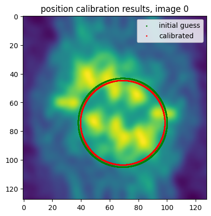
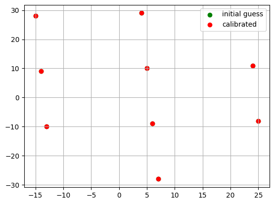
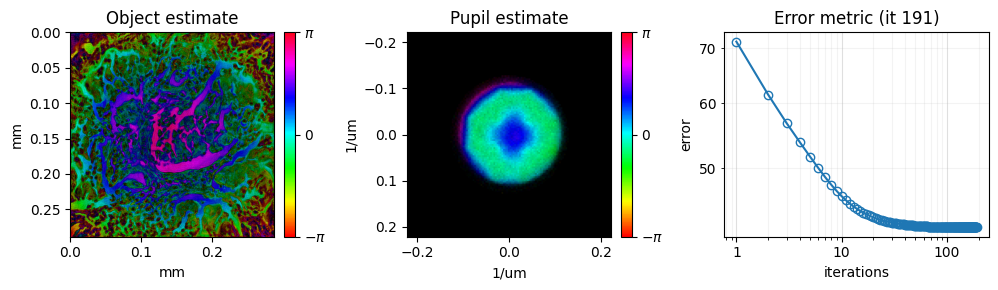
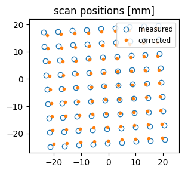
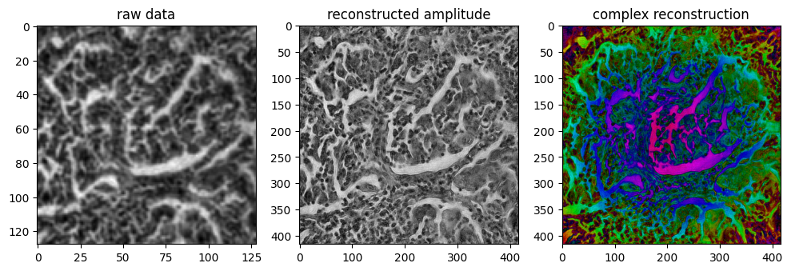
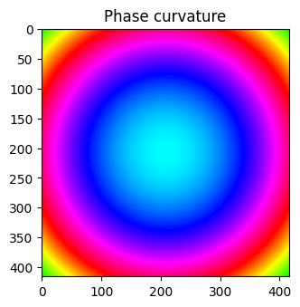
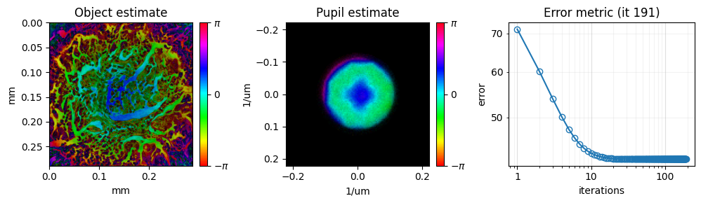
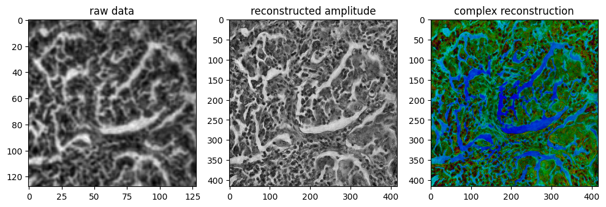

<!-- source-sha256: b1fc57bab782877158dd9b503424ff5e5d08aee9b75ff8b21bff3eb027042b1d (generated by `ptylab docs render` from scripts/tutorial_FPM.py, do not edit) -->

# FPM Example Data

This tutorial walks through a complete Fourier ptychographic microscopy (FPM) reconstruction. It loads a dataset recorded with an LED array, calibrates the LED positions, and recovers the high-resolution complex object and the pupil.

**What you'll learn:**

- How FPM differs from CPM in setup and initialization
- How to use `IlluminationCalibration` to correct LED positions
- How to run an FPM reconstruction with `qNewton`
- How to remove the phase curvature caused by the illumination and the optics

!!! quote "References"
    - PtyLab: L. Loetgering et al., "PtyLab.m/py/jl: a cross-platform, open-source inverse modeling toolbox for conventional and Fourier ptychography," Opt. Express 31, 13763 (2023). [doi:10.1364/OE.485370](https://doi.org/10.1364/OE.485370)
    - Fourier ptychography: G. Zheng, R. Horstmeyer and C. Yang, "Wide-field, high-resolution Fourier ptychographic microscopy," Nat. Photonics 7, 739–745 (2013). [doi:10.1038/nphoton.2013.187](https://doi.org/10.1038/nphoton.2013.187)
    - LED position calibration: R. Eckert, Z. F. Phillips and L. Waller, "Efficient illumination angle self-calibration in Fourier ptychography," Appl. Opt. 57, 5434 (2018). [doi:10.1364/AO.57.005434](https://doi.org/10.1364/AO.57.005434)
    - Phase curvature: T. Aidukas, L. Loetgering and A. R. Harvey, "Addressing phase-curvature in Fourier ptychography," Opt. Express 30, 22421 (2022). [doi:10.1364/OE.458657](https://doi.org/10.1364/OE.458657)

!!! tip "Run it yourself"
    Run this tutorial as a Jupyter notebook, or as a Python script with `python tutorial_FPM.py`.

    [Download Jupyter notebook](tutorial_FPM.ipynb){ .md-button download="tutorial_FPM.ipynb" } [Download Python source](scripts/tutorial_FPM.py){ .md-button download="tutorial_FPM.py" }

```python
import matplotlib.pyplot as plt
import numpy as np
```

```python
from PtyLab.io import getExampleDataFolder
from PtyLab import Engines
import PtyLab
```

```python
from PtyLab.io import getExampleDataFolder
import urllib.request

fileName = "LungCarcinomaFPM.hdf5"
filePath = getExampleDataFolder() / fileName

if not filePath.exists():
    print(f"Downloading {fileName}..")
    urllib.request.urlretrieve(
        "https://ndownloader.figshare.com/files/33956981", filePath
    )
    print("Download complete.")
else:
    print(f"{fileName} found, skipping download.")
```

```text
LungCarcinomaFPM.hdf5 found, skipping download.
```

```python
# fileName = "LungCarcinomaFPM.hdf5"
# # fileName = 'USAFTargetFPM.hdf5'
# filePath = getExampleDataFolder() / fileName

exampleData, reconstruction, params, monitor, engine, calib = PtyLab.easyInitialize(
    filePath, operationMode="FPM"
)
```

```text
Found encoder with shape (81, 2)
```

## ExperimentalData class
`ExperimentalData` loads the measurement from an HDF5 file (`.hdf5`). An FPM file must contain these fields:

| Field | Shape | Unit | Meaning |
|-------|-------|------|---------|
| `ptychogram` | `(numFrames, Nd, Nd)` | counts | one low-resolution image per LED |
| `encoder` | `(numFrames, 2)` | m | position of each LED in the array |
| `wavelength` | scalar | m | illumination wavelength |
| `dxd` | scalar | m | camera pixel size |
| `zled` | scalar | m | LED-to-sample distance |
| `magnification` | scalar | – | magnification of the microscope |

The numerical aperture `NA` of the objective is optional. Here `easyInitialize` loads the file and also creates the other objects, which the next sections adjust.

```python
mean_img = np.mean(exampleData.ptychogram, 0)
```

## Reconstruction class
`ExperimentalData` holds the measurement and does not change. `Reconstruction` holds what is estimated: the object and the pupil (in FPM the probe is the pupil).

In FPM the initial object can be computed from the data: `initialObject = "upsampled"` interpolates the low-resolution images up to the object grid. The pupil starts as a clear circle (`initialProbe = "circ"`), an open aperture without aberrations. `initializeObjectProbe()` then creates both. A copy is kept so the second reconstruction below can start from the same point.

```python
reconstruction.initialProbe = "circ"
reconstruction.initialObject = "upsampled"
reconstruction.initializeObjectProbe()

import copy

reconstruction0 = copy.deepcopy(reconstruction)
```

## Monitor class
`Monitor` plots the object, the pupil and the error while the reconstruction runs.

```python
# Set monitor properties
monitor.figureUpdateFrequency = 10
monitor.objectPlot = "complex"
monitor.verboseLevel = "low"
monitor.objectZoom = 0.01
monitor.probeZoom = 0.01
```

## Params class
`Params` holds the settings that all engines share, for example CPU or GPU and the order in which the images are used. `positionOrder = "NA"` processes the images from the central (bright-field) LEDs outwards.

```python
params.gpuSwitch = False
params.positionOrder = "NA"
params.probeBoundary = True
params.adaptiveDenoisingSwitch = True
```

```text
Disabling GPU switch. If this is unwanted, please set `self.gpuSwitch = True`
```

## IlluminationCalibration class
The LED positions in the file are not exact. `IlluminationCalibration` refines them from the data before the reconstruction, following R. Eckert, Z. F. Phillips and L. Waller, "Efficient illumination angle self-calibration in Fourier ptychography," Appl. Opt. 57, 5434–5442 (2018).

```python
calib.plot = True
calib.fit_mode = "SimilarityTransform"
calib.calibrateRadius = True
calib.runCalibration()
```

```text
Radius 30.960488594993688px, iteration 0
Radius 29.460488594993688px, iteration 1
Radius 29.460488594993688px, iteration 2
Initial radius was 30.96px
Calibrated radius is 29.46px
Initial NA was 0.067
Calibrated NA is 0.064
```





```text
<SimilarityTransform(matrix=
    [[ 1.05173803,  0.00385589, -0.76582643],
     [-0.00385589,  1.05173803,  0.75903545],
     [ 0.        ,  0.        ,  1.        ]]) at 0x7285ca33ca50>
```

## Engine class
An engine runs the iterative algorithm. Here it is `qNewton`, a quasi-Newton method, run for 200 iterations.

```python
engine = Engines.qNewton(reconstruction, exampleData, params, monitor)
engine.numIterations = 200
engine.reconstruct()
```





```python
from PtyLab.utils.utils import fft2c, ifft2c
from PtyLab.utils.visualisation import modeTile, complex2rgb

plt.rcParams["figure.figsize"] = [12, 12]
plt.rcParams["figure.dpi"] = 100

plt.subplot(131)
plt.title("raw data")
plt.imshow(abs(mean_img), cmap="gray")
plt.subplot(132)
plt.title("reconstructed amplitude")
plt.imshow(abs(modeTile(fft2c(reconstruction.object))), cmap="gray")
plt.subplot(133)
plt.title("complex reconstruction")
plt.imshow(complex2rgb(modeTile(fft2c(reconstruction.object))))
```

```text
<matplotlib.image.AxesImage at 0x7285c5b8cf50>
```



## Phase curvature correction
The complex reconstruction above shows a phase curvature. It has two causes: the imaging system is not telecentric, and each LED illuminates the sample with a spherical wave. Both are described in [this paper](https://doi.org/10.1364/OE.458657).

The method from that paper builds the expected curvature into the starting object and removes it after the reconstruction. This avoids the phase artefacts.

First, compute the combined curvature:

$$
C(x, y) = \exp\!\left[\frac{i\pi}{\lambda}\left(\frac{1}{z} + \frac{1}{u}\right)(x^2 + y^2)\right]
$$

where $\lambda$ is the wavelength, $z$ the LED-to-sample distance, $u$ the sample-to-lens distance and $(x, y)$ the coordinates in the object plane.

```python
wavelength = reconstruction.wavelength
Np = reconstruction.Np
No = reconstruction.No
dxp = reconstruction.dxp
z = 120e-3  # illumination to sample distance
u = 60e-3  # sample to lens distance

# create the coordinate grid
x = np.linspace(-Np / 2, Np / 2, No)
Yp, Xp = np.meshgrid(x, x)
Yp = Yp * dxp
Xp = Xp * dxp

# illumination phase curvature
ill_curvature = np.exp(1j * np.pi / wavelength * (1 / z) * (Xp**2 + Yp**2))
# non-telecentricity induced phase curvature
tele_curvature = np.exp(1j * np.pi / wavelength * (1 / u) * (Xp**2 + Yp**2))
# combined curvature
total_curvature = ill_curvature * tele_curvature

plt.subplot(132)
plt.title("Phase curvature")
plt.imshow(complex2rgb(total_curvature))
```

```text
<matplotlib.image.AxesImage at 0x7285c5ff7390>
```



Start again from the saved initial estimates, apply the conjugate curvature $C^*$ to the starting object, and reconstruct. Afterwards, multiply the result by $C$ to remove the curvature again.

```python
# Initialize the object + curvature
reconstruction = copy.deepcopy(reconstruction0)
reconstruction.object = ifft2c(fft2c(reconstruction.object) * total_curvature.conj())

# Reconstruct
engine = Engines.qNewton(reconstruction, exampleData, params, monitor)
engine.numIterations = 200
engine.reconstruct()

# Remove the curvature
fixed_object = modeTile(fft2c(reconstruction.object) * total_curvature);
```




The corrected reconstruction no longer shows the phase curvature.

```python
plt.subplot(131)
plt.title("raw data")
plt.imshow(abs(mean_img), cmap="gray")
plt.subplot(132)
plt.title("reconstructed amplitude")
plt.imshow(abs(fixed_object), cmap="gray")
plt.subplot(133)
plt.title("complex reconstruction")
plt.imshow(complex2rgb(fixed_object))
```

```text
<matplotlib.image.AxesImage at 0x7285c07ebd90>
```



---

[Download Jupyter notebook](tutorial_FPM.ipynb){ .md-button download="tutorial_FPM.ipynb" } [Download Python source](scripts/tutorial_FPM.py){ .md-button download="tutorial_FPM.py" }
