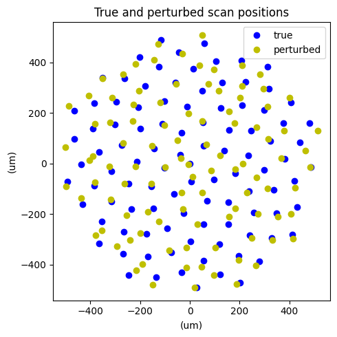
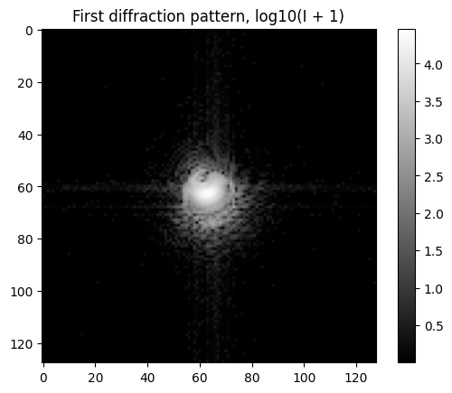
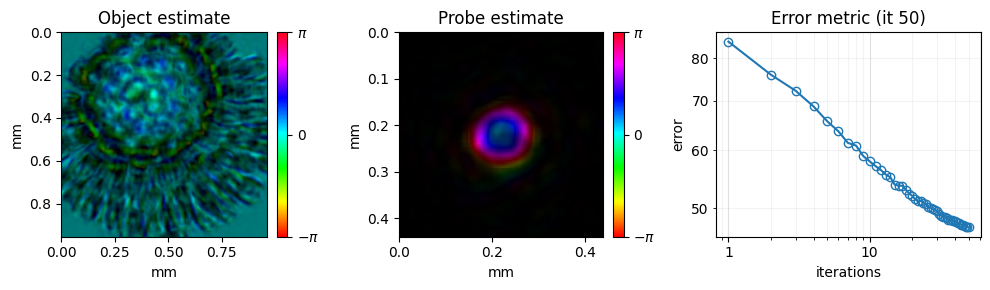
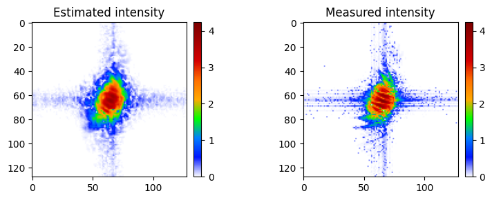
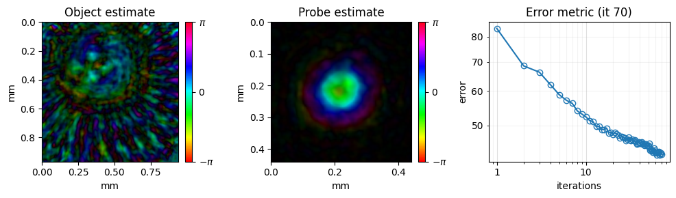
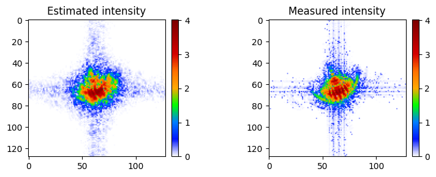
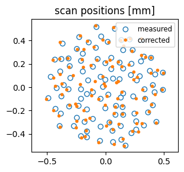
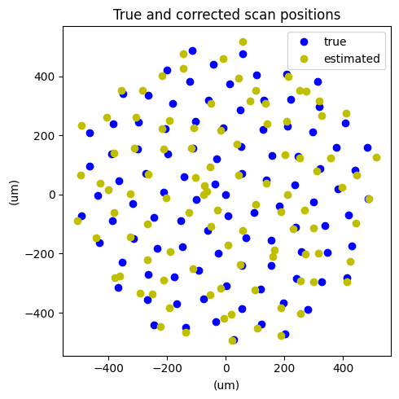

<!-- source-sha256: a6b93db2cd5d7d5c74da3e04aa1dac8c89ea59da91e42f3118332000a2f0a7ac (generated by docs/render_tutorials.py, do not edit) -->

# 04 – CPM Position Correction

This tutorial shows how to correct errors in the scan positions. Such errors come from stage imperfections or thermal drift. PtyLab estimates the positions together with the object and probe during the reconstruction.

**What you'll learn:**

- How to switch on position correction (`params.positionCorrectionSwitch`)
- How to compare the corrected positions with the true ones
- How to compare reconstructions with and without position correction

!!! note "Dataset"
    The dataset (`simu.hdf5`) is generated automatically into the `example_data/` folder at the project root the first time you run the tutorial. If the file already exists it is not re-generated.

!!! tip "Prerequisites"
    Complete [01 – CPM Simulation](tutorial_CPM_sim.md) before this tutorial.

!!! tip "Run it yourself"
    Run this tutorial as a Jupyter notebook, or as a Python script with `python tutorial_LateralPositionCorrection.py`.

    [Download Jupyter notebook](tutorial_LateralPositionCorrection.ipynb){ .md-button download="tutorial_LateralPositionCorrection.ipynb" } [Download Python source](tutorial_LateralPositionCorrection.py){ .md-button download="tutorial_LateralPositionCorrection.py" }

## Position correction algorithm
The position correction in PtyLab follows

- F. Zhang et al., "Translation position determination in ptychographic coherent diffraction imaging," Opt. Express 21, 13592–13606 (2013).

Please cite this paper if you use position correction in your results.

The idea: when the object is updated at scan position $k$, the update is slightly shifted towards the true position of that patch. Cross-correlating the object patch before and after the update therefore gives an estimate $\mathbf{g}_k$ of the position error, in pixels.

## Implementation in PtyLab
PtyLab feeds this estimate back into the scan positions with momentum. At each iteration and scan position $k$:

$$
\mathbf{D}_k \leftarrow \delta\, \mathbf{g}_k + \eta\, \mathbf{D}_k, \qquad \mathbf{r}_k \leftarrow \mathbf{r}_k - \alpha\, \mathbf{D}_k\, dx_o
$$

- $\mathbf{r}_k$: scan position $k$, in meters
- $\mathbf{g}_k$: error estimate from the cross-correlation, in pixels, limited to 3 pixels per axis
- $\mathbf{D}_k$: accumulated correction for position $k$, in pixels
- $\delta = 0.5$: feedback, $\eta = 0.9$: friction (how much of the previous correction is kept)
- $\alpha = 1$: step size, $dx_o$: object pixel size

After each update, the scan grid is re-centered on the mean of the original positions. The correction starts after the first iteration.

## Setup
Import the libraries and load `simu.hdf5`, a simulated CPM dataset. It is generated the first time this cell runs.

```python
import matplotlib

import PtyLab
from PtyLab.io import getExampleDataFolder, generate_simu_hdf5
import logging

logging.basicConfig(level=logging.INFO)
import numpy as np
from PtyLab import Params
from PtyLab import Monitor
from PtyLab import Reconstruction
from PtyLab import ExperimentalData
from PtyLab import Engines

fileName = "simu.hdf5"
filePath = getExampleDataFolder() / fileName

if not filePath.exists():
    print("Generating simu.hdf5...")
    generate_simu_hdf5(filePath)
    print("Done.")
else:
    print(f"{fileName} found, skipping generation.")
```

```text
simu.hdf5 found, skipping generation.
```

```python
# easy initialization
exampleData, reconstruction, params, monitor, ePIE_engine = PtyLab.easyInitialize(
    filePath
)
```

```text
INFO:GPU:cupy and CUDA available, switching to GPU
INFO:Reconstruction:Copying attribute wavelength
INFO:Reconstruction:Copying attribute dxd
INFO:Reconstruction:Copying attribute theta
INFO:Reconstruction:Copying attribute spectralDensity
INFO:Reconstruction:Copying attribute entrancePupilDiameter
INFO:Reconstruction:Initial object set to ones
INFO:Reconstruction:Initial probe set to circ
INFO:ePIE:Sucesfully created ePIE ePIE_engine
INFO:ePIE:Wavelength attribute: 6.327999813038332e-07
Found encoder with shape (100, 2)
```

To test the correction, add random errors of up to 10 object pixels per axis to the scan positions. In the plot, blue points are the true positions and yellow points the perturbed ones.

```python
# perturb encoder positions
maxPosError = 10
encoder0 = exampleData.encoder.copy()
exampleData.encoder = encoder0 + maxPosError * reconstruction.dxo * (
    2 * np.random.rand(encoder0.shape[0], encoder0.shape[1]) - 1
)
import matplotlib.pyplot as plt

figure, ax = plt.subplots(1, 1, num=112, squeeze=True, clear=True, figsize=(5, 5))
ax.set_title("True and perturbed scan positions")
ax.set_xlabel("(um)")
ax.set_ylabel("(um)")
(line1,) = plt.plot(encoder0[:, 1] * 1e6, encoder0[:, 0] * 1e6, "bo", label="true")
(line2,) = plt.plot(
    exampleData.encoder[:, 1] * 1e6,
    exampleData.encoder[:, 0] * 1e6,
    "yo",
    label="perturbed",
)
plt.legend(handles=[line1, line2])
plt.tight_layout()
plt.show(block=False)
```



The reconstruction should start from the perturbed positions, so create a new `Reconstruction` from the changed `exampleData`.

```python
# initialize again reconstruction with the wrong encoder data
reconstruction = Reconstruction(exampleData, params)
```

```text
INFO:Reconstruction:Copying attribute wavelength
INFO:Reconstruction:Copying attribute dxd
INFO:Reconstruction:Copying attribute theta
INFO:Reconstruction:Copying attribute spectralDensity
INFO:Reconstruction:Copying attribute entrancePupilDiameter
```

Set the initial guesses, the monitor and the parameters as in [02 – CPM Example Data](tutorial_CPM.md). Position correction stays off for now (`params.positionCorrectionSwitch = False`).

```python
# exampleData.showPtychogram() opens an interactive viewer of all frames; here we show the first one
plt.imshow(np.log10(exampleData.ptychogram[0] + 1), cmap="gray")
plt.title("First diffraction pattern, log10(I + 1)")
plt.colorbar()
plt.show()
```



```python
reconstruction.npsm = 1  # Number of probe modes to reconstruct
reconstruction.nosm = 1  # Number of object modes to reconstruct
reconstruction.nlambda = 1  # len(exampleData.spectralDensity) # Number of wavelength
reconstruction.nslice = 1  # Number of object slice


reconstruction.initialProbe = "circ"
exampleData.entrancePupilDiameter = (
    reconstruction.Np / 3 * reconstruction.dxp
)  # initial estimate of beam diameter
reconstruction.initialObject = "ones"
# initialize probe and object and related params
reconstruction.initializeObjectProbe()

# customize initial probe quadratic phase
reconstruction.probe = reconstruction.probe * np.exp(
    1.0j
    * 2
    * np.pi
    / reconstruction.wavelength
    * (reconstruction.Xp**2 + reconstruction.Yp**2)
    / (2 * 6e-3)
)

# set monitor properties
monitor = Monitor()
monitor.figureUpdateFrequency = 1
monitor.objectPlot = "complex"  # complex abs angle
monitor.verboseLevel = "high"  # high: plot two figures, low: plot only one figure
monitor.objectZoom = 1.5  # control object plot FoV
monitor.probeZoom = 0.5  # control probe plot FoV

params = Params()
## main parameters
params.positionOrder = "random"  # 'sequential' or 'random'
params.propagator = (
    "Fresnel"  # Fraunhofer Fresnel ASP scaledASP polychromeASP scaledPolychromeASP
)


## how do we want to reconstruct?
# params.gpuSwitch is detected automatically: True if CuPy finds a GPU
params.probePowerCorrectionSwitch = True
params.modulusEnforcedProbeSwitch = False
params.comStabilizationSwitch = True
params.orthogonalizationSwitch = False
params.orthogonalizationFrequency = 10
params.fftshiftSwitch = False
params.intensityConstraint = "standard"  # standard fluctuation exponential poission
params.absorbingProbeBoundary = False
params.objectContrastSwitch = False
params.absObjectSwitch = False
params.backgroundModeSwitch = False
params.couplingSwitch = True
params.couplingAleph = 1
params.positionCorrectionSwitch = False
```

```text
INFO:Reconstruction:Initial object set to ones
INFO:Reconstruction:Initial probe set to circ
/tmp/ipykernel_323549/3076955466.py:27: UserWarning: For faster update of the reconstruction plot, set `monitor.figureUpdateFrequency = 5` or higher.
  monitor.figureUpdateFrequency = 1
/tmp/ipykernel_323549/3076955466.py:29: UserWarning: For diffraction data plot, preferably use an interactive matplotlib backend or set `monitor.verboseLevel = "low"`. 
  monitor.verboseLevel = "high"  # high: plot two figures, low: plot only one figure
INFO:GPU:cupy and CUDA available, switching to GPU
```

First, reconstruct with ePIE and no position correction:

```python
engine_ePIE = Engines.ePIE(reconstruction, exampleData, params, monitor)
engine_ePIE.numIterations = 50
engine_ePIE.betaProbe = 0.25
engine_ePIE.betaObject = 0.25
engine_ePIE.reconstruct()
```

```text
INFO:ePIE:Sucesfully created ePIE ePIE_engine
INFO:ePIE:Wavelength attribute: 6.327999813038332e-07
INFO:ePIE:switch to gpu
INFO:ePIE:Doing probe com stabilization every iteration

final iteration: 49
error: 46.9
estimated linear overlap: 18.5 %
estimated area overlap: 47.9 %
INFO:ePIE:switch to cpu
```





Now reset the object and probe to the same initial guesses, switch position correction on (`params.positionCorrectionSwitch = True`) and reconstruct with mPIE. Note that mPIE also adds momentum to the object and probe updates, so part of the improvement over the ePIE run comes from mPIE itself.

```python
# reset object and probe to initial guesses
reconstruction.initialProbe = "circ"
exampleData.entrancePupilDiameter = (
    reconstruction.Np / 3 * reconstruction.dxp
)  # initial estimate of beam diameter
reconstruction.initialObject = "ones"
# initialize probe and object and related params
reconstruction.initializeObjectProbe()

# customize initial probe quadratic phase
reconstruction.probe = reconstruction.probe * np.exp(
    1.0j
    * 2
    * np.pi
    / reconstruction.wavelength
    * (reconstruction.Xp**2 + reconstruction.Yp**2)
    / (2 * 6e-3)
)
reconstruction.error = []
params.positionCorrectionSwitch = True

engine_mPIE = Engines.mPIE(reconstruction, exampleData, params, monitor)
engine_mPIE.numIterations = 70
engine_mPIE.reconstruct()
```

```text
INFO:Reconstruction:Initial object set to ones
INFO:Reconstruction:Initial probe set to circ
INFO:mPIE:Successfully created mPIE engine
INFO:mPIE:Wavelength attribute: 6.327999813038332e-07
INFO:mPIE:switch to gpu
INFO:mPIE:Doing probe com stabilization every iteration
INFO:mPIE:Position correction: updating scan positions every iteration
/mnt/home/shantanu/projects/PtyLab.py/PtyLab/Engines/BaseEngine.py:1828: ComplexWarning: Casting complex values to real discards the imaginary part
  cc[shifts] = xp.squeeze(

final iteration: 69
error: 43.0
estimated linear overlap: 76.4 %
estimated area overlap: 93.3 %
INFO:mPIE:switch to cpu
```







The plot compares the corrected positions (yellow) with the true ones (blue).

```python
# compare the true positions with the corrected ones
figure, ax = plt.subplots(1, 1, num=113, squeeze=True, clear=True, figsize=(5, 5))
ax.set_title("True and corrected scan positions")
ax.set_xlabel("(um)")
ax.set_ylabel("(um)")
(line1,) = plt.plot(encoder0[:, 1] * 1e6, encoder0[:, 0] * 1e6, "bo", label="true")
(line2,) = plt.plot(
    (reconstruction.positions[:, 1] - reconstruction.No // 2 + reconstruction.Np // 2)
    * reconstruction.dxo
    * 1e6,
    (reconstruction.positions[:, 0] - reconstruction.No // 2 + reconstruction.Np // 2)
    * reconstruction.dxo
    * 1e6,
    "yo",
    label="estimated",
)
plt.legend(handles=[line1, line2])
plt.tight_layout()
plt.show(block=False)
```



Finally, you can save the result.

```python
# now save the data
# reconstruction.saveResults('simulation_position_correction.hdf5')
```

---

[Download Jupyter notebook](tutorial_LateralPositionCorrection.ipynb){ .md-button download="tutorial_LateralPositionCorrection.ipynb" } [Download Python source](tutorial_LateralPositionCorrection.py){ .md-button download="tutorial_LateralPositionCorrection.py" }
