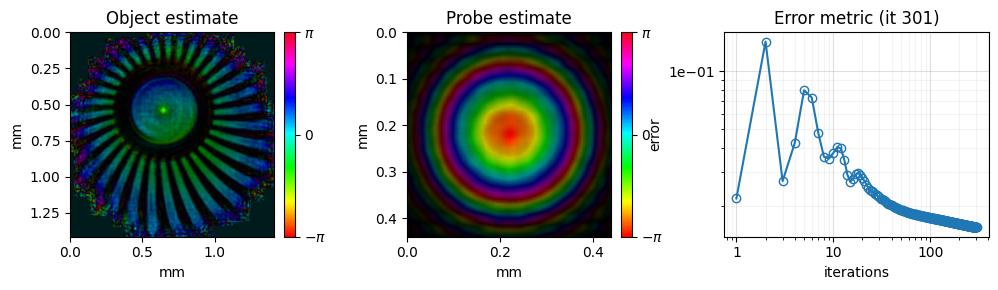
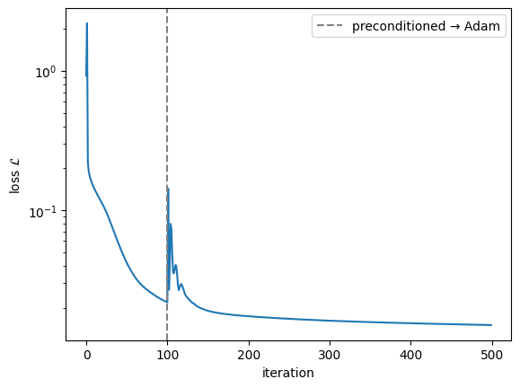
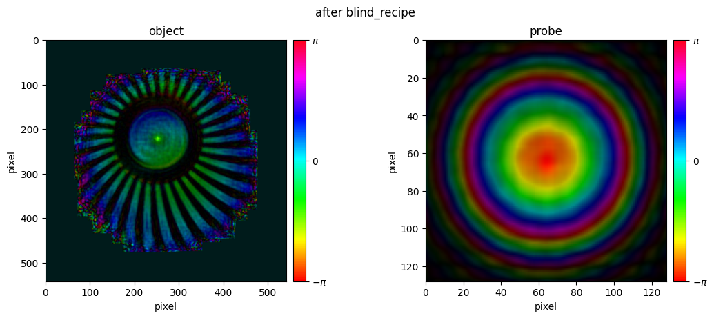
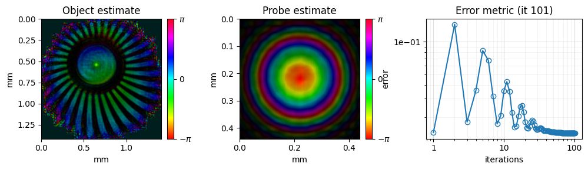
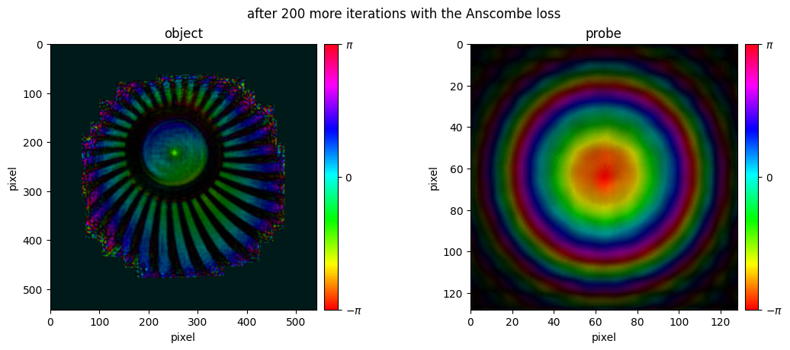

<!-- source-sha256: aebed68a3c18c4e6cddeaa905d2fbf2e6a187d2806d93615216791e31d3b1ece (generated by `ptylab docs render` from scripts/tutorial_differentiablePtychography.py, do not edit) -->

# CPM Differentiable Ptychography

This tutorial reconstructs the simulated CPM dataset with `GradientEngine`, PtyLab's optional PyTorch engine. Instead of hand-derived update rules, it writes down a forward model and a loss, lets PyTorch compute the gradients, and updates the object and probe with an optimizer. It covers only the basic workflow; the [Differentiable Ptychography](../differentiable/overview.md) guide describes every option.

**What you'll learn:**

- How to create a `GradientEngine` from the usual PtyLab objects
- How to recover object and probe from a flat start with `blind_recipe`
- How to choose the estimated parameters and switch the loss

!!! warning "Work in progress"
    `GradientEngine` needs the `torch` extra; see [Installation](../getting-started/installation.md#differentiable-ptychography). It supports CPM with the Fraunhofer, Fresnel, ASP and scaledASP propagators, and its API may still change.

!!! tip "Prerequisites"
    Complete [CPM Example Data](tutorial_CPM.md) before this tutorial.

!!! tip "Run it yourself"
    Run this tutorial as a Jupyter notebook, or as a Python script with `python tutorial_differentiablePtychography.py`.

    [Download Jupyter notebook](tutorial_differentiablePtychography.ipynb){ .md-button download="tutorial_differentiablePtychography.ipynb" } [Download Python source](scripts/tutorial_differentiablePtychography.py){ .md-button download="tutorial_differentiablePtychography.py" }

```python
import matplotlib.pyplot as plt

import PtyLab
from PtyLab.Engines.GradientEngine import GradientEngine, ProbeCentering, blind_recipe
from PtyLab.io import generate_simu_hdf5, getExampleDataFolder
from PtyLab.utils.visualisation import hsvplot
```

```python
fileName = "simu.hdf5"
filePath = getExampleDataFolder() / fileName

if not filePath.exists():
    print("Generating simu.hdf5...")
    generate_simu_hdf5(filePath)
    print("Done.")
else:
    print(f"{fileName} found, skipping generation.")
```

```text
simu.hdf5 found, skipping generation.
```

## Set up the data and the initial guesses

`GradientEngine` uses the same `ExperimentalData`, `Reconstruction`, `Params` and `Monitor` as the classic engines. `easyInitialize` creates them with a flat object (`ones`) and a `circ` probe.

```python
exampleData, reconstruction, params, monitor, _ = PtyLab.easyInitialize(
    filePath, operationMode="CPM"
)
params.propagatorType = "Fraunhofer"
params.gpuSwitch = False  # controls CuPy only; PyTorch picks its own device

monitor.figureUpdateFrequency = 100  # redraw the live figure every 100 iterations
```

```text
Disabling GPU switch. If this is unwanted, please set `self.gpuSwitch = True`
Found encoder with shape (100, 2)
```

## Forward model and loss

For scan position $j$, the model predicts the detector intensity

$$
I_j(\mathbf q) = \left|\mathcal{F}\{O(\mathbf r + \mathbf x_j)\,P(\mathbf r)\}\right|^2 ,
$$

where $O$ is the object, $P$ the probe, $\mathbf x_j$ the scan position, $\mathcal F$ the Fraunhofer propagator and $\mathbf q$ the detector pixel. The default loss compares predicted and measured amplitudes over all pixels $i$ of all frames:

$$
\mathcal{L} = \frac{1}{P_\text{tot}}\sum_i \left(\sqrt{I_i + \epsilon} - \sqrt{y_i}\right)^2 ,
$$

where $y_i$ is the measured intensity, $P_\text{tot} = \sum_i y_i$ the total measured power, and $\epsilon$ a small constant that keeps the gradient finite at dark pixels. PyTorch computes $\partial\mathcal L/\partial O$ and $\partial\mathcal L/\partial P$, and the optimizer takes one step per iteration over the full scan. The error plotted below is $\mathcal L$.

The engine is created like any other PtyLab engine. It runs on the GPU through PyTorch when CUDA is available, and on the CPU otherwise.

```python
engine = GradientEngine(reconstruction, exampleData, params, monitor)
print("device:", engine.device)
```

```text
device: cuda
```

## Blind reconstruction with `blind_recipe`

From a flat start, plain Adam can settle in a poor solution. `blind_recipe` builds two phases, run with `engine.run`:

1. The first 20 % of the iterations use a PIE-style preconditioned gradient descent, which finds the right basin.
2. The rest use Adam on the engine's loss.

`ProbeCentering` keeps the probe's centre of mass in the middle of its window after each step, like `params.comStabilizationSwitch` in the classic engines.

```python
history = engine.run(blind_recipe(iterations=500, constraints=[ProbeCentering()]))
```



```python
# reconstruction.error holds the loss of every iteration of both phases
boundary = len(history[0]["error"])
plt.semilogy(reconstruction.error)
plt.axvline(boundary, color="gray", linestyle="--", label="preconditioned → Adam")
plt.xlabel("iteration")
plt.ylabel("loss $\\mathcal{L}$")
plt.legend()
plt.show()
```



The estimates are written back to `reconstruction.object` and `reconstruction.probe` as NumPy arrays, in PtyLab's 6-D layout `(nlambda, nosm, npsm, nslice, N, N)`.

```python
def show_estimates(reconstruction, title):
    # hue = phase, brightness = amplitude, as in the monitor
    fig, axes = plt.subplots(1, 2, figsize=(11, 4.5), layout="constrained")
    hsvplot(reconstruction.object[0, 0, 0, 0], ax=axes[0])
    axes[0].set_title("object")
    hsvplot(reconstruction.probe[0, 0, 0, 0], ax=axes[1])
    axes[1].set_title("probe")
    fig.suptitle(title)
    plt.show()


show_estimates(reconstruction, "after blind_recipe")
```



## Choose what to estimate and which loss

`engine.parameters` selects the estimated tensors and their learning rates; tensors that are not listed stay fixed. The probe rate is in scale-free units (the probe is stored divided by a fixed power of two), so the same value works across photon counts.

`engine.lossFunction` sets the loss, with its options passed through `functools.partial`. Below, the reconstruction continues with the Anscombe version of the amplitude loss, which suits photon-counting (Poisson) data better:

$$
\mathcal{L}_\text{A} = \frac{1}{P_\text{tot}}\sum_i \left(\sqrt{I_i + c} - \sqrt{y_i + c}\right)^2 ,\qquad c = \tfrac{3}{8} ,
$$

where the shift $c$ makes the square root of Poisson counts have nearly constant variance. The Poisson and mixed Poisson-Gaussian losses are set the same way; see the [guide](../differentiable/overview.md#losses). Each `reconstruct()` starts a fresh optimizer from the current estimates.

```python
from functools import partial

from PtyLab.Engines.GradientEngine.losses import amplitude_loss

engine.parameters = {"object": {"lr": 0.03}, "probe.field": {"lr": 0.1}}
engine.lossFunction = partial(amplitude_loss, anscombe_offset_switch=True)
engine.numIterations = 200
engine.reconstruct()

show_estimates(reconstruction, "after 200 more iterations with the Anscombe loss")
```





```python
## save the result as HDF5, like with the classic engines
reconstruction.saveResults("reconstruction.hdf5")
```

```text
The reconstruction results (all) have been saved
```

---

[Download Jupyter notebook](tutorial_differentiablePtychography.ipynb){ .md-button download="tutorial_differentiablePtychography.ipynb" } [Download Python source](scripts/tutorial_differentiablePtychography.py){ .md-button download="tutorial_differentiablePtychography.py" }
