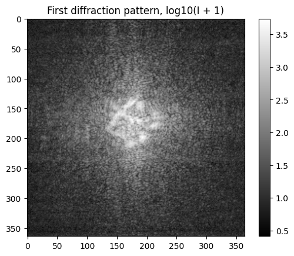
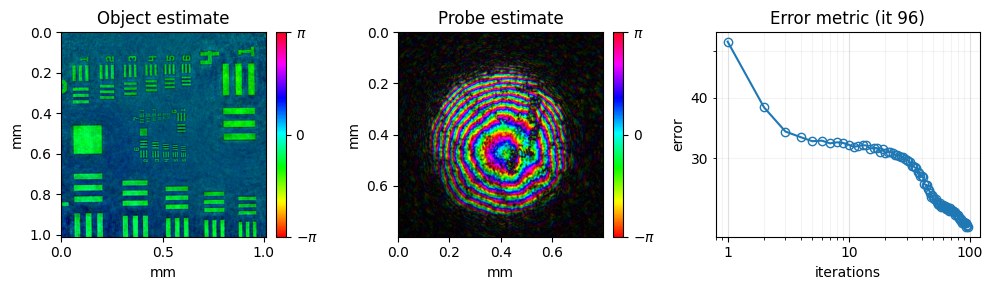
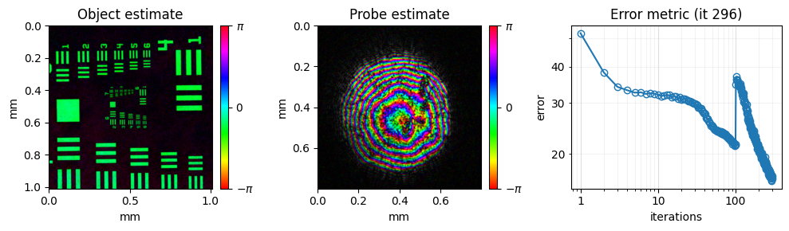

<!-- source-sha256: 7bc03cfd05702e9e7b56a1b69c46e6c4c54dc47b25a58df7b7cb17080acd1d63 (generated by docs/render_tutorials.py, do not edit) -->

# 06 – CPM Interferometric Intensity Constraint

This tutorial uses an extended forward model for reflection ptychography. Besides the reflection from the sample, the model includes a second reflection from a flat surface, which interferes with it like a reference wave. With this interferometric intensity constraint, the reconstruction becomes much less noisy.

**What you'll learn:**

- How to switch on the interferometric intensity constraint
- How to reconstruct a USAF target measured in reflection at 708.8 nm
- How the result compares with the standard intensity constraint

!!! note "Dataset"
    The dataset (`USAF_speckle_bin4.hdf5`) is downloaded automatically into the `example_data/` folder at the project root the first time you run the tutorial. If the file already exists it is not re-downloaded.

!!! tip "Prerequisites"
    Complete [05 – CPM Reflection](tutorial_reflectionPtychography.md) before this tutorial.

!!! tip "Run it yourself"
    Run this tutorial as a Jupyter notebook, or as a Python script with `python tutorial_interferometricIntensityConstraint.py`.

    [Download Jupyter notebook](tutorial_interferometricIntensityConstraint.ipynb){ .md-button download="tutorial_interferometricIntensityConstraint.ipynb" } [Download Python source](tutorial_interferometricIntensityConstraint.py){ .md-button download="tutorial_interferometricIntensityConstraint.py" }

```python
import matplotlib
import matplotlib.pyplot as plt
import numpy as np
from pathlib import Path
import h5py
```

```python
# import the PtyLab module
import PtyLab
from PtyLab import ExperimentalData
from PtyLab import Reconstruction
from PtyLab import Monitor
from PtyLab import Params
from PtyLab import Engines
from PtyLab.utils.utils import posit
```

```python
from PtyLab.io import getExampleDataFolder
import urllib.request

fileName = "USAF_speckle_bin4.hdf5"
filePath = getExampleDataFolder() / fileName

if not filePath.exists():
    print(f"Downloading {fileName}...")
    urllib.request.urlretrieve(
        "https://ndownloader.figshare.com/files/28713885",
        filePath,
    )
    print("Download complete.")
else:
    print(f"{fileName} found, skipping download.")
```

```text
USAF_speckle_bin4.hdf5 found, skipping download.
```

## Load and prepare the data
Load the measurement, then set the sample-to-detector distance and an estimate of the beam diameter. A constant background of 20 counts is subtracted from every image; `posit` sets negative values to zero.

```python
experimentalData = ExperimentalData(filePath, operationMode="CPM")
# experimentalData.showPtychogram() opens an interactive viewer of all frames; here we show the first one
plt.imshow(np.log10(experimentalData.ptychogram[0] + 1), cmap="gray")
plt.title("First diffraction pattern, log10(I + 1)")
plt.colorbar()
plt.show()
```

```text
Found encoder with shape (102, 2)
```



```python
experimentalData.zo = 25.02e-3
experimentalData.entrancePupilDiameter = (
    0.4e-3  # exampleData.Np / 3 * exampleData.dxp  # initial estimate of beam size
)
backgroundOffset = 20
experimentalData.ptychogram = posit(experimentalData.ptychogram - backgroundOffset)
# experimentalData.showPtychogram()
```

## Monitor, parameters and initial guesses
These steps are the same as in [05 – CPM Reflection](tutorial_reflectionPtychography.md).

```python
# Set monitor properties
monitor = Monitor()
monitor.figureUpdateFrequency = 5
monitor.objectPlot = "complex"  # complex abs angle
monitor.verboseLevel = "low"  # high: plot two figures, low: plot only one figure
monitor.probeZoom = 1  # control probe plot FoV
monitor.objectZoom = 2  # control object plot FoV
monitor.objectPlotContrast = 0.8
monitor.probePlotContrast = 0.5
```

```python
# Set the reconstruction parameters
params = Params()
## switches
# params.gpuSwitch is detected automatically: True if CuPy finds a GPU
params.positionOrder = "random"  # 'sequential' or 'random'
params.propagator = (
    "Fraunhofer"  # Fraunhofer Fresnel ASP scaledASP polychromeASP scaledPolychromeASP
)
params.probePowerCorrectionSwitch = True
params.comStabilizationSwitch = True
params.fftshiftSwitch = False
params.backgroundModeSwitch = True
```

```text
INFO:GPU:cupy and CUDA available, switching to GPU
```

```python
reconstruction = Reconstruction(experimentalData, params)
reconstruction.No = 2**11
reconstruction.initialProbe = "circ"
reconstruction.initialObject = "ones"
# initialize probe and object and related params
reconstruction.initializeObjectProbe()

# customize initial probe quadratic phase
reconstruction.probe = reconstruction.probe * np.exp(
    1.0j
    * 2
    * np.pi
    / reconstruction.wavelength
    * (reconstruction.Xp**2 + reconstruction.Yp**2)
    / (3 * 6e-3)
)
```

```text
INFO:Reconstruction:Copying attribute wavelength
INFO:Reconstruction:Copying attribute dxd
INFO:Reconstruction:Copying attribute theta
INFO:Reconstruction:Copying attribute spectralDensity
INFO:Reconstruction:Copying attribute entrancePupilDiameter
INFO:Reconstruction:Initial object set to ones
INFO:Reconstruction:Initial probe set to circ
```

First, reconstruct with the standard intensity constraint, which treats the USAF target as a thin, single-layer object.

```python
params.intensityConstraint = "standard"

mPIE = Engines.mPIE(reconstruction, experimentalData, params, monitor)
mPIE.numIterations = 100
mPIE.betaProbe = 0.05
mPIE.betaObject = 0.25
mPIE.reconstruct()
```

```text
INFO:mPIE:Successfully created mPIE engine
INFO:mPIE:Wavelength attribute: 7.087999733812467e-07
INFO:mPIE:switch to gpu
INFO:mPIE:Doing probe com stabilization every iteration
INFO:mPIE:switch to cpu
```



Now switch to the interferometric constraint (`params.intensityConstraint = "interferometric"`). It treats the reflection from the flat back side of the glass substrate as an external reference wave. This run continues from the estimates of the first run. The noise in the object is much reduced.

```python
params.intensityConstraint = "interferometric"

mPIE = Engines.mPIE(reconstruction, experimentalData, params, monitor)
mPIE.numIterations = 200
mPIE.betaProbe = 0.25
mPIE.betaObject = 0.25
mPIE.reconstruct()
```

```text
INFO:mPIE:Successfully created mPIE engine
INFO:mPIE:Wavelength attribute: 7.087999733812467e-07
INFO:mPIE:switch to gpu
INFO:mPIE:Doing probe com stabilization every iteration
INFO:mPIE:switch to cpu
```



```python
## now save the data
# reconstruction.saveResults('reconstruction.hdf5')
```

---

[Download Jupyter notebook](tutorial_interferometricIntensityConstraint.ipynb){ .md-button download="tutorial_interferometricIntensityConstraint.ipynb" } [Download Python source](tutorial_interferometricIntensityConstraint.py){ .md-button download="tutorial_interferometricIntensityConstraint.py" }
