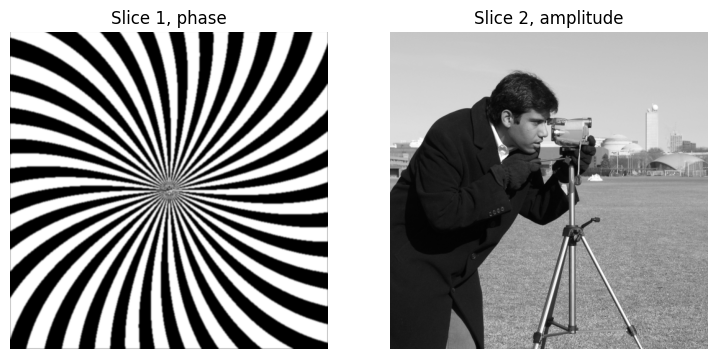
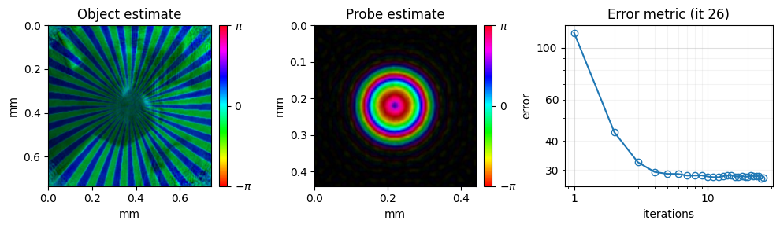
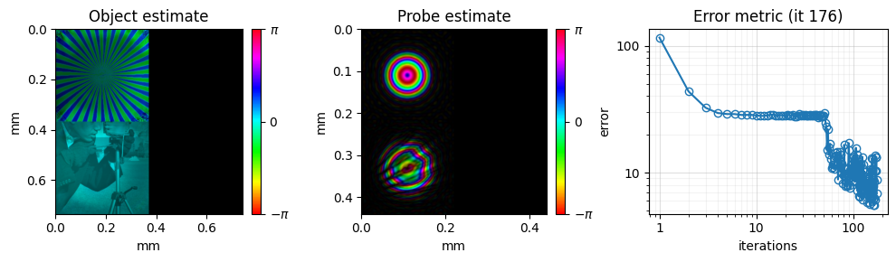
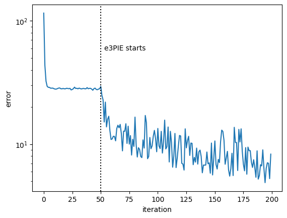
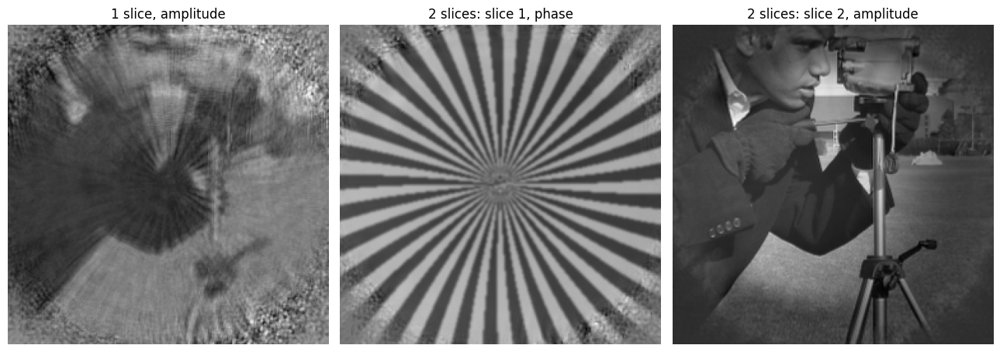

<!-- source-sha256: abe2f70ff401a152a60f267dba3e7fe9177ca98b4f3b91430323298a217ae59e (generated by `ptylab docs render` from scripts/tutorial_multiSlice.py, do not edit) -->

# CPM Multi-Slice

This tutorial simulates a sample made of two layers 1 mm apart and reconstructs both layers separately with the multi-slice engine `e3PIE`. A conventional reconstruction treats the sample as one thin layer, which fails once the beam diffracts noticeably on its way through the sample.

**What you'll learn:**

- How the multi-slice model propagates the beam through a thick sample
- How to simulate data from a two-layer sample
- How to start from a single-slice mPIE result and continue with `e3PIE`

!!! quote "References"
    - Multi-slice ptychography and `e3PIE`: A. M. Maiden, M. J. Humphry and J. M. Rodenburg, "Ptychographic transmission microscopy in three dimensions using a multi-slice approach," J. Opt. Soc. Am. A 29, 1606 (2012). [doi:10.1364/JOSAA.29.001606](https://doi.org/10.1364/JOSAA.29.001606)

!!! note "Dataset"
    No dataset is needed; the data are simulated in the tutorial.

!!! tip "Prerequisites"
    Complete [CPM Simulation](tutorial_CPM_sim.md) before this tutorial; it uses the same geometry and probe.

!!! info "Run time"
    The reconstructions take about half a minute on a GPU and considerably longer on a CPU.

!!! tip "Run it yourself"
    Run this tutorial as a Jupyter notebook, or as a Python script with `python tutorial_multiSlice.py`.

    [Download Jupyter notebook](tutorial_multiSlice.ipynb){ .md-button download="tutorial_multiSlice.ipynb" } [Download Python source](scripts/tutorial_multiSlice.py){ .md-button download="tutorial_multiSlice.py" }

## Multi-slice model
A sample is *thin* when the beam does not change shape while passing through it; the exit wave is then the product of probe and object. For a thicker sample, the multi-slice model splits it into $S$ thin slices $O_1, \dots, O_S$ separated by a distance $\Delta z$, and propagates the wave between them:

$$
\psi_1 = P \cdot O_1, \qquad \psi_s = \mathcal{P}_{\Delta z}\{\psi_{s-1}\} \cdot O_s \quad (s = 2, \dots, S), \qquad I = \left| \mathcal{F}\{\psi_S\} \right|^2
$$

- $P$: probe incident on the first slice, $O_s$: transmission of slice $s$ (the patch at the current scan position)
- $\psi_s$: exit wave behind slice $s$
- $\mathcal{F}$: Fourier transform to the detector (Fraunhofer propagation), $I$: diffraction pattern
- $\mathcal{P}_{\Delta z}$: angular-spectrum propagation over $\Delta z$, $\mathcal{P}_{\Delta z}\{\psi\} = \mathcal{F}^{-1}\{ \mathcal{F}\{\psi\}\, H \}$ with

$$
H(f_x, f_y) = \exp\left( i 2\pi \Delta z \sqrt{(n/\lambda)^2 - f_x^2 - f_y^2} \right)
$$

where $f_x, f_y$ are spatial frequencies, $\lambda$ the wavelength and $n$ the refractive index of the medium between slices. `e3PIE` (A. M. Maiden et al., J. Opt. Soc. Am. A 29, 1606 (2012)) runs this model forward, then passes the detector update backwards through the slices, updating each slice and the wave incident on it.

## 1. Simulate a two-layer sample
Use the geometry and the focused probe of [CPM Simulation](tutorial_CPM_sim.md).

```python
import matplotlib.pyplot as plt
import numpy as np
from scipy.signal import convolve2d
from skimage import data
from skimage.transform import resize

import PtyLab
from PtyLab import Engines
from PtyLab.Operators.Operators import aspw
from PtyLab.utils.scanGrids import GenerateNonUniformFermat
from PtyLab.utils.utils import cart2pol, circ, fft2c, gaussian2D

# geometry
wavelength = 632.8e-9
zo = 5e-2  # sample-detector distance
Nd = 2**7  # detector pixels per side
dxd = 16 * 4.5e-6  # detector pixel size
Ld = Nd * dxd

# probe and object coordinates; dxp = wavelength * zo / Ld
dxp = wavelength * zo / Ld
Np = Nd
Lp = dxp * Np
xp = np.arange(-Np // 2, Np // 2) * dxp
Xp, Yp = np.meshgrid(xp, xp)

No = 2**9
dxo = dxp
xo = np.arange(-No // 2, No // 2) * dxo
Xo, Yo = np.meshgrid(xo, xo)

# focused probe: a smoothed pinhole imaged by a lens of focal length f
f = 5e-3
pinhole = circ(Xp, Yp, Lp / 2)
pinhole = convolve2d(pinhole, gaussian2D(5, 1).astype(np.float32), mode="same")
probe = aspw(pinhole, 2 * f, wavelength, Lp, is_FT=False)[0]
aperture = circ(Xp, Yp, 3 * Lp / 4)
aperture = convolve2d(aperture, gaussian2D(5, 3).astype(np.float32), mode="same")
probe = probe * np.exp(-1.0j * 2 * np.pi / wavelength * (Xp**2 + Yp**2) / (2 * f)) * aperture
probe = aspw(probe, 2 * f, wavelength, Lp, is_FT=False)[0]
```

The two layers carry different patterns, so that each one is easy to recognize in the reconstruction: the first is a phase-only spiral, the second an amplitude-only photograph (`camera` from scikit-image). Neither is fully opaque, so the beam reaches the second layer everywhere.

```python
# slice 1: binary spiral, as a phase of 0 or pi/2
theta, rho = cart2pol(Xo, Yo)
spiral = (1 + np.sign(np.sin(33 * theta + 2 * np.pi * (rho / 1e-3) ** 2))) / 2
spiral = convolve2d(spiral, gaussian2D(5, 1), mode="same")  # smooth edges
slice1 = np.exp(1j * np.pi / 2 * spiral)

# slice 2: photograph as an amplitude between 0.3 and 1
camera = resize(data.camera().astype(float), (No, No), anti_aliasing=True)
slice2 = (0.3 + 0.7 * camera / camera.max()).astype(complex)

dz = 1e-3  # distance between the slices

fig, axes = plt.subplots(1, 2, figsize=(9, 4.5))
axes[0].imshow(np.angle(slice1), cmap="gray")
axes[0].set_title("Slice 1, phase")
axes[1].imshow(np.abs(slice2), cmap="gray")
axes[1].set_title("Slice 2, amplitude")
for ax in axes:
    ax.axis("off")
plt.show()
```



Over $\Delta z$ = 1 mm, a feature of a few probe pixels ($dx_p \approx$ 3.4 µm) spreads by about $\lambda \Delta z / dx_p \approx$ 0.19 mm, or 50 pixels. The two layers can therefore not be treated as one thin sample.

Scan 200 positions on a Fermat grid (see [Scan Grids](tutorial_scanGrids.md)), and compute each diffraction pattern with the multi-slice model.

```python
R, C = GenerateNonUniformFermat(200, radius=100, power=1)
encoder = np.vstack((R * dxo, C * dxo)).T  # scan positions in meters
positions = (np.round(encoder / dxo) + No // 2 - Np // 2).astype(int)  # top-left corner of each patch

ptychogram = np.zeros((len(R), Nd, Nd))
for j, (row, col) in enumerate(positions):
    sy, sx = slice(row, row + Np), slice(col, col + Np)
    esw = probe * slice1[sy, sx]  # psi_1 = P * O_1
    esw = aspw(esw, dz, wavelength, Lp, is_FT=False)[0] * slice2[sy, sx]  # psi_2
    ptychogram[j] = np.abs(fft2c(esw)) ** 2  # I = |F{psi_2}|^2
```

## 2. Load the data into PtyLab
Fill `ExperimentalData` by hand, as in [CPM Simulation](tutorial_CPM_sim.md).

```python
experimentalData = PtyLab.ExperimentalData(operationMode="CPM")
experimentalData.ptychogram = ptychogram
experimentalData.wavelength = wavelength
experimentalData.encoder = encoder
experimentalData.dxd = dxd
experimentalData.zo = zo
experimentalData.entrancePupilDiameter = 150e-6  # initial estimate of beam diameter
experimentalData.spectralDensity = None
experimentalData.theta = None
experimentalData._setData()

params = PtyLab.Params()
params.propagatorType = "Fraunhofer"  # matches the fft2c used in the simulation
params.positionOrder = "random"
params.intensityConstraint = "standard"
params.probePowerCorrectionSwitch = True
params.comStabilizationSwitch = True

monitor = PtyLab.Monitor()
monitor.figureUpdateFrequency = 25
monitor.objectPlot = "complex"
monitor.objectZoom = 1.5
monitor.probeZoom = 0.5
```

## 3. Single-slice reconstruction
First reconstruct with one slice and mPIE. This gives a good probe and a first object to start from, but the single slice has to explain both layers at once.

```python
reconstruction = PtyLab.Reconstruction(experimentalData, params)
reconstruction.No = No
reconstruction.npsm = 1
reconstruction.nosm = 1
reconstruction.nlambda = 1
reconstruction.nslice = 1
reconstruction.initialProbe = "circ"
reconstruction.initialObject = "ones"
reconstruction.initializeObjectProbe()

engine_mPIE = Engines.mPIE(reconstruction, experimentalData, params, monitor)
engine_mPIE.numIterations = 50
engine_mPIE.betaProbe = 0.25
engine_mPIE.betaObject = 0.25
engine_mPIE.reconstruct()

object_single = reconstruction.object[0, 0, 0, 0].copy()
```

```text
Starting mPIE: 50 iterations on the GPU
```



## 4. Multi-slice reconstruction
Switch to two slices: set `nslice`, the slice distance `dz` and the refractive index `refrIndex` between the slices (1 for air), then initialize again. This gives an object array with a slice axis of length 2. Copy the single-slice probe and object into the first slice as a starting point; the second slice starts as `"ones"`, fully transparent.

In the multi-slice model the probe also has one entry per slice: `probe[..., 0, :, :]` is the probe incident on the first slice, and `e3PIE` fills the other entries with the wave propagated to each slice. Switch off the center-of-mass stabilization, which would shift these waves.

```python
probe_single = reconstruction.probe[0, 0, :, 0].copy()

reconstruction.nslice = 2
reconstruction.dz = dz
reconstruction.refrIndex = 1.0
reconstruction.initializeObjectProbe()
reconstruction.probe[0, 0, :, 0] = probe_single
reconstruction.object[0, 0, 0, 0] = object_single
params.comStabilizationSwitch = False

engine_e3PIE = Engines.e3PIE(reconstruction, experimentalData, params, monitor)
engine_e3PIE.numIterations = 150
engine_e3PIE.betaProbe = 0.25
engine_e3PIE.betaObject = 0.25
engine_e3PIE.reconstruct()
```

```text
Starting e3PIE: 150 iterations on the GPU
```



## 5. Results
The error drops further once the second slice is added, since the model can now describe the data:

```python
plt.semilogy(reconstruction.error)
plt.axvline(engine_mPIE.numIterations, ls=":", c="k")
plt.text(engine_mPIE.numIterations + 3, max(reconstruction.error) / 2, "e3PIE starts")
plt.xlabel("iteration")
plt.ylabel("error")
plt.show()
```



The single-slice reconstruction shows a mixture of both layers. The multi-slice reconstruction separates them: the spiral appears in the phase of slice 1 and the photograph in the amplitude of slice 2. Only the scanned area in the middle is reconstructed.

```python
crop = (slice(130, 382), slice(130, 382))
fig, axes = plt.subplots(1, 3, figsize=(13, 4.5))
axes[0].imshow(np.abs(object_single[crop]), cmap="gray")
axes[0].set_title("1 slice, amplitude")
axes[1].imshow(np.angle(reconstruction.object[0, 0, 0, 0][crop]), cmap="gray")
axes[1].set_title("2 slices: slice 1, phase")
axes[2].imshow(np.abs(reconstruction.object[0, 0, 0, 1][crop]), cmap="gray")
axes[2].set_title("2 slices: slice 2, amplitude")
for ax in axes:
    ax.axis("off")
plt.tight_layout()
plt.show()
```



Finally, you can save the result.

```python
# saves the result as HDF5, plus a PNG of the final reconstruction
reconstruction.saveResults("multi_slice.hdf5", snapshot=monitor)
```

```text
The reconstruction results (all) have been saved
Saved monitor figure multi_slice_reconstruction.png
```

---

[Download Jupyter notebook](tutorial_multiSlice.ipynb){ .md-button download="tutorial_multiSlice.ipynb" } [Download Python source](scripts/tutorial_multiSlice.py){ .md-button download="tutorial_multiSlice.py" }
