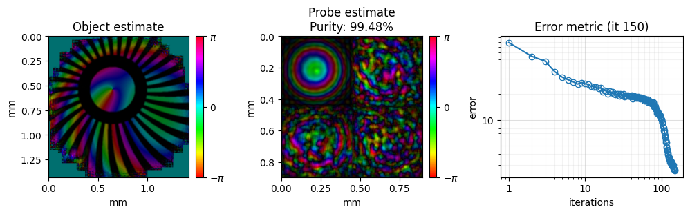
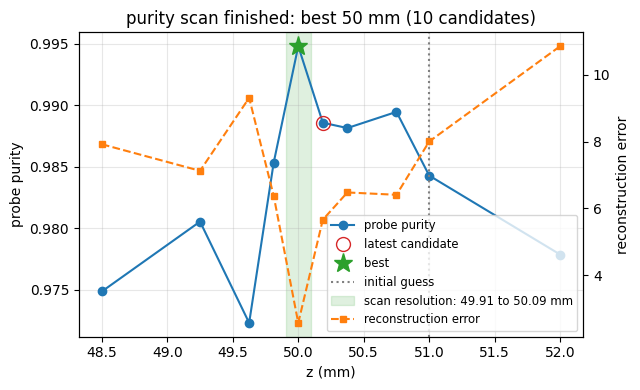
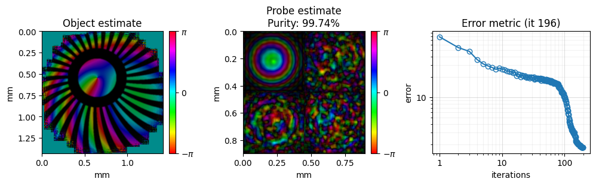
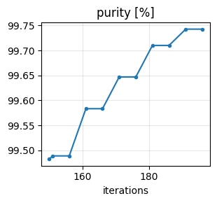
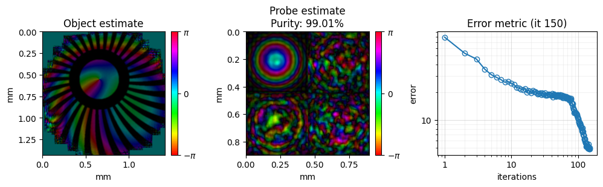
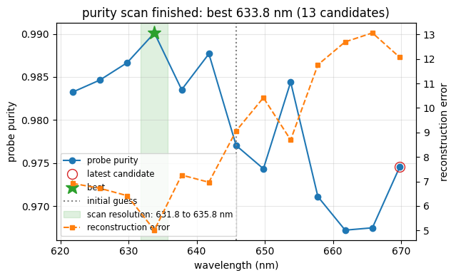
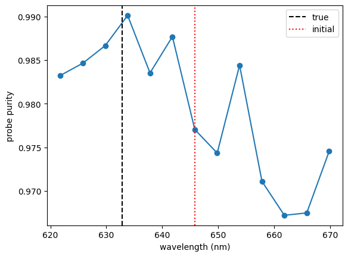

<!-- source-sha256: 113aeedd98fe1cf0f8f8542c10a1196730661af69974ea9b81076960dc068dc1 (generated by `ptylab docs render` from scripts/tutorial_purityCalibration.py, do not edit) -->

# CPM Purity-Based Calibration

This tutorial calibrates the sample-to-detector distance $z_o$ and the wavelength $\lambda$ from the data, with the `purityPIE` engine. An error in either scales the reconstruction geometry and blurs the result. `purityPIE` finds the value for which the reconstructed probe is most coherent.

**What you'll learn:**

- Why the probe purity peaks at the correct geometry
- How to set up an adaptive purity scan of $z_o$
- How to read the scan results and continue from the calibrated state
- How to calibrate the wavelength with a fixed-grid scan, with $z_o$ known

!!! quote "References"
    - Purity-based calibration: C. Liu et al., "Purity-based self-calibration in ptychography," Opt. Lett. 50, 1581 (2025). [doi:10.1364/OL.543865](https://doi.org/10.1364/OL.543865)

!!! note "Dataset"
    The dataset (`simu.hdf5`) is generated automatically into the `example_data/` folder at the project root the first time you run the tutorial. If the file already exists it is not re-generated.

!!! tip "Prerequisites"
    Complete [CPM Mixed States](tutorial_mixedStates.md) before this tutorial; it introduces probe modes and purity.

!!! info "Run time"
    Each calibration runs about a dozen short reconstructions, one per candidate value. Both together take about 3.5 minutes on a GPU and considerably longer on a CPU.

!!! tip "Run it yourself"
    Run this tutorial as a Jupyter notebook, or as a Python script with `python tutorial_purityCalibration.py`.

    [Download Jupyter notebook](tutorial_purityCalibration.ipynb){ .md-button download="tutorial_purityCalibration.ipynb" } [Download Python source](scripts/tutorial_purityCalibration.py){ .md-button download="tutorial_purityCalibration.py" }

## Method
The method follows C. Liu et al., "Purity-based self-calibration in ptychography," Opt. Lett. 50, 1581 (2025). Reconstruct with several probe modes $P_m$ and orthogonalize them. With $w_k$ the fraction of the total probe power in mode $k$, the probe purity is

$$
\mu = \sqrt{\sum_k w_k^2}, \qquad \mu \in \left[ 1/\sqrt{M},\ 1 \right]
$$

for $M$ modes; [CPM Mixed States](tutorial_mixedStates.md) explains $w_k$. With the correct geometry, the data are explained by the beam's true coherence, and $\mu$ is as high as it gets. With a wrong $z_o$, the model cannot fit the data with the same probe; the reconstruction spreads power into the extra modes to absorb the mismatch, and $\mu$ drops. The calibrated value is therefore the one that maximizes $\mu$:

$$
\hat{z}_o = \arg\max_{z_o} \mu(z_o)
$$

Each candidate $z_o$ gets its own reconstruction with `numIterations` iterations of mPIE, all starting from the same initial guess. A scan therefore costs as many reconstructions as it has candidates.

## Setup
Load `simu.hdf5`, a simulated dataset with $z_o$ = 50 mm, and start the calibration 1 mm away from it, as if the distance had been measured imprecisely.

```python
import matplotlib.pyplot as plt
import numpy as np

import PtyLab
from PtyLab import Engines
from PtyLab.io import generate_simu_hdf5, getExampleDataFolder

fileName = "simu.hdf5"
filePath = getExampleDataFolder() / fileName

if not filePath.exists():
    print("Generating simu.hdf5...")
    generate_simu_hdf5(filePath)
    print("Done.")
else:
    print(f"{fileName} found, skipping generation.")

experimentalData, reconstruction, params, monitor, _ = PtyLab.easyInitialize(filePath, operationMode="CPM")

true_z = experimentalData.zo
initial_z = true_z + 1e-3  # a 1 mm error in the measured distance
experimentalData.zo = initial_z
reconstruction.zo = initial_z  # also updates the probe pixel size dxp

print(f"true z:    {true_z * 1e3:.3f} mm")
print(f"initial z: {initial_z * 1e3:.3f} mm")
```

```text
simu.hdf5 found, skipping generation.
Found encoder with shape (100, 2)
true z:    50.000 mm
initial z: 51.000 mm
```

## Reconstruction settings
Purity needs at least two probe modes; use four. The other settings are the usual ones from [CPM Example Data](tutorial_CPM.md).

```python
reconstruction.npsm = 4  # purity needs npsm >= 2
reconstruction.nosm = 1
reconstruction.nlambda = 1
reconstruction.nslice = 1
reconstruction.initialObject = "ones"
reconstruction.initialProbe = "circ"
reconstruction.initializeObjectProbe()

monitor.figureUpdateFrequency = 5
monitor.objectPlot = "complex"

params.positionOrder = "random"
params.propagatorType = "Fraunhofer"
params.intensityConstraint = "standard"
params.probePowerCorrectionSwitch = True
params.comStabilizationSwitch = True
params.orthogonalizationSwitch = True
params.orthogonalizationFrequency = 10
params.couplingSwitch = True
params.couplingAleph = 1
```

## Scan settings
`purityCalibrationTarget` selects what to calibrate, `"z"` or `"wavelength"`. With `purityAdaptive = True` the scan searches around the initial value instead of evaluating a fixed grid:

1. Evaluate the initial $z_o$ and its two neighbours at $\pm$ `purityZInitialStep`. This first step must be large enough that the purity differs by more than its run-to-run noise; 1 mm works here, while steps of 0.2 mm get lost in the noise near the starting point.
2. Step towards higher purity, growing the step by `purityZStepGrowth` each time, until the purity stops rising by more than `purityZPurityTolerance`.
3. Refine around the best candidate, shrinking the step by `purityZStepShrink`, until it is below `purityZMinStep`.

`purityMaxEvaluations` caps the number of candidates. `puritySeed` makes every candidate start from the same random state, so the candidates differ only in $z_o$. With `purityAdaptive = False`, the scan evaluates `purityZScanPoints` values evenly spread over `purityZScanRange` around the initial value instead.

```python
params.purityCalibrationTarget = "z"
params.purityAdaptive = True
params.purityMaxEvaluations = 12
params.puritySeed = 0

params.purityZInitialStep = 1e-3
params.purityZStepGrowth = 1.5
params.purityZStepShrink = 0.5
params.purityZMinStep = 100e-6
params.purityZPurityTolerance = 1e-4
```

## Run the calibration
`reconstruct()` returns the best value and its purity, and leaves the reconstruction of the best candidate in `reconstruction`. The monitor plots the purity (and the final error) of every candidate as the scan proceeds.

Each candidate must converge for the comparison to be fair: with too few iterations, the purities mostly reflect how far each run got, and the scan can end far from the true value. Larger mPIE step sizes (`betaObject`, `betaProbe` = 0.5 instead of the default 0.25) let each candidate converge in 150 iterations. Do not start the candidates from a probe reconstructed at the initial guess (`initialProbe = "recon"`) to save iterations: such a probe pulls the scan back towards that guess.

```python
engine = Engines.purityPIE(reconstruction, experimentalData, params, monitor)
engine.numIterations = 150  # mPIE iterations per candidate
engine.betaObject = 0.5
engine.betaProbe = 0.5
best_z, best_purity = engine.reconstruct()
```

```text
Starting purityPIE: 150 iterations on the GPU

Starting adaptive purity-based z scan
Initial z = 51.000001 mm | initial step = 1000.0 µm

Starting mPIE: 150 iterations on the GPU
z = 51.000001 mm | purity = 0.984279 | error = 8.005732e+00
NEW BEST: z = 51.000001 mm | purity = 0.984279
Starting mPIE: 150 iterations on the GPU
z = 50.000001 mm | purity = 0.994821 | error = 2.563637e+00
NEW BEST: z = 50.000001 mm | purity = 0.994821
Starting mPIE: 150 iterations on the GPU
z = 52.000001 mm | purity = 0.977848 | error = 1.086479e+01
Starting mPIE: 150 iterations on the GPU
z = 48.500001 mm | purity = 0.974840 | error = 7.922302e+00
Starting mPIE: 150 iterations on the GPU
z = 49.250001 mm | purity = 0.980532 | error = 7.125771e+00
Starting mPIE: 150 iterations on the GPU
z = 50.750001 mm | purity = 0.989469 | error = 6.406174e+00
Starting mPIE: 150 iterations on the GPU
z = 49.625001 mm | purity = 0.972283 | error = 9.314051e+00
Starting mPIE: 150 iterations on the GPU
z = 50.375001 mm | purity = 0.988151 | error = 6.476521e+00
Starting mPIE: 150 iterations on the GPU
z = 49.812501 mm | purity = 0.985340 | error = 6.372165e+00
Starting mPIE: 150 iterations on the GPU
z = 50.187501 mm | purity = 0.988587 | error = 5.659125e+00
============================================================
Adaptive purity-based z scan finished
Best z      = 50.000001 mm
Best Δz     = -1000.00 µm
Best purity = 0.994821
Evaluations = 10
============================================================
```





## Results
The evaluated distances and purities are stored on the engine, in `purityZValues` and `purityZMetrics`.

```python
print(f"true z    : {true_z * 1e3:.3f} mm")
print(f"initial z : {initial_z * 1e3:.3f} mm")
print(f"best z    : {best_z * 1e3:.3f} mm   (error {(best_z - true_z) * 1e6:+.0f} um)")
print(f"purity    : {best_purity:.4f}")
print()
for z, purity in sorted(zip(engine.purityZValues, engine.purityZMetrics)):
    print(f"z = {z * 1e3:.3f} mm   purity = {purity:.4f}")
```

```text
true z    : 50.000 mm
initial z : 51.000 mm
best z    : 50.000 mm   (error +0 um)
purity    : 0.9948

z = 48.500 mm   purity = 0.9748
z = 49.250 mm   purity = 0.9805
z = 49.625 mm   purity = 0.9723
z = 49.813 mm   purity = 0.9853
z = 50.000 mm   purity = 0.9948
z = 50.188 mm   purity = 0.9886
z = 50.375 mm   purity = 0.9882
z = 50.750 mm   purity = 0.9895
z = 51.000 mm   purity = 0.9843
z = 52.000 mm   purity = 0.9778
```

The scan moved from the 1 mm error to the true distance, within `purityZMinStep`.

## Continue the reconstruction
The calibrated state is a normal reconstruction, so any engine can continue from it, for example more mPIE iterations at the calibrated distance:

```python
engine_mPIE = Engines.mPIE(reconstruction, experimentalData, params, monitor)
engine_mPIE.numIterations = 50
engine_mPIE.reconstruct()
```

```text
Starting mPIE: 50 iterations on the GPU
```





Finally, you can save the result.

```python
# saves the result as HDF5, plus a PNG of the final reconstruction
reconstruction.saveResults("purity_calibrated_z.hdf5", snapshot=monitor)
```

```text
The reconstruction results (all) have been saved
Saved monitor figure purity_calibrated_z_reconstruction.png
Saved monitor figure purity_calibrated_z_history.png
Saved monitor figure purity_calibrated_z_purity_scan.png
```

## Wavelength calibration
The same method calibrates the wavelength when $z_o$ is known. With Fraunhofer propagation, $\lambda$ and $z_o$ enter the model only through the probe pixel size

$$
dx_p = \frac{\lambda z_o}{N_d\, dx_d}
$$

with $N_d$ the number of detector pixels and $dx_d$ the detector pixel size. A 2 % error in $\lambda$ therefore distorts the reconstruction like a 2 % error in $z_o$, and the purity drops in the same way.

Load the data again, keep the true $z_o$ = 50 mm, and start from a wavelength that is 13 nm (2 %) too long. Create a new `Reconstruction` so that its geometry, including $dx_p$, follows from the wrong wavelength; `spectralDensity = None` lets it be derived from the new wavelength as well.

```python
experimentalData = PtyLab.ExperimentalData(filePath, operationMode="CPM")

true_wavelength = experimentalData.wavelength
initial_wavelength = true_wavelength + 13e-9  # 2 % too long
experimentalData.wavelength = initial_wavelength
experimentalData.spectralDensity = None

reconstruction = PtyLab.Reconstruction(experimentalData, params)
reconstruction.npsm = 4
reconstruction.nosm = 1
reconstruction.nlambda = 1
reconstruction.nslice = 1
reconstruction.initialObject = "ones"
reconstruction.initialProbe = "circ"
reconstruction.initializeObjectProbe()

print(f"true wavelength:    {true_wavelength * 1e9:.1f} nm")
print(f"initial wavelength: {initial_wavelength * 1e9:.1f} nm")
```

```text
Found encoder with shape (100, 2)
true wavelength:    632.8 nm
initial wavelength: 645.8 nm
```

Keep the reconstruction settings from above and switch the target to the wavelength. This time use a fixed-grid scan (`purityAdaptive = False`): it evaluates `purityWavelengthScanPoints` wavelengths evenly spread over $\pm$ `purityWavelengthScanRange` around the initial value, here 13 candidates 4 nm apart. The purity varies by about 0.005 from one candidate to the next even away from the peak, enough to stop an adaptive scan at a local maximum; a grid always shows the whole curve. Its accuracy is limited by the grid spacing, and the true wavelength is deliberately not one of the grid points.

The wavelength versions of the adaptive settings (`purityWavelengthInitialStep`, `purityWavelengthStepGrowth`, `purityWavelengthStepShrink`, `purityWavelengthMinStep`, `purityWavelengthPurityTolerance`) mirror the $z_o$ ones, for when the purity curve is smooth enough.

```python
params.purityCalibrationTarget = "wavelength"
params.purityAdaptive = False
params.purityWavelengthScanRange = 24e-9  # scan initial +/- 24 nm
params.purityWavelengthScanPoints = 13  # 4 nm spacing

engine = Engines.purityPIE(reconstruction, experimentalData, params, monitor)
engine.numIterations = 150
engine.betaObject = 0.5
engine.betaProbe = 0.5
best_wavelength, best_purity = engine.reconstruct()
```

```text
Starting purityPIE: 150 iterations on the GPU

Starting purity-based wavelength scan
Initial wavelength = 645.799981 nm | range = ±24.0000 nm | points = 13 | iterations/wavelength = 150

[1/13] Reconstructing wavelength = 621.799981 nm (Δλ = -24.0000 nm)
Starting mPIE: 150 iterations on the GPU
    Probe purity = 0.983243 | reconstruction error = 6.920484e+00
    NEW BEST: wavelength = 621.799981 nm | purity = 0.983243

[2/13] Reconstructing wavelength = 625.799981 nm (Δλ = -20.0000 nm)
Starting mPIE: 150 iterations on the GPU
    Probe purity = 0.984643 | reconstruction error = 6.721423e+00
    NEW BEST: wavelength = 625.799981 nm | purity = 0.984643

[3/13] Reconstructing wavelength = 629.799981 nm (Δλ = -16.0000 nm)
Starting mPIE: 150 iterations on the GPU
    Probe purity = 0.986656 | reconstruction error = 6.419657e+00
    NEW BEST: wavelength = 629.799981 nm | purity = 0.986656

[4/13] Reconstructing wavelength = 633.799981 nm (Δλ = -12.0000 nm)
Starting mPIE: 150 iterations on the GPU
    Probe purity = 0.990115 | reconstruction error = 5.012731e+00
    NEW BEST: wavelength = 633.799981 nm | purity = 0.990115

[5/13] Reconstructing wavelength = 637.799981 nm (Δλ = -8.0000 nm)
Starting mPIE: 150 iterations on the GPU
    Probe purity = 0.983524 | reconstruction error = 7.260722e+00

[6/13] Reconstructing wavelength = 641.799981 nm (Δλ = -4.0000 nm)
Starting mPIE: 150 iterations on the GPU
    Probe purity = 0.987688 | reconstruction error = 6.967922e+00

[7/13] Reconstructing wavelength = 645.799981 nm (Δλ = +0.0000 nm)
Starting mPIE: 150 iterations on the GPU
    Probe purity = 0.977043 | reconstruction error = 9.063293e+00

[8/13] Reconstructing wavelength = 649.799981 nm (Δλ = +4.0000 nm)
Starting mPIE: 150 iterations on the GPU
    Probe purity = 0.974341 | reconstruction error = 1.041858e+01

[9/13] Reconstructing wavelength = 653.799981 nm (Δλ = +8.0000 nm)
Starting mPIE: 150 iterations on the GPU
    Probe purity = 0.984413 | reconstruction error = 8.695560e+00

[10/13] Reconstructing wavelength = 657.799981 nm (Δλ = +12.0000 nm)
Starting mPIE: 150 iterations on the GPU
    Probe purity = 0.971097 | reconstruction error = 1.176182e+01

[11/13] Reconstructing wavelength = 661.799981 nm (Δλ = +16.0000 nm)
Starting mPIE: 150 iterations on the GPU
    Probe purity = 0.967212 | reconstruction error = 1.269634e+01

[12/13] Reconstructing wavelength = 665.799981 nm (Δλ = +20.0000 nm)
Starting mPIE: 150 iterations on the GPU
    Probe purity = 0.967485 | reconstruction error = 1.306143e+01

[13/13] Reconstructing wavelength = 669.799981 nm (Δλ = +24.0000 nm)
Starting mPIE: 150 iterations on the GPU
    Probe purity = 0.974542 | reconstruction error = 1.206714e+01

============================================================
Purity-based wavelength scan finished
Best wavelength = 633.799981 nm
Best Δλ         = -12.0000 nm
Best purity     = 0.990115
============================================================
```





The evaluated wavelengths and purities are stored in `purityWavelengthValues` and `purityWavelengthMetrics`:

```python
print(f"true wavelength : {true_wavelength * 1e9:.1f} nm")
print(f"best wavelength : {best_wavelength * 1e9:.1f} nm   (error {(best_wavelength - true_wavelength) * 1e9:+.1f} nm)")

wavelengths = np.array(engine.purityWavelengthValues) * 1e9
purities = np.array(engine.purityWavelengthMetrics)
order = np.argsort(wavelengths)
plt.plot(wavelengths[order], purities[order], "o-")
plt.axvline(true_wavelength * 1e9, ls="--", c="k", label="true")
plt.axvline(initial_wavelength * 1e9, ls=":", c="r", label="initial")
plt.xlabel("wavelength (nm)")
plt.ylabel("probe purity")
plt.legend()
plt.show()
```

```text
true wavelength : 632.8 nm
best wavelength : 633.8 nm   (error +1.0 nm)
```



The purity peaks at the grid point closest to the true wavelength, 1 nm away from it. To refine further, scan again around this value with a smaller `purityWavelengthScanRange`, or continue with mPIE as above.

Finally, you can save the result.

```python
# saves the result as HDF5, plus a PNG of the final reconstruction
reconstruction.saveResults("purity_calibrated_wavelength.hdf5", snapshot=monitor)
```

```text
The reconstruction results (all) have been saved
Saved monitor figure purity_calibrated_wavelength_reconstruction.png
Saved monitor figure purity_calibrated_wavelength_purity_scan.png
```

---

[Download Jupyter notebook](tutorial_purityCalibration.ipynb){ .md-button download="tutorial_purityCalibration.ipynb" } [Download Python source](scripts/tutorial_purityCalibration.py){ .md-button download="tutorial_purityCalibration.py" }
