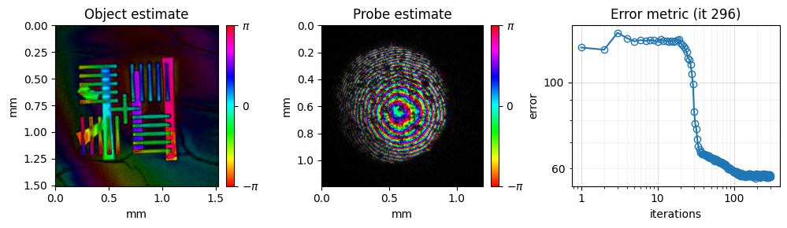
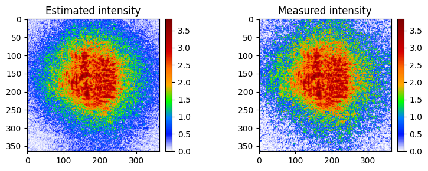

<!-- source-sha256: 110b74139588910bad3b6aac980cb83aff367b882bcb093b628411fd5309de98 (generated by docs/render_tutorials.py, do not edit) -->

# 05 – CPM Reflection

This tutorial reconstructs a two-layer sample measured in reflection at a wavelength of 708.8 nm. It sets up a reconstruction for a reflection measurement and runs it with the `mPIE` engine.

**What you'll learn:**

- How to load a reflection dataset and set up its reconstruction
- How to start from a diverging initial probe
- How to model a background in the diffraction data (`params.backgroundModeSwitch`)

!!! note "Dataset"
    The dataset (`TwoLayer_bin4.hdf5`) is downloaded automatically into the `example_data/` folder at the project root the first time you run the tutorial. If the file already exists it is not re-downloaded.

!!! tip "Prerequisites"
    Complete [01 – CPM Simulation](tutorial_CPM_sim.md) before this tutorial.

!!! tip "Run it yourself"
    Run this tutorial as a Jupyter notebook, or as a Python script with `python tutorial_reflectionPtychography.py`.

    [Download Jupyter notebook](tutorial_reflectionPtychography.ipynb){ .md-button download="tutorial_reflectionPtychography.ipynb" } [Download Python source](tutorial_reflectionPtychography.py){ .md-button download="tutorial_reflectionPtychography.py" }

```python
import matplotlib
import matplotlib.pyplot as plt
import numpy as np
from pathlib import Path
import h5py
```

```python
# import the PtyLab module
import PtyLab
from PtyLab import ExperimentalData
from PtyLab import Reconstruction
from PtyLab import Monitor
from PtyLab import Params
from PtyLab import Engines
```

```python
from PtyLab.io import getExampleDataFolder
import urllib.request

fileName = "TwoLayer_bin4.hdf5"
filePath = getExampleDataFolder() / fileName

if not filePath.exists():
    print(f"Downloading {fileName}...")
    urllib.request.urlretrieve(
        "https://ndownloader.figshare.com/files/28720086",
        filePath,
    )
    print("Download complete.")
else:
    print(f"{fileName} found, skipping download.")
```

```text
TwoLayer_bin4.hdf5 found, skipping download.
```

## Load the data
Load the measurement into `ExperimentalData` in CPM mode.

```python
# Initialize the ExperimentalData using the filePath, and choose the operation Mode (default is 'CPM')
experimentalData = ExperimentalData(filePath, operationMode="CPM")
# opens an interactive viewer of all frames
# experimentalData.showPtychogram()
```

```text
Found encoder with shape (202, 2)
```

## Monitor
The monitor shows the object, the probe and the error while the reconstruction runs. With `verboseLevel = "high"` it also shows measured and estimated diffraction patterns.

```python
# Initialize the Monitor class
monitor = Monitor()
# Set monitor properties
monitor.figureUpdateFrequency = 5
monitor.objectPlot = "complex"  # complex abs angle
monitor.verboseLevel = "high"  # high: plot two figures, low: plot only one figure
monitor.probeZoom = 1  # control probe plot FoV
monitor.objectZoom = 2  # control object plot FoV
monitor.objectPlotContrast = (
    0.8  # control object plot contrast, 0-1, higher constrast with smaller number
)
monitor.probePlotContrast = (
    0.5  # control probe plot contrast, 0-1, higher constrast with smaller number
)
```

```text
/tmp/ipykernel_319703/3848753130.py:6: UserWarning: For diffraction data plot, preferably use an interactive matplotlib backend or set `monitor.verboseLevel = "low"`. 
  monitor.verboseLevel = "high"  # high: plot two figures, low: plot only one figure
```

## Parameters
`backgroundModeSwitch = True` also estimates a background, one value per detector pixel, which is added to the modelled diffraction intensity.

```python
# Initialize the Params class
params = Params()
# Set params properties
# params.gpuSwitch is detected automatically: True if CuPy finds a GPU
params.positionOrder = "random"  # 'sequential' or 'random'
params.propagator = (
    "Fraunhofer"  # Fraunhofer Fresnel ASP scaledASP polychromeASP scaledPolychromeASP
)
params.probePowerCorrectionSwitch = True
params.comStabilizationSwitch = True
params.fftshiftSwitch = False
params.backgroundModeSwitch = True
params.intensityConstraint = "standard"
```

```text
INFO:GPU:cupy and CUDA available, switching to GPU
```

## Reconstruction
Start from a circular probe and a flat object. The beam in this setup is known to diverge, so the initial probe gets a diverging (quadratic) phase.

```python
# Initialize the Reconstruction class
reconstruction = Reconstruction(experimentalData, params)
# reconstruction.No = 2**11

# choose the initial probe and object, and create them
reconstruction.initialProbe = "circ"
reconstruction.initialObject = "ones"
reconstruction.initializeObjectProbe()

# optional: the beam is known to diverge, so add a diverging wavefront to the initial probe
reconstruction.probe = reconstruction.probe * np.exp(
    1.0j
    * 2
    * np.pi
    / reconstruction.wavelength
    * (reconstruction.Xp**2 + reconstruction.Yp**2)
    / (3 * 6e-3)
)
```

```text
INFO:Reconstruction:Copying attribute wavelength
INFO:Reconstruction:Copying attribute dxd
INFO:Reconstruction:Copying attribute theta
INFO:Reconstruction:Copying attribute spectralDensity
INFO:Reconstruction:Copying attribute entrancePupilDiameter
INFO:Reconstruction:Initial object set to ones
INFO:Reconstruction:Initial probe set to circ
```

## Run mPIE
Reconstruct for 300 iterations.

```python
mPIE = Engines.mPIE(reconstruction, experimentalData, params, monitor)
mPIE.numIterations = 300
mPIE.betaProbe = 0.25
mPIE.betaObject = 0.25
mPIE.reconstruct()
```

```text
INFO:mPIE:Successfully created mPIE engine
INFO:mPIE:Wavelength attribute: 7.087999733812467e-07
INFO:mPIE:switch to gpu
INFO:mPIE:Doing probe com stabilization every iteration
INFO:mPIE:switch to cpu

final iteration: 299
error: 57.7
estimated linear overlap: 86.1 %
estimated area overlap: 80.1 %
```





```python
## now save the data
# reconstruction.saveResults(fileName+'_reconstruction.hdf5')
```

---

[Download Jupyter notebook](tutorial_reflectionPtychography.ipynb){ .md-button download="tutorial_reflectionPtychography.ipynb" } [Download Python source](tutorial_reflectionPtychography.py){ .md-button download="tutorial_reflectionPtychography.py" }
