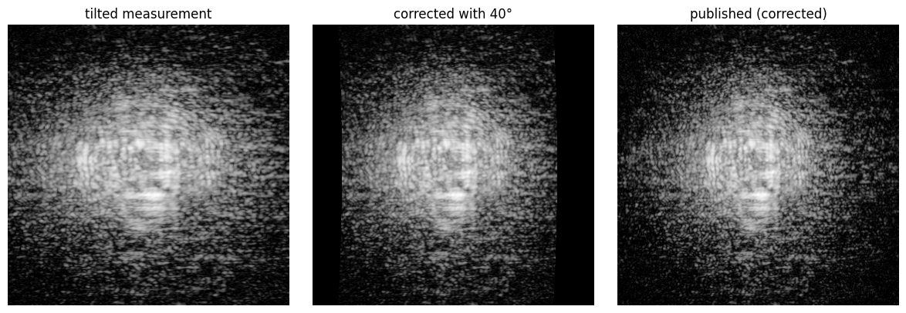
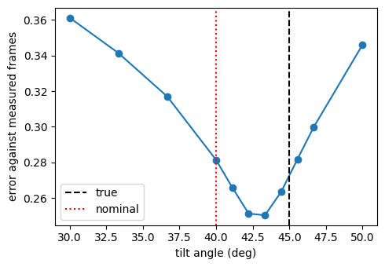
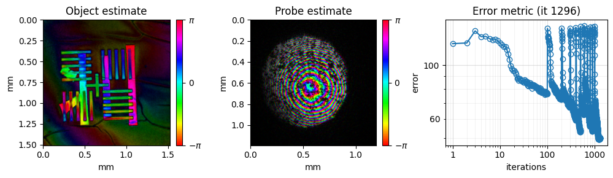
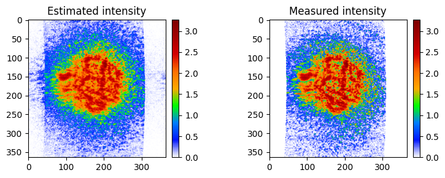

<!-- source-sha256: 83f5609b6963dae191d18c2fa7ff0672de17812d31ee724af1755e3bd4ab5c18 (generated by `ptylab docs render` from scripts/tutorial_reflectionPtychography.py, do not edit) -->

# CPM Reflection

In reflection ptychography the sample is tilted with respect to the beam and the detector. This tilt distorts the diffraction patterns, and the distortion has to be removed before a standard engine can reconstruct the data. This tutorial goes through the usual steps: correct the tilted plane with the nominal angle, calibrate the angle from the data with the `aPIE` engine, and reconstruct at the calibrated angle with `mPIE`.

**What you'll learn:**

- Why a tilted sample distorts the diffraction patterns, and how tilted-plane correction removes the distortion
- How to calibrate the tilt angle with `aPIE`
- How to reconstruct reflection data with a diverging initial probe and a background model

!!! quote "References"
    - Tilted-plane correction: D. F. Gardner et al., "High numerical aperture reflection mode coherent diffraction microscopy using off-axis apertured illumination," Opt. Express 20, 19050 (2012). [doi:10.1364/OE.20.019050](https://doi.org/10.1364/OE.20.019050)
    - Angle calibration: A. de Beurs et al., "aPIE: an angle calibration algorithm for reflection ptychography," Opt. Lett. 47, 1949 (2022). [doi:10.1364/OL.453655](https://doi.org/10.1364/OL.453655)
    - Dataset: M. Du et al., "Ptychographic optical coherence tomography," Opt. Lett. 46, 1337 (2021). [doi:10.1364/OL.416144](https://doi.org/10.1364/OL.416144)

!!! note "Dataset"
    The dataset (`TwoLayer_bin4.hdf5`) is downloaded automatically into the `example_data/` folder at the project root the first time you run the tutorial. If the file already exists it is not re-downloaded.

!!! tip "Prerequisites"
    Complete [CPM Simulation](tutorial_CPM_sim.md) before this tutorial. The angle calibration works like the scan in [CPM Purity-Based Calibration](tutorial_purityCalibration.md).

!!! info "Run time"
    The angle calibration runs about a dozen short reconstructions, one per candidate angle. The whole tutorial takes about 10 minutes on a GPU and considerably longer on a CPU.

!!! tip "Run it yourself"
    Run this tutorial as a Jupyter notebook, or as a Python script with `python tutorial_reflectionPtychography.py`.

    [Download Jupyter notebook](tutorial_reflectionPtychography.ipynb){ .md-button download="tutorial_reflectionPtychography.ipynb" } [Download Python source](scripts/tutorial_reflectionPtychography.py){ .md-button download="tutorial_reflectionPtychography.py" }

## Method
The detector is perpendicular to the reflected beam, but the sample surface is tilted by $\theta$. A detector pixel at $(x, y)$, at distance $z$ from the sample, therefore does not sample the spatial frequencies of the sample on a regular grid. In the sample frame, the pixel sits at

$$
x_c = x \cos\theta - \sin\theta \left( \sqrt{x^2 + y^2 + z^2} - z \right), \qquad y_c = y
$$

This is the transformation `T` in `PtyLab.Engines.aPIE`. Since $|x_c| < |x|$, the measured pattern is stretched along $x$, by about $1/\cos\theta$ near the centre, and the square-root term bends straight lines into curves. A Fourier-transform propagator such as Fraunhofer assumes a regular grid in $(x_c, y_c)$, so the data must be resampled onto that grid first: every pixel of the regular grid takes the measured intensity at the point $(x, y)$ with $T(x, y) = (x_c, y_c)$. This is the tilted-plane correction.

The correction needs $\theta$, which is usually known only roughly from the setup. A wrong angle leaves a residual distortion, and the reconstruction can no longer fit the data as well. `aPIE` uses this to calibrate the angle from the data itself.

```python
import matplotlib.pyplot as plt
import numpy as np
from scipy import ndimage

import PtyLab
from PtyLab import Engines, ExperimentalData, Monitor, Params, Reconstruction
from PtyLab.Engines.aPIE import T
```

```python
from PtyLab.io import getExampleDataFolder
import urllib.request

fileName = "TwoLayer_bin4.hdf5"
filePath = getExampleDataFolder() / fileName

if not filePath.exists():
    print(f"Downloading {fileName}...")
    urllib.request.urlretrieve(
        "https://ndownloader.figshare.com/files/28720086",
        filePath,
    )
    print("Download complete.")
else:
    print(f"{fileName} found, skipping download.")
```

```text
TwoLayer_bin4.hdf5 found, skipping download.
```

## Load the data and simulate a tilted measurement
The published frames of this dataset have already been corrected for the tilt. To go through the correction and the calibration, put a known tilt back in: resample every frame so that each measured pixel $(x, y)$ takes the corrected intensity at $T(x, y)$. The result is what a detector would record with the sample tilted by `true_theta` = 45°.

```python
experimentalData = ExperimentalData(filePath, operationMode="CPM")
corrected = experimentalData.ptychogram.copy()

true_theta = 45.0  # tilt angle in degrees

xd = experimentalData.xd
Xc, _ = T(experimentalData.Xd, experimentalData.Yd, experimentalData.zo, true_theta)
# fractional column of the corrected grid that each measured pixel samples; rows are unchanged
columns = (Xc - xd[0]) / (xd[1] - xd[0])
rows = np.broadcast_to(np.arange(xd.size)[:, None], columns.shape)
experimentalData.ptychogram = np.stack(
    [ndimage.map_coordinates(frame, [rows, columns], order=1, cval=0) for frame in corrected]
).astype(np.float32)
experimentalData._setData()  # update the quantities derived from the ptychogram
```

```text
Found encoder with shape (202, 2)
```

## Monitor and parameters
The monitor shows the object, the probe and the error while the reconstruction runs. `backgroundModeSwitch = True` also estimates a background, one value per detector pixel, which is added to the modelled diffraction intensity.

```python
monitor = Monitor()
monitor.figureUpdateFrequency = 5
monitor.objectPlot = "complex"  # complex abs angle
monitor.verboseLevel = "high"  # high: plot two figures, low: plot only one figure
monitor.probeZoom = 1  # control probe plot FoV
monitor.objectZoom = 2  # control object plot FoV
monitor.objectPlotContrast = 0.8  # 0-1, a smaller number gives a higher contrast
monitor.probePlotContrast = 0.5

params = Params()
# params.gpuSwitch is detected automatically: True if CuPy finds a GPU
params.positionOrder = "random"  # 'sequential' or 'random'
params.propagatorType = "Fraunhofer"
params.probePowerCorrectionSwitch = True
params.comStabilizationSwitch = True
params.fftshiftSwitch = False
params.backgroundModeSwitch = True
params.intensityConstraint = "standard"
```

```text
/tmp/ipykernel_496569/333202618.py:4: UserWarning: For diffraction data plot, preferably use an interactive matplotlib backend or set `monitor.verboseLevel = "low"`. 
  monitor.verboseLevel = "high"  # high: plot two figures, low: plot only one figure
```

## Initial guesses
Start from a circular probe and a flat object. The beam in this setup is known to diverge, so the initial probe gets a diverging (quadratic) phase.

```python
reconstruction = Reconstruction(experimentalData, params)
reconstruction.initialProbe = "circ"
reconstruction.initialObject = "ones"
reconstruction.initializeObjectProbe()

reconstruction.probe = reconstruction.probe * np.exp(
    1.0j
    * 2
    * np.pi
    / reconstruction.wavelength
    * (reconstruction.Xp**2 + reconstruction.Yp**2)
    / (3 * 6e-3)
)
```

## Tilted-plane correction
Suppose the setup was built for 40°, 5° away from the true angle. `aPIE` takes the starting angle from `reconstruction.theta`, in degrees. Its `resampleDetector()` method applies the tilted-plane correction for a given angle and also returns the weight `W`, the fraction of each corrected pixel that the detector covers.

```python
nominal_theta = 40.0
reconstruction.theta = nominal_theta

engine = Engines.aPIE(reconstruction, experimentalData, params, monitor)
resampled, W = engine.resampleDetector(nominal_theta)

frame = 100
images = {
    "tilted measurement": experimentalData.ptychogram[frame],
    f"corrected with {nominal_theta:.0f}°": resampled[frame],
    "published (corrected)": corrected[frame],
}
fig, axes = plt.subplots(1, 3, figsize=(12, 4))
for ax, (title, image) in zip(axes, images.items()):
    ax.imshow(np.log10(np.clip(image, 0, None) + 1), cmap="gray")
    ax.set_title(title)
    ax.axis("off")
plt.tight_layout()
plt.show()
```



The tilt stretches the measured pattern along $x$; the correction compresses it back, so that it matches the published frames. The strips at the sides of the corrected grid lie outside the detector and stay empty (`W` close to 0).

## Angle calibration
`aPIE` offers two ways to find the angle:

- `thetaSearch = "stochastic"` (the default) is the search of de Beurs et al.: during one reconstruction, every iteration also tries a random nearby angle and keeps it if it lowers the error.
- `thetaSearch = "scan"` runs one short `mPIE` reconstruction per candidate angle, each from the same initial guess, and keeps the angle with the lowest error.

This tutorial uses the scan. Each candidate is scored against the measured frames before resampling, so the interpolation in the correction does not favour any angle. The first grid has `thetaScanPoints` angles within $\pm$ `thetaScanRange` of the starting angle. Each of the `thetaScanRefinements` further grids spans one grid step on either side of the best angle so far, with the same number of points.

As in the purity scan, each candidate must converge for the comparison to be fair. With the default mPIE step sizes of 0.25, some candidates converge within 100 iterations and others do not, which makes the error curve jumpy. Step sizes of 0.5 make all of them converge.

```python
engine.thetaSearch = "scan"
engine.thetaScanRange = 10.0  # first grid: 40 +/- 10 degrees
engine.thetaScanPoints = 7  # 3.3 degree spacing, then 1.1 degree spacing
engine.thetaScanRefinements = 1
engine.numIterations = 100  # mPIE iterations per candidate
engine.betaObject = 0.5
engine.betaProbe = 0.5
best_theta, best_error = engine.reconstruct()
```

## Results
The scanned angles and errors are stored on the engine, in `thetaScanValues` and `thetaScanErrors`.

```python
print(f"true angle    : {true_theta:.2f} deg")
print(f"nominal angle : {nominal_theta:.2f} deg")
print(f"best angle    : {best_theta:.2f} deg   (error {best_theta - true_theta:+.2f} deg)")

thetas = np.array(engine.thetaScanValues)
errors = np.array(engine.thetaScanErrors)
order = np.argsort(thetas)
plt.figure(figsize=(5, 3.5))
plt.plot(thetas[order], errors[order], "o-")
plt.axvline(true_theta, ls="--", c="k", label="true")
plt.axvline(nominal_theta, ls=":", c="r", label="nominal")
plt.xlabel("tilt angle (deg)")
plt.ylabel("error against measured frames")
plt.legend()
plt.tight_layout()
plt.show()
```

```text
true angle    : 45.00 deg
nominal angle : 40.00 deg
best angle    : 43.33 deg   (error -1.67 deg)
```



The error has a clear minimum near the true angle. Starting 5° away, the scan ends within 2° of the true angle. The minimum lies between two points of the fine grid, so the remaining offset is not only the grid spacing; expect an accuracy of about 2° with 100 iterations per candidate. More iterations per candidate, or a further refinement, cost proportionally more time.

## Reconstruct at the calibrated angle
After the scan, `reconstruction` holds the best candidate and `experimentalData.ptychogram` holds the data corrected with the best angle. Continue with `mPIE` from there, back at the default step sizes.

```python
mPIE = Engines.mPIE(reconstruction, experimentalData, params, monitor)
mPIE.numIterations = 200
mPIE.betaProbe = 0.25
mPIE.betaObject = 0.25
mPIE.reconstruct()
```

```text
final iteration: 199
error: 50.0
estimated linear overlap: 85.9 %
estimated area overlap: 79.9 %
```





```python
## now save the data
# reconstruction.saveResults(fileName+'_reconstruction.hdf5')
```

---

[Download Jupyter notebook](tutorial_reflectionPtychography.ipynb){ .md-button download="tutorial_reflectionPtychography.ipynb" } [Download Python source](scripts/tutorial_reflectionPtychography.py){ .md-button download="tutorial_reflectionPtychography.py" }
