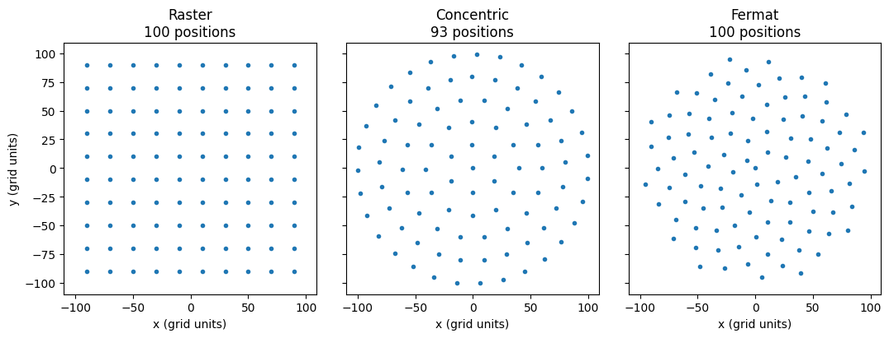
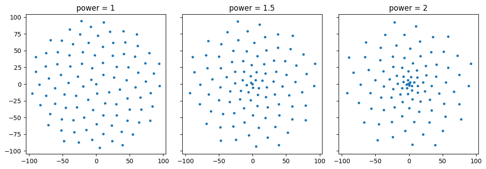
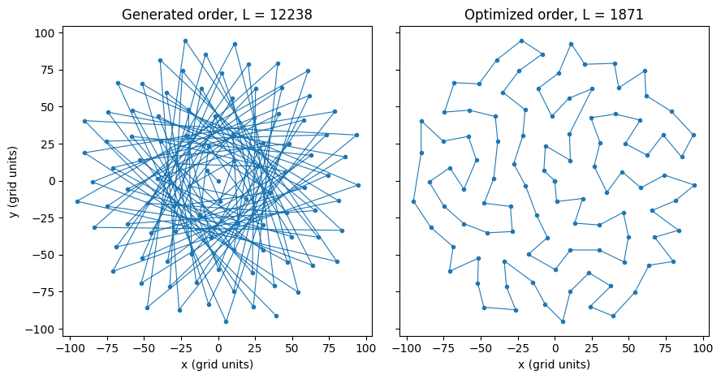

<!-- source-sha256: 297dc2fde225009d5ce38e4cdb070be9ba3c34da8ca62e537e270fc68023f6e7 (generated by `ptylab docs render` from scripts/tutorial_scanGrids.py, do not edit) -->

# Scan Grids

This tutorial shows how to design the scan grid of a CPM experiment, the set of sample positions at which a diffraction pattern is recorded. It compares the grid types in `PtyLab.utils.scanGrids`, shortens the path the stage travels between positions, and writes the positions to a text file for the stage controller.

**What you'll learn:**

- How to generate raster, concentric and Fermat spiral grids
- How to check the step size between neighbouring positions
- How to optimize the scan order with `tsp_ga` and save it with `generateTXT`

!!! quote "References"
    - Fermat spiral scans: X. Huang et al., "Optimization of overlap uniformness for ptychography," Opt. Express 22, 12634 (2014). [doi:10.1364/OE.22.012634](https://doi.org/10.1364/OE.22.012634)

!!! note "Dataset"
    No dataset is needed; this tutorial only generates positions.

!!! tip "Prerequisites"
    Complete [CPM Simulation](tutorial_CPM_sim.md) before this tutorial; it uses a Fermat grid to simulate data.

!!! tip "Run it yourself"
    Run this tutorial as a Jupyter notebook, or as a Python script with `python tutorial_scanGrids.py`.

    [Download Jupyter notebook](tutorial_scanGrids.ipynb){ .md-button download="tutorial_scanGrids.ipynb" } [Download Python source](scripts/tutorial_scanGrids.py){ .md-button download="tutorial_scanGrids.py" }

```python
import matplotlib.pyplot as plt
import numpy as np

from PtyLab.utils.scanGrids import (
    GenerateConcentricGrid,
    GenerateNonUniformFermat,
    GenerateRasterGrid,
    generateTXT,
    tsp_ga,
)
```

## Grid types
Each generator returns two arrays, `R` (rows, y) and `C` (columns, x), one entry per scan position. The values are in grid units, usually object pixels: [CPM Simulation](tutorial_CPM_sim.md) multiplies them by the object pixel size `dxo` to get positions in meters.

| Function | Arguments | Grid |
|----------|-----------|------|
| `GenerateRasterGrid(n, ds)` | `n` points per side, period `ds` | square raster of `n`² points |
| `GenerateConcentricGrid(Nr, s, rend)` | `Nr` circles, spacing `s` along each circle, outer radius `rend` | concentric circles |
| `GenerateNonUniformFermat(n, radius, power)` | `n` points inside `radius` | Fermat spiral; `power > 1` packs more points near the center |
| `GenerateFermatSpiral(n, c)` | `n` points, scale `c` | the same spiral with `power = 1`, sized by `c` instead: its radius is $c\sqrt{n}$ |

A raster grid is easy to set up but its periodicity causes artifacts in the reconstruction (the *raster grid pathology*): the probe and object can trade structure at the grid period without changing the data. Concentric and Fermat grids break this periodicity. Below, each grid covers roughly the same disk of radius 100 with about 100 positions.

```python
grids = {
    "Raster": GenerateRasterGrid(10, 20),
    "Concentric": GenerateConcentricGrid(6, 20, 100),
    "Fermat": GenerateNonUniformFermat(100, radius=100, power=1),
}

fig, axes = plt.subplots(1, 3, figsize=(11, 3.8), sharex=True, sharey=True)
for ax, (name, (R, C)) in zip(axes, grids.items()):
    ax.plot(C, R, "o", ms=3)
    ax.set_title(f"{name}\n{len(R)} positions")
    ax.set_aspect("equal")
    ax.set_xlabel("x (grid units)")
axes[0].set_ylabel("y (grid units)")
plt.tight_layout()
plt.show()
```



## Step size and overlap
Neighbouring illuminated areas must overlap; a common rule of thumb is that the step between neighbours is at most about 30 % of the probe diameter (60–70 % linear overlap). For each position the cell below finds the distance to its nearest neighbour; the mean of these is the typical step size of the grid.

With `power > 1`, `GenerateNonUniformFermat` packs the positions near the center more densely, which helps when the probe is strongest there or the region of interest sits in the middle.

```python
def nearest_neighbour_steps(R, C):
    """Distance from each position to its nearest neighbour, in grid units."""
    xy = np.stack([R, C], axis=1).astype(float)
    d = np.linalg.norm(xy[:, None, :] - xy[None, :, :], axis=-1)  # (n, n) distances
    np.fill_diagonal(d, np.inf)  # ignore the distance of a point to itself
    return d.min(axis=1)


for name, (R, C) in grids.items():
    steps = nearest_neighbour_steps(R, C)
    print(f"{name:12s} mean step {steps.mean():5.1f}, min {steps.min():5.1f}, max {steps.max():5.1f}")
```

```text
Raster       mean step  20.0, min  20.0, max  20.0
Concentric   mean step  19.9, min  19.1, max  20.6
Fermat       mean step  16.6, min  10.0, max  17.1
```

```python
fig, axes = plt.subplots(1, 3, figsize=(11, 3.8), sharex=True, sharey=True)
for ax, power in zip(axes, [1, 1.5, 2]):
    R, C = GenerateNonUniformFermat(100, radius=100, power=power)
    ax.plot(C, R, "o", ms=3)
    ax.set_title(f"power = {power}")
    ax.set_aspect("equal")
plt.tight_layout()
plt.show()
```



## Shortest scan path
The generators return the positions in an order that makes the stage jump back and forth across the sample. Visiting them in a different order does not change the data, but it shortens the total travel distance and the measurement time.

Finding the shortest closed path through all positions is the travelling salesman problem. `tsp_ga` solves it approximately with a genetic algorithm: it keeps a population of candidate routes, and in each iteration mutates the best route of every group of four by flipping, swapping or sliding a random section. The total path length is

$$
L = \sum_{k=1}^{n-1} \left\| \mathbf{r}_{k+1} - \mathbf{r}_k \right\|
$$

where $\mathbf{r}_k = (R_k, C_k)$ is the $k$-th position along the route and $n$ the number of positions. `converge()` returns the visiting order as indices, starting and ending at position 0. `plotUpdateFrequency` sets how many times the progress is printed; `tsp_ga` labels the distance in um, but it is in the same units as `R` and `C`.

```python
R, C = GenerateNonUniformFermat(100, radius=100, power=1)


def path_length(R, C):
    return np.sum(np.sqrt(np.diff(R) ** 2 + np.diff(C) ** 2))


print(f"path length in generated order: {path_length(R, C):.0f} grid units")

np.random.seed(0)  # the genetic algorithm is random; fix the seed for a reproducible route
optRoute = tsp_ga(R, C, population_size=40, iterations=5000, plotUpdateFrequency=5).converge()
plt.close(999)  # tsp_ga draws its progress in figure 999; the comparison below replaces it
Rnew, Cnew = R[optRoute], C[optRoute]
print(f"path length after optimization: {path_length(Rnew, Cnew):.0f} grid units")
```

```text
path length in generated order: 12238 grid units
distance: 2474 um, numIteration: 0, 
distance: 2020 um, numIteration: 1000, 
distance: 1945 um, numIteration: 2000, 
distance: 1924 um, numIteration: 3000, 
distance: 1900 um, numIteration: 4000, 
path length after optimization: 1871 grid units
```

```python
fig, axes = plt.subplots(1, 2, figsize=(9, 4.5), sharex=True, sharey=True)
axes[0].plot(C, R, "o-", ms=3, lw=0.8)
axes[0].set_title(f"Generated order, L = {path_length(R, C):.0f}")
axes[1].plot(Cnew, Rnew, "o-", ms=3, lw=0.8)
axes[1].set_title(f"Optimized order, L = {path_length(Rnew, Cnew):.0f}")
for ax in axes:
    ax.set_aspect("equal")
    ax.set_xlabel("x (grid units)")
axes[0].set_ylabel("y (grid units)")
plt.tight_layout()
plt.show()
```



## Save the positions
`generateTXT(R, C, fileName)` writes the positions to `<fileName>.txt`: a header with the number of positions and the column names, then one `row column` pair per line. Convert the grid units to the stage's units (here micrometers) before writing. The last entry of `optRoute` returns to the start, so drop it.

```python
stepSize = 2  # micrometers per grid unit, chosen for this example
generateTXT(Rnew[:-1] * stepSize, Cnew[:-1] * stepSize, fileName="positions")

with open("positions.txt") as f:
    print("".join(f.readlines()[:5]))
```

```text
number of positions: 100 
y (row) [um] | x (col) [um] 
0.0 0.0 
-28.17595156146098 2.4730049749655962 
-24.002431256746053 37.73437814202297 
```

To use a grid in a simulation, convert it to positions in meters and store them in `encoder`, as in [CPM Simulation](tutorial_CPM_sim.md):

```python
encoder = np.vstack((R * dxo, C * dxo)).T
```

---

[Download Jupyter notebook](tutorial_scanGrids.ipynb){ .md-button download="tutorial_scanGrids.ipynb" } [Download Python source](scripts/tutorial_scanGrids.py){ .md-button download="tutorial_scanGrids.py" }
